# edap 容器设计文档

> edap = Enterprise Distributed Application Platform
> 一个轻量级 Java 应用服务器容器，Proto-First 多协议自动发布。

---

## 一、项目定位

edap 是一个**应用服务器**（类似 Tomcat / JBoss / Open Liberty），不是应用框架（区别于 Solon / Spring Boot）。

| 维度 | edap | Solon |
|------|------|-------|
| 进程模型 | 单进程多应用 | 单进程单应用 |
| 部署单元 | EAR 应用包 | JAR 应用 |
| 核心能力 | 容器管理 + 多应用 + 热部署 | 应用框架 + 插件 |
| 接口定义 | proto 文件 + option | Java 注解 |

---

## 二、核心设计理念

### 2.1 单一信息源（Single Source of Truth）

```proto
// hello.proto —— 唯一的接口定义
syntax = "proto3";
package io.edap.demo;

import "google/api/annotations.proto";      // HTTP option
import "edap/ws.proto";                      // WS option (edap 自定义)
import "edap/rpc.proto";                     // eRPC option

service HelloService {
    rpc SayHello (HelloRequest) returns (HelloResponse) {
        option (google.api.http).get = "/v1/hello";   // ← HTTP 注解
        option (edap.ws).method = "HelloService.SayHello";  // ← WS 注解
        option (edap.rpc).method = 1001;              // ← eRPC 注解
    };
}

message HelloRequest {
    string name = 1;
}

message HelloResponse {
    string message = 1;
}
```

**一个 proto 文件 = 接口契约 + 接口文档 + 多协议实现 + 多语言 SDK**

### 2.2 节点驱动的协议发布

**核心思想**：应用是协议无关的，节点才是协议载体。

开发者**不需要在应用里配置 protocols**。应用只写一份 proto + 实现业务逻辑即可。**部署到哪种节点，就自动获得该节点支持的协议能力**。

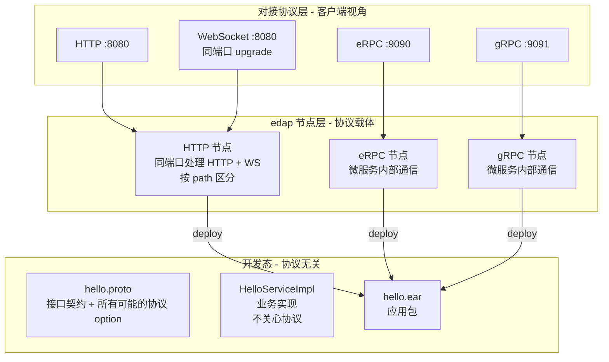

**节点能力对照**：

| 节点能力组合 | 激活的协议 option | 用途 | 典型端口 |
|------------|-----------------|------|---------|
| `{HTTP, WS}` | `google.api.http` + `edap.ws` | Web 全栈服务（HTTP 请求 + WebSocket 同端口，HTTP server 按 path 区分） | 8080 |
| `{ERPC}` | `edap.rpc` | 微服务内部通信 | 9090 |
| `{GRPC}` | `edap.grpc` | 微服务内部通信（外部互通） | 9091 |

> **HTTP 节点 = HTTP + WebSocket 两个独立能力**：HTTP 和 WebSocket 物理上同端口（HTTP Upgrade 握手），但握手后的消息处理模型完全不同——HTTP 是请求-响应单向（服务器不能主动 push），WS 是双向长连接（服务器可主动推送）。拆成两个独立 `Capability` 让 bind 阶段把 WS 路由独立写入，与多协议嗅探（§8.1）一致——HTTP 节点默认 `{HTTP, WS}` 同端口共存，未来也可独立关闭其中之一。

**关键收益**：

- ✅ **应用零协议配置**：开发者只关心业务，不关心部署形态
- ✅ **一份 EAR 多场景部署**：同一个 hello.ear，部署到 HTTP 节点暴露 Web 服务，部署到 eRPC 节点变成微服务
- ✅ **环境隔离天然实现**：前端调 HTTP，后端互调用 eRPC，同一份代码
- ✅ **proto option 描述"能力谱"**：option 不是声明"必须用这个协议"，而是声明"这个方法**支持**这些协议，部署时由节点激活"

### 2.3 一次编写，多处自动生成

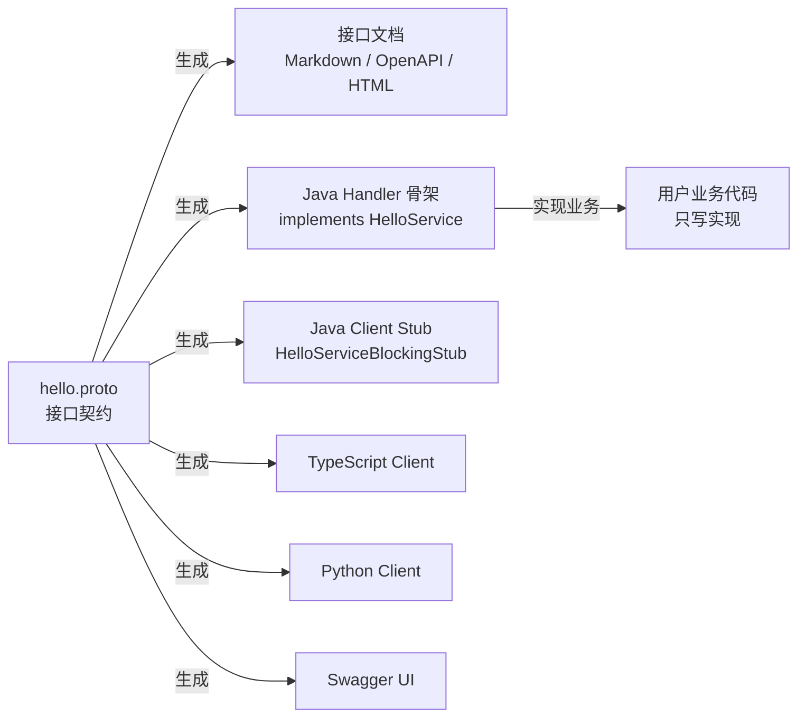

### 2.4 灵活打包：包可自由合并 / 分开部署

edap 的部署单元（EAR）和开发单元（包）是解耦的。开发者按业务模块拆分包，部署时**自由组合**这些包。

#### 核心概念

| 概念 | 维度 | 说明 |
|------|------|------|
| **包（Package）** | 开发维度 | 开发者视角，一个 proto + impl 一个包 |
| **EAR** | 部署维度 | 容器视角，可包含一个或多个包 |
| **应用（App）** | 运行维度 | 一个 EAR 部署后变成一个应用实例 |

#### 三种典型部署形态

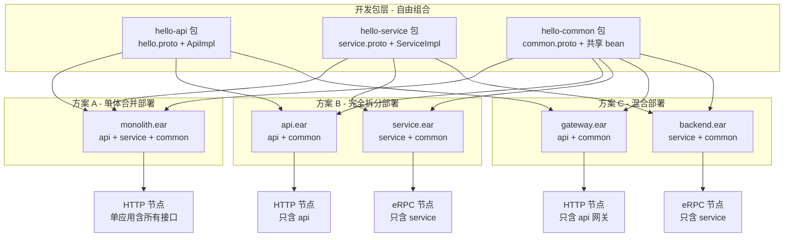

#### 共享包的隔离规则

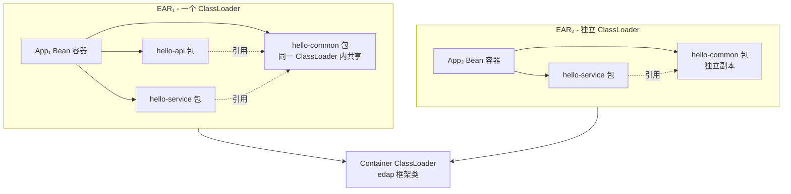

**隔离规则**：

| 范围 | 是否共享 | 说明 |
|------|---------|------|
| 同一 EAR 内 | ✅ 完全共享 | 共享包可直接被业务包引用 |
| 不同 EAR 之间 | 完全隔离 | 各自独立 ClassLoader，副本加载 |
| EAR ↔ Container | 单向（EAR 可见容器） | 框架类从容器 CL 加载 |

#### EAR 内 proto 文件组织（按 artifactId 目录分层）

当 EAR 包含多个 Maven 模块时，每个模块的 proto 文件按 **artifactId 目录** 分层组织。目录路径镜像 Maven 模块路径。

**每个 Maven 模块内部**：proto 文件统一放在 `src/main/resources/proto/` 目录下（与 Maven 标准资源约定一致）：

```
hello-api/
└── src/main/resources/proto/
    └── api.proto                    ← service UserService
└── src/main/java/io/edap/api/
    └── UserServiceImpl.java

hello-service/
└── src/main/resources/proto/
    └── service.proto                ← service OrderService
└── src/main/java/io/edap/service/
    └── OrderServiceImpl.java
```

打包进 jar 后，proto 文件位于 jar 内 `resources/proto/`：

```
hello-api.jar
└── resources/proto/api.proto

hello-service.jar
└── resources/proto/service.proto
```

**EAR 装配后的目录结构示例**（按 artifactId 重新分目录组织）：

```
monolith.ear/
├── BUILD.json                          ← EAR 元数据
├── hello-api/                          ← artifactId = hello-api
│   ├── api.proto                       ← service UserService
│   └── classes/
│       └── io/edap/api/UserServiceImpl.class
├── hello-service/                      ← artifactId = hello-service
│   ├── service.proto                   ← service OrderService
│   └── classes/
│       └── io/edap/service/OrderServiceImpl.class
└── hello-common/                       ← artifactId = hello-common
    ├── common.proto                    ← message BaseRequest
    └── classes/
        └── io/edap/common/BaseUtils.class
```

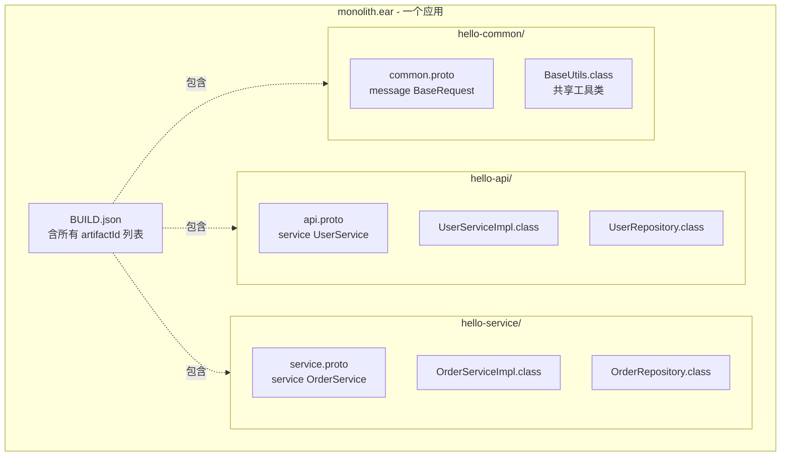

**proto 服务全限定名规则**：

```
全限定名 = {artifactId}.{proto_file}.{service_name}
```

示例：

| proto 文件路径 | service 定义 | 全限定名 |
|--------------|------------|---------|
| `hello-api/api.proto` | `service UserService` | `hello-api.api.UserService` |
| `hello-service/service.proto` | `service OrderService` | `hello-service.service.OrderService` |
| `hello-api/api.proto` | `service UserService`（另一个文件）| `hello-api.user.UserService` |

**命名空间天然隔离**：

```protobuf
// hello-api/api.proto
package io.edap.api;
service UserService {              // ← 全限定: hello-api.api.UserService
  rpc GetUser(...) returns (...);
}

// hello-service/service.proto
package io.edap.service;
service UserService {              // ← 全限定: hello-service.service.UserService
  rpc CreateUser(...) returns (...);
}
```

不同包里可以有同名 service（甚至同包名 `UserService`），因为 artifactId 已经把它们区分开了。

**容器扫描规则**：

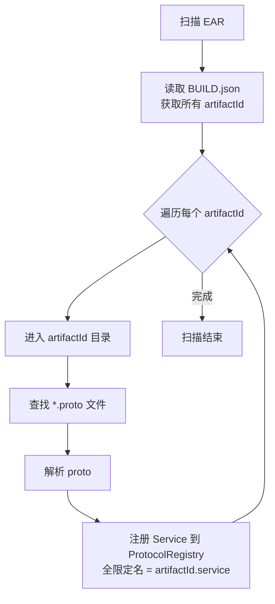

**关键收益**：

- ✅ **目录即归属**：从 proto 文件路径就能看出它来自哪个 Maven 模块，IDE 跳转友好
- ✅ **全限定名天然防冲突**：不同 artifactId 下的同名 service 不会冲突
- ✅ **构建可追溯**：proto 路径 = Maven 模块路径，编译期就能关联
- ✅ **零配置命名空间**：不需要手动指定 namespace，目录层级就是 namespace

#### 与 Maven 多模块的关系

edap 的"包"概念与 Maven 多模块天然契合：

```xml
<!-- 父 POM：聚合 -->
<modules>
    <module>hello-api</module>
    <module>hello-service</module>
    <module>hello-common</module>
</modules>

        <!-- 每个子模块独立编译输出 jar -->
<plugin>
<artifactId>maven-jar-plugin</artifactId>
</plugin>
```

**通过 Maven profile / assembly 决定 EAR 打包内容**：

```xml
<!-- profile-a: 单体部署 -->
<profile>
    <id>monolith</id>
    <dependencies>
        <dependency>hello-api</dependency>
        <dependency>hello-service</dependency>
        <dependency>hello-common</dependency>
    </dependencies>
</profile>

        <!-- profile-b: 拆分部署 -->
<profile>
<id>split</id>
<dependencies>
    <dependency>hello-api</dependency>
    <dependency>hello-common</dependency>
</dependencies>
</profile>
```

```bash
# 单体部署
mvn package -P monolith  # 生成 monolith.ear

# 拆分部署
mvn package -P split      # 生成 api.ear
cd ../hello-service && mvn package -P split  # 生成 service.ear
```

#### 关键收益

- ✅ **开发期模块化**：按业务边界拆包，职责清晰
- ✅ **部署期灵活**：根据场景自由组合，初期单体迭代，后期按需拆分
- ✅ **零代码改动**：同一份代码，EAR 打包组合变了，应用形态就变了
- ✅ **渐进式微服务**：业务发展后，无需重写代码，只需调整打包 profile
- ✅ **共享包天然隔离**：不同 EAR 互不污染，ClassLoader 级别隔离

---

## 三、参考设计：Spring 容器的核心思想

edap 不重复造 Spring 的轮子，但要借鉴其设计精华。

### 3.1 容器自身 —— BeanFactory / ApplicationContext

```
┌─────────────────────────────────────────┐
│          ApplicationContext             │  ← 对外门面，集成所有能力
│  ┌─────────────────────────────────┐    │
│  │        BeanFactory              │    │  ← 核心：getBean / containsBean
│  │  ┌──────────────────────────┐   │    │
│  │  │  beanDefinitionMap        │   │    │  ← 注册表 (name → BeanDefinition)
│  │  │  singletonObjects         │   │    │  ← 一级缓存（成品 bean）
│  │  │  earlySingletonObjects    │   │    │  ← 二级缓存（半成品，解决循环依赖）
│  │  │  singletonFactories       │   │    │  ← 三级缓存（ObjectFactory）
│  │  └──────────────────────────┘   │    │
│  └─────────────────────────────────┘    │
│  + AppResourceLoader（加载配置/类）       │
│  + ApplicationEventPublisher（事件）     │
│  + Environment（profile/property）       │
└─────────────────────────────────────────┘
```

### 3.2 扩展点 —— 容器的灵魂

```
InstantiationAwareBeanPostProcessor   ← 实例化前(可替换 bean)
            ↓
        构造器 / 工厂方法
            ↓
SmartInstantiationAwareBeanPostProcessor ← 提前暴露引用
            ↓
        属性注入
            ↓
BeanPostProcessor.postProcessBeforeInit  ← 初始化前（AOP 织入点）
            ↓
        @PostConstruct / InitializingBean / 自定义 init
            ↓
BeanPostProcessor.postProcessAfterInit   ← 初始化后（AOP 织入点）
            ↓
SmartLifecycle.start()               ← 运行时（容器启动完成事件）
```

---

## 四、参考设计：Solon 框架（轻量级对比）

### 4.1 三大核心组件

| 组件 | 作用 | 体验风格 |
|------|------|---------|
| Plugin 插件扩展机制 | 模块级扩展 | 编码风格 |
| Ioc/Aop 应用容器 | 依赖注入 + 切面 | 类似 Spring |
| Context + Handler | 通用请求处理（三元合一） | Http / WebSocket / Socket 同一套 API |

### 4.2 Solon 插件机制（两套 SPI）

```java
public interface Plugin {
    void start(AppContext context) throws Throwable;
    default void prestop() throws Throwable {}
    default void stop() throws Throwable {}
}
```

| 机制 | 用途 | 类比 |
|------|------|------|
| E-Spi | 普通扩展（编码风格） | Spring Factories / Java SPI |
| H-Spi | 生产级热插拔，独立 ClassLoader | OSGi |

### 4.3 Solon AppContext 设计要点

```java
// 关键设计：单类集成所有能力
public class AppContext extends BeanContainer {
    public AppContext(SolonApp app, ClassLoader classLoader, Props props) {
        super(app, classLoader, props);
        initialize();                                 // ① 注册所有 builder/extractor/injector
        lifecycle(LF_IDX_FIELD_COLLECTION_INJECT,     // ② 注册两个"注入审查回调"
                () -> startInjectReview(0));
        lifecycle(LF_IDX_PARAM_COLLECTION_INJECT,
                () -> startInjectReview(1));
    }
}
```

**两段式注入 —— Solon 的招牌设计**：

```java
public void start() {
    starting = true;
    Collection<BeanWrapLifecycle> asynInitTasks = startBeanLifecycle();
    started = true;
    startInjectReview(2);    // 第一段注入审查
    startInjectReview(2);    // 第二段，处理二阶依赖
    executeAsyncInitTasks(asynInitTasks);
    postStartBeanLifecycle();
}
```

**关键观察**：
- 构造函数不做任何 bean 扫描
- 扫描期只记录到 gatherSet，不立即解析
- start() 时统一 commit（不需要三级缓存就能处理循环引用）

---

## 五、edap 核心架构

### 5.1 容器 vs 工具 vs 应用 三层架构

```
Container（运行时核心）
    ├─ Container AppContext（容器级上下文）
    ├─ AppRegistry（应用注册表）
    ├─ ClassLoader（容器级）
    └─ Router（容器级路由）

DeployManager（管理工具）
    ├─ HTTP 管理 API（deploy_app / undeploy / list）
    └─ 操作 Container

Applications（被管理的多个应用）
    ├─ App₁（独立 CL + AppContext + Beans）
    ├─ App₂（独立 CL + AppContext + Beans）
    └─ Appₙ（独立 CL + AppContext + Beans）
```

> **类比**：Container = Tomcat，DeployManager = Tomcat Manager（管理控制台）

### 5.2 全景架构图

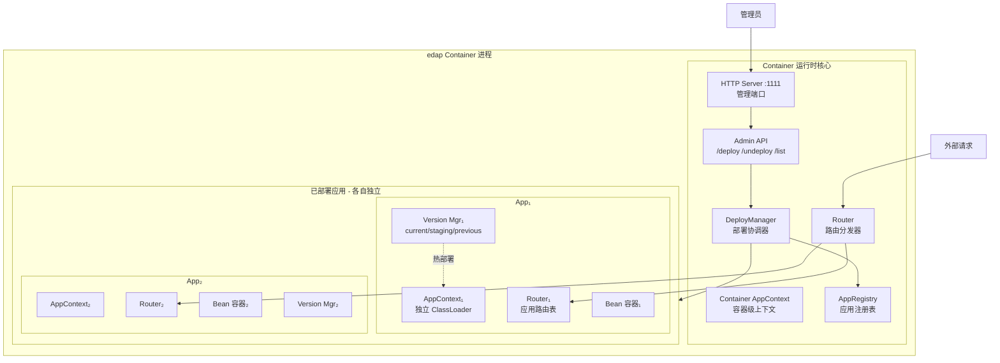

### 5.3 父子 ClassLoader 隔离

```
Container CL (容器) ──── 共享 edap-* 框架类
    │
    ├── App₁ CL ──── 加载 app₁ 自己的类
    ├── App₂ CL ──── 加载 app₂ 自己的类
    └── App₃ CL ──── 加载 app₃ 自己的类
        (双亲委派时,框架类走容器 CL,应用类自己加载)
```

---

## 六、Proto-First 设计

### 6.1 proto 驱动的多协议发布

应用在 proto 中声明**所有可能的协议绑定**（option），实际激活哪个由**部署节点的类型**决定。

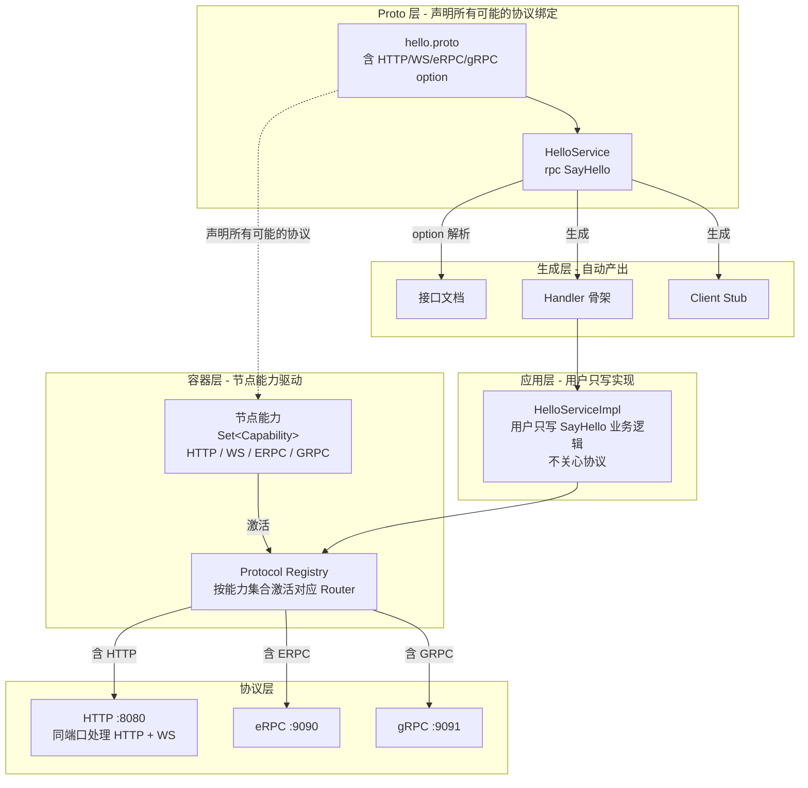

### 6.2 proto option 解析流程

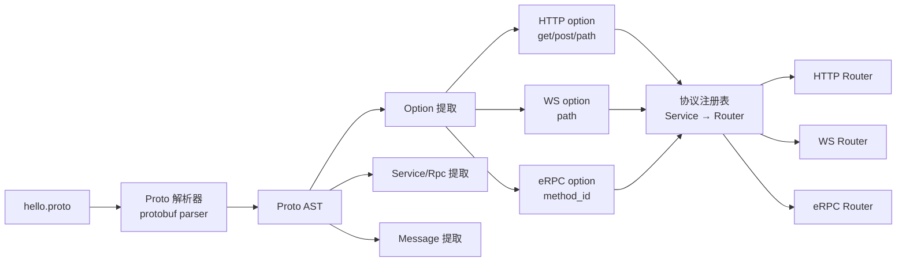

### 6.3 Option 标准化

| Option 类型 | 来源 | 作用 |
|-----------|------|------|
| `google.api.http` | Google 标准 | HTTP 路径和方法 |
| `edap.ws.path` | edap 自定义 | WebSocket 路径 |
| `edap.rpc.method_id` | edap 自定义 | eRPC 方法编号 |
| `edap.grpc` | 未来 | gRPC 兼容 |

### 6.4 proto 驱动的容器架构

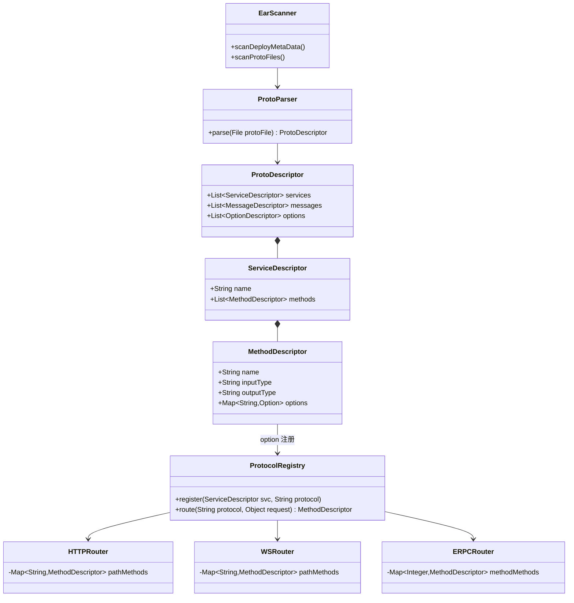

### 6.5 协议绑定自动生成 —— 约定优于配置 + 按需覆盖

**核心原则**：90% 场景用默认规则自动生成协议绑定，10% 特殊场景用户用 proto option 显式覆盖。

#### 核心思想

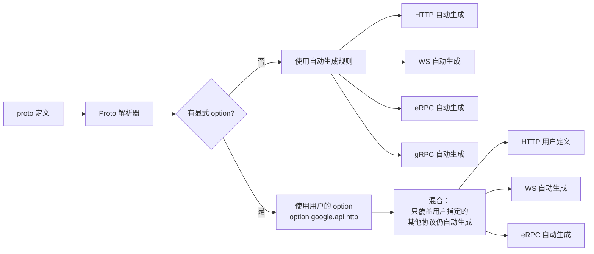

#### 默认生成规则

| 协议 | 默认规则 | 示例 |
|------|---------|------|
| **HTTP** | 统一用 **POST**，body 为 **JSON 字符串** | `POST /api/{ServiceName}/{MethodName}` (Content-Type: application/json) |
| **WebSocket** | **统一端点** + 消息 method 路由 | 端点 `/ws`，method = `{ServiceName}.{MethodName}` |
| **eRPC** | service.method 哈希生成 method_id | `hash("UserService.GetUser")` |
| **gRPC** | 标准 gRPC 路径 | `/UserService/GetUser` |

#### WS 协议的特殊处理

WS 不同于 HTTP/eRPC：**所有方法共享一个统一端点**，通过消息体里的 `method` 字段路由。

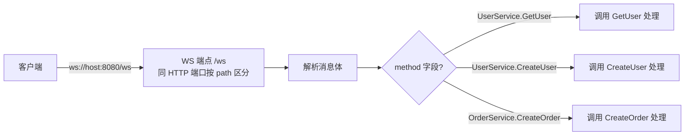

**客户端消息格式（JSON-RPC 风格）**：

```json
{
  "id": "req-001",
  "method": "UserService.GetUser",
  "params": {
    "user_id": "123"
  }
}
```

**服务端响应**：

```json
{
  "id": "req-001",
  "result": {
    "name": "张三",
    "age": 28
  }
}
```

**自动生成的 method 名**：默认 `{ServiceName}.{MethodName}`（如 `UserService.GetUser`）

#### HTTP 协议的特殊处理

HTTP 与传统 RESTful 惯例不同：**所有方法统一用 POST，请求参数通过 body 里的 JSON 字符串传递**。


**为什么默认 POST + JSON body？**

| 决策 | 理由 |
|------|------|
| 统一 POST | 避免按方法名动词识别（`Get*→GET, Create*→POST` …）带来的歧义与特例<br/>GET 的可缓存性不适合"动作"语义（POST/PUT 更匹配 RPC 语义）<br/>简化默认生成规则，新方法零配置直接生效 |
| body 用 JSON | 与 WS（JSON-RPC 风格）保持一致，多协议同一份 body 序列化思路<br/>支持复杂嵌套结构、无 URL 长度限制<br/>`Content-Type: application/json` 业界通用 |

**典型 HTTP 请求示例**：

```http
POST /api/UserService/GetUser HTTP/1.1
Content-Type: application/json

{
  "user_id": "123"
}
```

**响应**：

```http
HTTP/1.1 200 OK
Content-Type: application/json

{
  "name": "张三",
  "age": 28
}
```

> 想用 RESTful 风格（GET/PUT/DELETE + 路径参数）？直接在 proto 里用 option 覆盖即可，其他协议仍走默认。

#### 实际示例对比

**最简 proto（推荐写法）**：

```protobuf
service UserService {
  rpc GetUser(GetUserRequest) returns (GetUserResponse);
  rpc CreateUser(CreateUserRequest) returns (CreateUserResponse);
  rpc UpdateUser(UpdateUserRequest) returns (UpdateUserResponse);
  rpc DeleteUser(DeleteUserRequest) returns (DeleteUserResponse);
}
```

**自动生成的协议绑定**：

| 方法 | HTTP（自动） | eRPC method_id（自动） | WS method（自动） |
|------|------------|---------------------|------------------|
| `GetUser` | `POST /api/UserService/GetUser` (body: JSON) | `0x4F3A...` | `UserService.GetUser` |
| `CreateUser` | `POST /api/UserService/CreateUser` (body: JSON) | `0x7B91...` | `UserService.CreateUser` |
| `UpdateUser` | `POST /api/UserService/UpdateUser` (body: JSON) | `0x2D5E...` | `UserService.UpdateUser` |
| `DeleteUser` | `POST /api/UserService/DeleteUser` (body: JSON) | `0x9C4F...` | `UserService.DeleteUser` |

> HTTP 全部统一为 `POST /api/Service/Method`，参数通过 body 的 JSON 字符串传递；WS 端点统一为 `/ws`，所有方法共享，客户端通过消息体 `method` 字段路由。

**用户想自定义时**（按需覆盖）：

```protobuf
service UserService {
  // 用默认规则（最常见，无需写 option）
  rpc GetUser(GetUserRequest) returns (GetUserResponse);

  // 自定义 HTTP 路径（其他协议仍用默认）
  rpc CreateUser(CreateUserRequest) returns (CreateUserResponse) {
    option (google.api.http).post = "/v1/users";        // ← 覆盖 HTTP
    // ↑ WS、eRPC、gRPC 仍走自动生成
  };

  // 自定义 eRPC method_id（特殊场景）
  rpc UpdateUser(UpdateUserRequest) returns (UpdateUserResponse) {
    option (edap.rpc).method = 10001;                   // ← 覆盖 eRPC
    // ↑ HTTP、WS、gRPC 仍走自动生成
  };

  // 自定义多个协议
  rpc DeleteUser(DeleteUserRequest) returns (DeleteUserResponse) {
    option (google.api.http).delete = "/v1/users/{user_id}";   // ← 自定义 HTTP
    option (edap.ws).method = "user.delete";                   // ← 自定义 WS method 名
    // ↑ eRPC、gRPC 仍走自动生成
  };
}
```

#### 覆盖粒度

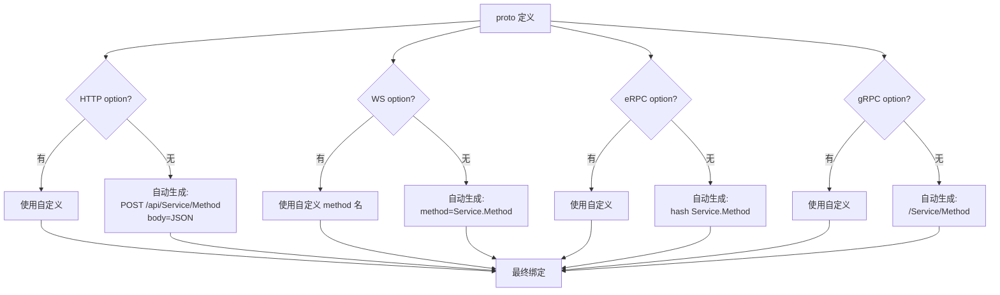

#### 容器端的处理逻辑

```java
// 伪代码：协议绑定解析器
class ProtocolBindingResolver {
    public Map<Protocol, Binding> resolve(ServiceDescriptor svc, MethodDescriptor method) {
        Map<Protocol, Binding> bindings = new HashMap<>();

        for (Protocol p : Protocol.values()) {
            // 1. 用户显式 option 优先
            OptionDescriptor explicit = method.findOption(p.optionName());
            if (explicit != null) {
                bindings.put(p, Binding.fromOption(explicit));
            } else {
                // 2. 否则走默认生成规则
                bindings.put(p, defaultRules.generate(p, svc, method));
            }
        }
        return bindings;
    }
}

// 默认规则生成器
class DefaultBindingRules {
    public Binding generate(Protocol p, ServiceDescriptor svc, MethodDescriptor method) {
        switch (p) {
            case HTTP:
                return generateHttp(svc, method);    // POST /api/Service/Method (body: JSON)
            case WS:
                return generateWs(svc, method);       // method = "Service.Method"
            case ERPC:
                return generateErpc(svc, method);     // hash("Service.Method")
            case GRPC:
                return generateGrpc(svc, method);     // /Service/Method
        }
    }
}
```

#### 用户覆盖的常见场景

| 场景 | 原因 | 示例 |
|------|------|------|
| URL 路径美化 | RESTful 风格要求 | `option (google.api.http).get = "/v1/users/{user_id}"` |
| HTTP 改用 GET/PUT/DELETE | 兼容 RESTful 客户端、浏览器缓存 | `option (google.api.http).get = "/api/users/{user_id}"` |
| eRPC method_id 固定 | 兼容老系统、调协议号 | `option (edap.rpc).method = 10001` |
| WS 子协议 | 不同客户端用不同协议 | `option (edap.ws).subprotocol = "graphql-ws"` |
| HTTP body 改非 JSON | 兼容已有二进制协议（如 protobuf） | `option (google.api.http).body = "*"` |
| gRPC 兼容外部 | 对接已有 gRPC 服务 | `option (edap.grpc).enable = true` |
| 部分协议禁用 | 某些方法不支持某协议 | `option (edap.rpc).enabled = false` |

#### 规则的可配置性

容器提供**应用级规则配置**（在 `application.yml` 或 build.json 里），允许覆盖默认生成规则：

```yaml
# application.yml - 全局规则
edap:
  binding:
    http:
      pathPattern: "/api/{service}/{method}"  # 自定义 HTTP 路径模板（默认 POST）
      bodyFormat: "json"                      # body 序列化格式（默认 json）
    erpc:
      methodIdStrategy: "hash"               # hash | increment | fixed
      hashSeed: 10000                        # 起始编号
    ws:
      endpoint: "/ws"                        # 统一端点
      methodPattern: "{service}.{method}"    # method 名生成规则
```

#### 关键收益

- ✅ **proto 文件极简**：90% 方法不用写 option，只在特殊场景覆盖
- ✅ **风格一致**：所有 service 默认同一种 URL / 协议风格
- ✅ **渐进式细化**：先用默认跑通，需要时再覆盖
- ✅ **规则可配置**：项目级定制默认生成规则
- ✅ **学习成本低**：新人不用学 option 怎么写，遵守命名约定即可

### 6.6 从 Java 接口反向生成 proto —— 兼容 Java 优先的开发流程

edap 不仅支持 Proto-First，还提供**逆向工具**：从已有的 Java 接口自动生成 proto 定义，让 Java-First 的项目也能平滑切换到 edap 的 Proto-First 模式。

> **当前范围（v1.0）**：本工具**仅支持纯 Java 接口（`interface`）+ 实现类（`implements`）** 的反向生成。
> **暂不支持** Spring MVC `@RestController` / `@GetMapping`、Dubbo `@DubboService`、gRPC `@GrpcService` 等带框架注解的类。
> 这些场景请先把 Controller/Service 类拆成 `interface + impl` 后再使用本工具。

#### 适用场景

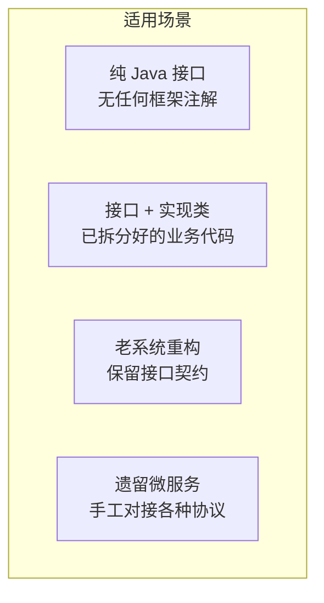

#### Java 结构 → proto 元素映射

| Java 结构 | 生成的 proto 元素 | 说明 |
|----------|------------------|------|
| `interface` | `service` 块 | 接口名 → service 名 |
| 接口方法 | `rpc` 块 | 方法名 → rpc 名 |
| 方法入参（自定义类）| `message` 块（作为 Request） | 参数类名 → message 名 |
| 方法返回值（自定义类）| `message` 块（作为 Response） | 返回类名 → message 名 |
| 关联的实现类（`impl`）| **不参与生成** | 仅用于校验接口已有实现，避免生成无人调用的 proto |

#### 实际转换示例

**原始 Java 接口 + 实现类**：

```java
package io.edap.demo.service;

// 纯 Java 接口（无任何框架注解）
public interface UserService {

    UserDTO getUser(Long userId);

    UserDTO createUser(CreateUserRequest req);

    UserDTO updateUser(Long userId, UpdateUserRequest req);

    void deleteUser(Long userId);
}

// 实现类（可选，工具只校验存在性，不读取其方法体）
public class UserServiceImpl implements UserService {

    @Override
    public UserDTO getUser(Long userId) {
        // ... 业务逻辑
    }

    @Override
    public UserDTO createUser(CreateUserRequest req) {
        // ... 业务逻辑
    }

    @Override
    public UserDTO updateUser(Long userId, UpdateUserRequest req) {
        // ... 业务逻辑
    }

    @Override
    public void deleteUser(Long userId) {
        // ... 业务逻辑
    }
}
```

**自动生成的 proto 文件**：

```protobuf
syntax = "proto3";
package io.edap.demo.service;

import "google/api/annotations.proto";
import "edap/ws.proto";
import "edap/rpc.proto";

option java_package = "io.edap.demo.service";
option java_multiple_files = true;

// ===== Message 块（从入参 / 返回值 / DTO 类生成）=====

message UserDTO {
  int64 user_id = 1;
  string name = 2;
  int32 age = 3;
}

// 单基本类型入参自动包装为 GetUserRequest
message GetUserRequest {
  int64 user_id = 1;   // ← 从方法签名 getUser(Long userId) 的参数名提取
}

// 已有的 POJO 直接复用
message CreateUserRequest {
  string name = 1;
  int32 age = 2;
}

// 多参数方法自动合并入参到 UpdateUserRequest
message UpdateUserRequest {
  int64 user_id = 1;   // ← 从方法签名 updateUser(Long userId, UpdateUserRequest req) 提取
  string name = 2;     // ← UpdateUserRequest 已有字段
  int32 age = 3;
}

// void 返回 → 生成 google.protobuf.Empty
// 单参数 Long userId → 自动包装 DeleteUserRequest
message DeleteUserRequest {
  int64 user_id = 1;
}

// ===== Service 块（从接口生成）=====

service UserService {
  rpc GetUser(GetUserRequest) returns (UserDTO) {
    // 默认绑定（按 §6.5）：HTTP POST + body=JSON，WS method=UserService.GetUser，eRPC hash
  };
  rpc CreateUser(CreateUserRequest) returns (UserDTO);
  rpc UpdateUser(UpdateUserRequest) returns (UserDTO);
  rpc DeleteUser(DeleteUserRequest) returns (google.protobuf.Empty);
}
```

> **协议绑定遵循 §6.5 默认生成规则**：HTTP 统一 `POST /api/Service/Method` + body JSON，WS 统一端点 `/ws` + method 字段，eRPC 哈希 method_id。用户可以在生成的 proto 上再加 option 覆盖。

#### 生成规则详解

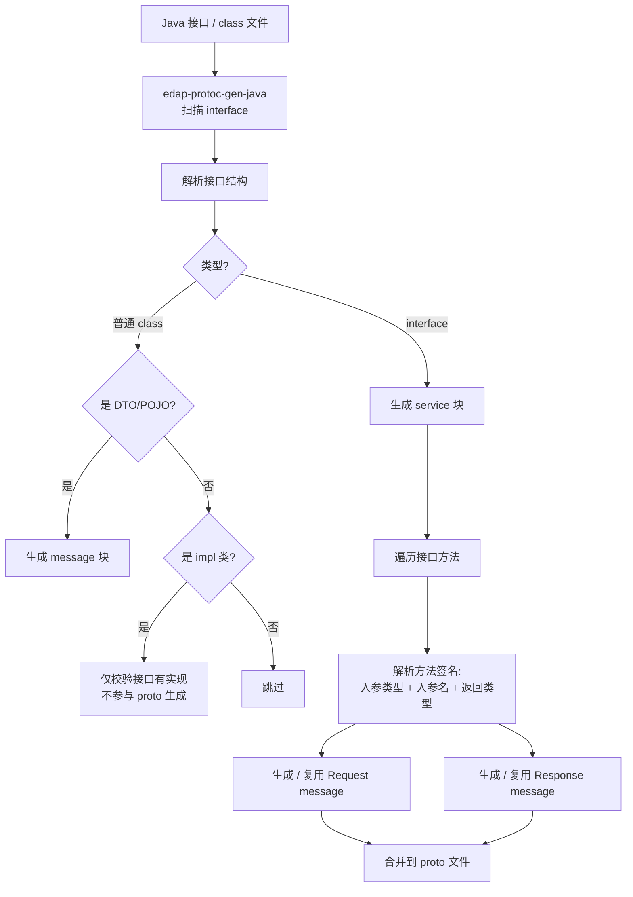

#### 使用方式

**Maven 插件**（在已有 Java 项目中）：

```xml
<build>
    <plugins>
        <plugin>
            <groupId>io.edap</groupId>
            <artifactId>edap-protoc-gen-java</artifactId>
            <version>1.0.0</version>
            <configuration>
                <sourcePackages>
                    <package>io.edap.demo.service</package>
                </sourcePackages>
                <outputDir>${project.basedir}/src/main/proto</outputDir>
                <naming>
                    <!-- 接口名 UserService → service UserService -->
                    <serviceSuffix>Service</serviceSuffix>
                </naming>
                <messageOptions>
                    <generateEmptyMessage>false</generateEmptyMessage>
                    <wrapSingleParam>true</wrapSingleParam>
                </messageOptions>
                <verifyImpl>true</verifyImpl>     <!-- 校验接口有实现类 -->
            </configuration>
            <executions>
                <execution>
                    <goals>
                        <goal>generate-proto</goal>
                    </goals>
                </execution>
            </executions>
        </plugin>
    </plugins>
</build>
```

**命令行工具**（适合临时转换）：

```bash
# 从源码目录扫描所有 interface
edap-protoc-gen-java \
    --source ./src/main/java \
    --output ./src/main/proto \
    --package io.edap.demo.service

# 从已编译的 class 文件扫描
edap-protoc-gen-java \
    --classpath ./target/classes \
    --output ./src/main/proto \
    --include "io.edap.demo.service.**"

# 只生成指定接口
edap-protoc-gen-java \
    --interface io.edap.demo.service.UserService \
    --output ./proto/user.proto

# 指定实现类（用于校验）
edap-protoc-gen-java \
    --interface io.edap.demo.service.UserService \
    --impl io.edap.demo.service.UserServiceImpl \
    --output ./proto/user.proto
```

#### 高级特性

**类型映射表**（Java → proto）：

| Java 类型 | proto 类型 | 说明 |
|----------|----------|------|
| `String` | `string` | |
| `int` / `Integer` | `int32` | |
| `long` / `Long` | `int64` | |
| `float` / `Float` | `float` | |
| `double` / `Double` | `double` | |
| `boolean` / `Boolean` | `bool` | |
| `byte[]` | `bytes` | |
| `BigDecimal` | `string` | 精度安全 |
| `BigInteger` | `int64` 或 `string` | 配置项 |
| `Date` / `LocalDateTime` | `string` 或自定义 | 配置项 |
| `List<T>` | `repeated T` | |
| `Map<K, V>` | `map<K, V>` | K/V 需是基本类型 |
| 自定义类 | 嵌套 message | 自动生成 |

**智能推断**（基于接口方法签名）：

- 方法多个入参 → 自动合并到一个 `XxxRequest` message（如 `UpdateUserRequest` 包含 `userId` + `req` 的字段）
- 方法单个基本类型入参 → 自动包装成 `XxxRequest`（如 `Long userId` → `GetUserRequest.user_id`）
- 方法单个 POJO 入参 → 可选包装（`wrapSingleParam` 配置项）
- 方法返回 `void` → 生成 `google.protobuf.Empty`
- 入参名（`userId`）→ 转为 snake_case 作为 message 字段名（`user_id`）
- 已存在的同名 POJO → 复用，不重复生成
- 关联 impl 类（`UserServiceImpl implements UserService`）→ 仅校验存在性，不读取方法体

#### 迁移工作流

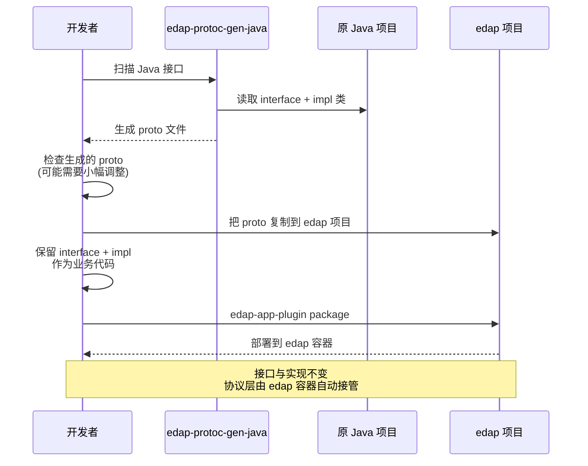

#### 与现有代码对齐

edap 已有 `ProtoServiceData` / `ProtoMethodData` / `AnnoData` 等基础结构，逆向生成工具可以**复用这些数据结构**：

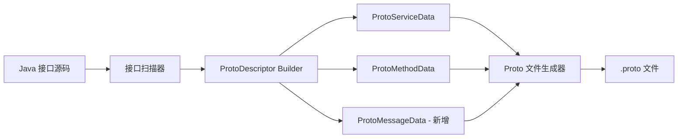

**关键收益**：

- ✅ **零迁移成本**：已有 Java 接口平滑切换到 edap
- ✅ **协议层升级**：从手工对接各种协议 → 由 edap 容器自动多协议发布
- ✅ **保留接口与实现**：业务代码完全不变，仅补一份 proto
- ✅ **工具复用**：复用 edap 现有的 ProtoServiceData 等数据结构
- ✅ **类型安全**：Java 类型 → proto 类型的映射是确定性的，无歧义

#### 局限与注意事项

- ⚠️ **当前仅支持纯 Java 接口**：不支持 Spring MVC `@RestController`、Dubbo `@DubboService` 等带框架注解的类（这些场景请先把 Controller 拆成 `interface + impl`）
- ⚠️ **方法重载**：Java 允许同名方法重载（不同参数），proto 不支持 → 同接口内重载方法需手动调整
- ⚠️ **复杂泛型可能丢失精度**：如 `List<Map<String, CustomType>>` 需要手动调整
- ⚠️ **继承关系拍平**：Java 接口继承在 proto 中用组合代替，需要手动调整
- ⚠️ **循环依赖**：接口互相引用时，生成的 proto 文件可能需要手动拆包

---

## 七、文档自动生成

### 7.1 文档生成管线

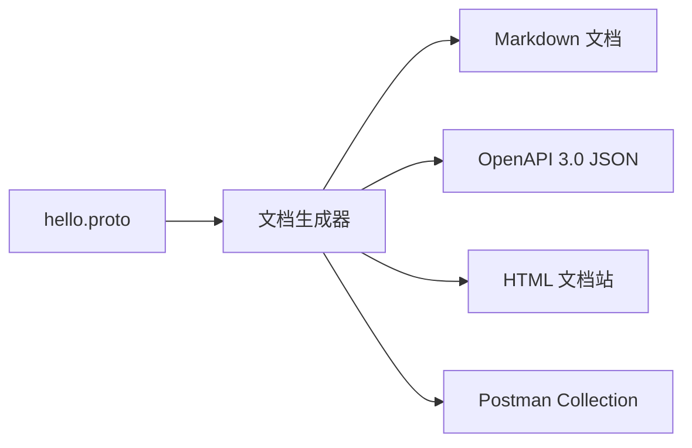

### 7.2 自动生成的 Markdown 示例

````markdown
# HelloService

> 自动生成于 hello.proto，请勿手动修改

## 接口列表

| 方法 | HTTP | WebSocket method | eRPC |
|------|------|-----------------|------|
| SayHello | `GET /v1/hello` | `HelloService.SayHello` | method_id=1001 |

## SayHello

**请求** `HelloRequest`
```json
{ "name": "string" }
```

**响应** `HelloResponse`
```json
{ "message": "string" }
```
````

---

## 八、多协议发布

### 8.1 容器层的多协议统一监听

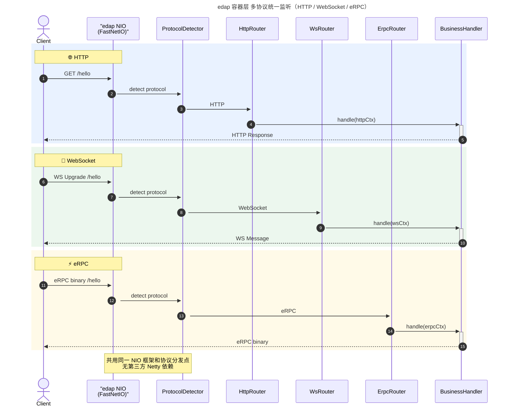

> **底层说明**：图中的 `edap NIO` 是 edap 自研的 NIO 框架（`io.edap.nio` 包，含 `FastNetIO` 等原生实现），不是 Netty。HTTP 层基于 `io.edap.http.server.HttpServerBuilder`，WS / eRPC 同理均为 edap 自研。整个容器不依赖任何第三方 NIO / HTTP 库。

### 8.2 节点能力驱动的协议发布

**应用零协议配置**。容器节点的能力集合（`Set<Capability>`，详见 §13.1）在容器启动时由系统配置（或环境变量）决定，容器按能力集合激活对应的协议 Router。

```mermaid
flowchart LR
    Caps[节点能力<br/>edap.node.capabilities 决定]
    Caps -->|含 HTTP| Reg1[激活 HTTP Router<br/>扫描 google.api.http]
    Caps -->|含 WS| Reg2[激活 WS Router<br/>同端口按 path 分流<br/>扫描 edap.ws]
    Caps -->|含 ERPC| Reg3[激活 eRPC Router<br/>扫描 edap.rpc]
    Caps -->|含 GRPC| Reg4[激活 gRPC Router<br/>扫描 edap.grpc]

    Reg1 --> R1[HTTP Server :8080]
    Reg2 --> R2[HTTP Server :8080<br/>同端口]
    Reg3 --> R3[eRPC Router :9090]
    Reg4 --> R4[gRPC Router :9091]
```

**节点能力的配置方式**（容器侧，不是应用侧）：

```bash
# 通过系统属性（推荐）—— 逗号分隔能力名，大小写不敏感
-Dedap.node.capabilities=http,ws          # HTTP 节点（默认）
-Dedap.node.capabilities=erpc             # eRPC 节点
-Dedap.node.capabilities=grpc             # gRPC 节点
-Dedap.node.capabilities=http,ws,erpc     # 混合节点

# 或环境变量
EDAP_NODE_CAPABILITIES=http,ws

# 或容器启动配置文件
node:
  capabilities: [HTTP, WS]    # HTTP 节点
```

### 8.3 单端口 vs 多端口方案对比

| 方案 | 优点 | 缺点 |
|------|------|------|
| 统一端口（协议嗅探） | 部署简单、负载均衡友好 | 需要解析协议头 |
| 多端口（每协议一端口） | 隔离清晰、协议纯粹 | 需要客户端配多个端口 |

**建议**：初期采用多端口，每个协议独立监听。

---

## 九、热部署（蓝绿部署）

### 9.1 部署元数据结构

```
apps/.deploy/
├── apps.json                       ← 应用 ID 列表
├── current-{appId}.json            ← 当前运行版本
├── previous-{appId}.json           ← 上一个版本（保留用于回滚）
├── staging-{appId}.json            ← 预上线版本（已加载,待切换）
└── history-{appId}.jsonl           ← 历史记录
```

### 9.2 热部署时序

```mermaid
sequenceDiagram
    autonumber
    participant Client as Client
    participant DM as DeployManager
    participant VM as VersionManager
    participant OldCtx as 旧版本 Context
    participant NewCtx as 新版本 Context

    Client->>DM: POST /deploy_app (新ear)
    DM->>VM: loadNew(newEar)
    VM->>NewCtx: 创建新 ClassLoader
    VM->>NewCtx: 创建新 AppContext
    VM->>NewCtx: beanMake + 启动
    NewCtx->>VM: 启动成功,写 staging-meta.json
    Note over NewCtx: 此时流量仍走 Old

    Client->>DM: POST /switch_app (appId)
    DM->>VM: switchVersion()
    VM->>VM: 原子切换 router 引用<br/>旧→current, 新→active
    VM->>DM: 写 current-meta.json
    DM-->>Client: 切换成功

    Note over OldCtx: 旧版本进入 Draining
    OldCtx->>OldCtx: 等待请求排空
    OldCtx->>OldCtx: 写 previous-meta.json
    OldCtx->>OldCtx: dispose Bean + 释放 ClassLoader
```

### 9.3 原子流量切换

```java
// 错误的做法
oldRouter.remove(path);
newRouter.add(path);   // 中间有空窗期

// 正确的做法（参考 Tomcat HostConfig）
AtomicReference<Router> currentRef = ...;
        newRouter.build();      // 先完整构建
currentRef.set(newRouter);  // 一行原子替换
```

### 9.4 优雅下线

```mermaid
flowchart TB
    Start[收到下线请求] --> Mark[标记为 Draining<br/>拒绝新连接]
    Mark --> Wait[等待进行中请求完成<br/>超时30s]
    Wait --> Notify{是否还有活跃连接?}
    Notify -->|是| Force[强制关闭<br/>记录告警]
    Notify -->|否| Disposal
    Force --> Disposal
    Disposal[Bean容器 dispose]
    Disposal --> Close[Closeable bean.stop]
    Close --> Dereg[从注册表移除]
    Dereg --> Free[释放 ClassLoader]
    Free --> Done[GC 回收]
```

### 9.5 资源释放清单

| 资源 | 释放方式 |
|------|---------|
| ClassLoader | 清空所有 ThreadLocal 引用 |
| 静态缓存 | BeanWrap / MethodWrap 清空 |
| Bean 单例 | `Lifecycle.stop()` + `DisposableBean` |
| 线程池 | shutdown + awaitTermination |
| 连接池 | DataSource.close |
| 定时任务 | Scheduler.remove |

---

## 十、有状态微服务与无中台部署

edap 支持两种部署形态：**有状态微服务** 和 **无中台部署**。这是 edap 区别于普通微服务框架的关键差异化能力。

### 10.1 两种部署形态概览

```mermaid
graph TB
    subgraph Stateful [有状态部署 - 分片亲和]
        S1[节点 1<br/>本地内存<br/>只服务 shard A]
        S2[节点 2<br/>本地内存<br/>只服务 shard B]
        S3[节点 N<br/>本地内存<br/>只服务 shard C]
        DB[(共享数据库)]
        S1 <-.->|读写本分片数据| DB
        S2 <-.->|读写本分片数据| DB
        S3 <-.->|读写本分片数据| DB
    end

    subgraph Stateless [无状态部署]
        N1[应用实例 1<br/>无状态]
        N2[应用实例 2<br/>无状态]
        N3[应用实例 N<br/>无状态]
        LB[负载均衡<br/>随机分配]
        LB --> N1
        LB --> N2
        LB --> N3
    end

subgraph NoMiddleware [无中台部署]
AppCtx[AppContext<br/>内置：注册发现/配置/监控]
Apps[应用集]
AppCtx -.内置.-> Apps
end
```

### 10.2 有状态微服务 —— 应对高并发资源需求

**核心场景**：某些资源（限流令牌、分布式锁、热点缓存、本地计数器、热点数据）需要**全局高频访问**，每次远程调用性能不够。

**edap 的解决思路**：
- **分片亲和路由**：相同 shard_key 的请求确定性路由到同一节点（一致性哈希，详见 §10.6）
- **本地内存即权威**：每个节点只维护自己分片的数据，**不跨节点同步内存**
- **DB 是唯一共享存储**：数据库共享即可（按 shard 分区是**可选的性能优化**，不是必需）
- **自然的数据局部性**：请求按 shard_key 确定性路由 → 每个节点天然只访问本分片数据，即便 DB 不分区，每个节点访问的也是自己的那部分数据
- **彻底摆脱 Redis**：因为没有跨节点共享内存需求，**不需要 Redis 类共享缓存**
- **DB 无并发冲突**：因为请求已按 shard_key 分开，**同一行数据只会被一个节点访问**——无需行锁 / 分布式事务，读写吞吐量大幅提升

```mermaid
graph LR
    subgraph Node [edap 节点 - 单 shard]
        subgraph App [应用实例]
            Bean[业务 Bean]
            LocalMem[本地内存<br/>只存本分片数据<br/>Map / Counter / Cache]
            Bean -.本地访问.-> LocalMem
        end
    end

    subgraph Cluster [集群 - 各节点独立 shard]
        N1[节点 1<br/>shard A]
        N2[节点 2<br/>shard B]
        N3[节点 N<br/>shard C]
    end

    LocalMem -.本地权威<br/>不跨节点同步.-> N1

    DB[(共享 DB<br/>是否分区可选)]
    N1 <-.->|读写本分片| DB
    N2 <-.->|读写本分片| DB
    N3 <-.->|读写本分片| DB
```

**高并发资源处理模式**：

| 场景 | 资源类型 | edap 实现 | 性能 |
|------|---------|----------|------|
| 限流 | 令牌桶 | 本地内存（userId 路由到固定节点）| 内存级访问 |
| 分布式锁 | 互斥信号 | 本地内存（lockKey 路由到固定节点）| 内存级访问 |
| 热点缓存 | KV 存储 | 本地 Map（key 路由到固定节点）| 内存级访问 |
| 计数器 | 数值累加 | 本地原子（counterKey 路由到固定节点）| 原子操作 |
| 会话 | Session | 本地 Map（sessionId 路由到固定节点）| 内存级访问 |
| DB 行读写 | 行 / 文档 | 同一行只被一个节点访问，**无行锁 / 无分布式事务** | 顺序写，无等待 |

**容器视角的有状态支持**：

```mermaid
classDiagram
    class StatefulApp {
        +String appId
        +boolean stateful
        +LocalMemory localMem
        +ShardRouter shardRouter
    }

    class LocalMemory {
        +Map~String,Object~ kv
        +AtomicLong counter
        +LockManager locks
        +put/get/remove
    }

    class ShardRouter {
        +String extractShardKey(request)
        +Node route(shardKey)
        +Map~String,Node~ ring
    }

    StatefulApp *-- LocalMemory
    StatefulApp --> ShardRouter : 同一 shardKey → 同一节点
```

**与无状态的关键区别**：

| 维度 | 无状态 | 有状态 |
|------|------|------|
| 扩缩容 | 直接加实例 | 一致性哈希重哈希（仅影响部分 shard）|
| 故障转移 | 任意实例可接 | shard 转移给其他节点接管 |
| 性能 | 受远程调用限制 | 内存级访问（本地内存，无跨节点通信）|
| DB 并发 | 同一行可能被多实例写 | 同一行只被一个节点写，**无行锁 / 无分布式事务** |
| 复杂度 | 简单 | 需考虑分片路由 |
| 共享内存 | 无 | 无（每个 shard 独立）|
| 适用场景 | HTTP API / 静态计算 | 高并发资源 / 热点数据 |

### 10.2.1 开发期体验 —— 配置驱动，本地内存放心用

edap 的有状态服务开发模型：**开发者只管写业务代码 + 声明配置，路由 / 节点分配 / shard 迁移由容器在运行时自动处理**。开发时可以把有状态服务当作"加强版的本地 Map"来用。

#### 三层职责划分

| 层级 | 开发者做什么 | 容器做什么 |
|------|------------|-----------|
| **代码层** | 按业务逻辑读写本地 Map / Cache / Counter | — |
| **声明层** | proto 方法 option 加 `(edap.rpc.sharded) = true` + `(edap.shard.key) = "user_id"` | 解析 proto option / 配置；分片数由容器运行时决定 |
| **运行层** | — | 一致性哈希路由、本地内存实例化、shard 迁移、运行期调优 |

#### 声明方式 —— proto option 优先，配置文件补充

**方式 1（推荐）**：在 proto 方法 option 中直接声明

```protobuf
service OrderService {
  rpc GetUserOrders(GetUserOrdersRequest) returns (GetUserOrdersResponse) {
    option (google.api.http.get) = "/v1/users/{user_id}/orders";
    option (edap.rpc.sharded) = true;         // ← 声明该方法为可分片（生成方法级 @Sharded 注解）
    option (edap.shard.key) = "user_id";      // ← 声明分片键（生成 @ShardKey 注解）
    option (edap.local_cache) = true;         // ← 启用本地内存缓存（可选）
    option (edap.cache_ttl) = "60s";          // ← 缓存过期（可选）
  };
}
```

**方式 2**：在 `application.yml` 中集中配置（适合非 proto 项目，或临时调整）

```yaml
# application.yml - 应用配置
edap:
  services:
    - name: OrderService
      stateful: true              # ← 声明为有状态服务
      shardKey: "user_id"         # ← 分片键
      localCache: true            # ← 启用本地内存缓存
      cacheTTL: 60s               # ← 缓存过期时间（可选）
```

#### 运行期调整 —— 根据数据分布动态调

```yaml
# 容器运行时，根据实际数据分布调整分片键或缓存策略
# 例：发现 user_id 分布不均，改用 tenant_id 平衡
edap:
  services:
    - name: OrderService
      stateful: true
      shardKey: "tenant_id"       # ← 运行期调整，无需改代码
      localCache: true
      cacheTTL: 120s              # ← 调长缓存时间
```

#### 典型代码写法（与写无状态一样简单）

```java
@Service
public class OrderServiceImpl implements OrderService {

    // 直接用本地 Map，无需考虑分布式
    private final Map<Long, List<Order>> cache = new ConcurrentHashMap<>();

    @Override
    public GetUserOrdersResponse getUserOrders(GetUserOrdersRequest req) {
        long userId = req.getUserId();

        // 本地缓存查找 → 命中率 90%+（同 shard_key 必路由到此节点）
        List<Order> orders = cache.get(userId);
        if (orders == null) {
            orders = db.query("SELECT * FROM orders WHERE user_id = ?", userId);
            cache.put(userId, orders);
        }

        return GetUserOrdersResponse.newBuilder()
                .addAllOrders(orders.stream().map(this::toProto).collect(toList()))
                .build();
    }
}
```

#### 开发流程对比

| 传统微服务开发时 | edap 有状态开发时 |
|-----------------|------------------|
| 思考：要不要加 Redis？ | 不用：直接用本地 Map |
| 思考：要不要分布式锁？ | 不用：单节点访问无竞争 |
| 思考：缓存击穿 / 数据一致性？ | 不用：本地访问无这些问题 |
| 思考：水平扩展后状态怎么办？ | 不用：路由自动按 shard 分配 |
| 写代码时刻提醒"我在写分布式" | 写代码就是普通单进程写法 |
| 部署后才看到效果 | 配置文件声明后即可看到分片效果 |

#### 关键收益

- ✅ **本地内存敢用**：开发者确信同 shard_key 请求都路由到此节点 → 本地 Map 缓存安全有效
- ✅ **开发零负担**：按单进程模式写代码，不被分布式复杂度干扰
- ✅ **运行期可调**：根据实际数据分布调整 shard_key、缓存策略，**无需改代码**
- ✅ **保持简单心智模型**：代码不需要知道自己在集群中运行
- ✅ **调试简单**：本地开发可直接 `stateful: false` 跑无状态模式

### 10.3 无中台部署 —— 自包含的容器

**传统微服务需要的中台**：
- 配置中心（Apollo / Nacos）
- 注册中心（Eureka / Consul）
- 服务发现（DNS / 注册中心）
- 监控中心（Prometheus / Grafana）
- 链路追踪（Zipkin / Jaeger）
- 限流熔断（Sentinel / Hystrix）

**edap 的"无中台"思路**：这些能力**内置到容器**，不依赖外部服务。

```mermaid
graph TB
    subgraph Traditional [传统微服务 - 有中台]
        App1[应用 1] --> C1[配置中心]
        App2[应用 2] --> C1
        App1 --> R1[注册中心]
        App2 --> R1
        App1 --> M1[监控中心]
        App2 --> M1
    end

subgraph EdapStyle [edap 部署 - 无中台]
CAC[Container AppContext<br/>内置：<br/>· 注册表<br/>· 配置存储<br/>· 健康检查<br/>· 指标收集]
AppA[应用 A]
AppB[应用 B]
CAC -.内置.-> AppA
CAC -.内置.-> AppB
end
```

**容器内置能力清单**：

| 传统中台 | edap 内置实现 | 备注 |
|---------|-------------|------|
| 配置中心 | `Container.Props` + `AppContext.cfg()` | 配置随 EAR 部署，无外部依赖 |
| 注册中心 | `AppRegistry`（Map<appId, AppContext>） | 进程内内存，无需网络发现 |
| 服务发现 | 容器内部 DNS / 直接调用 | 同进程内 RPC，无需网络 |
| 健康检查 | `AppState` 状态机 + 心跳 | 进程内监控 |
| 监控指标 | 容器内置 Metrics 收集器 | 可选导出到外部系统 |
| 限流熔断 | 应用内 `LocalMemory` 限流 | 本地内存（按 shard_key 路由），无需外部协调 |
| 链路追踪 | 容器内置 TraceId 传播 | 进程内传递 |

### 10.4 有状态与无中台的结合

**edap 的典型架构**：

```mermaid
graph TB
    subgraph Container [edap 容器 - 单进程]
        subgraph StatefulApps [有状态应用集 - 各节点独立 shard]
            SA1[有状态实例 1<br/>本地内存 shard A]
            SA2[有状态实例 2<br/>本地内存 shard B]
        end

        subgraph StatelessApps [无状态应用集]
            NA1[无状态实例 1]
            NA2[无状态实例 2]
            NA3[无状态实例 N]
        end

        subgraph Builtin [容器内置 - 替代中台]
            BuiltInReg[注册表]
            BuiltInCfg[配置存储]
            BuiltInMon[健康检查]
            BuiltInTrace[链路追踪]
        end
    end

    External[外部客户端]
    External --> NA1
    External --> NA2
    External --> NA3

    SA1 -.独立 shard<br/>不互相同步.-> SA2
```

**核心收益**：

- ✅ **零外部依赖**：单进程即可运行，无需额外部署 Nacos / Redis / Prometheus
- ✅ **启动即用**：不需要等中台就绪，应用就能跑
- ✅ **资源本地化**：高并发资源走本地内存，性能提升 10×~100×
- ✅ **渐进式外部化**：需要时再把配置/监控导出到外部系统
- ✅ **单机即是集群**：单 edap 容器 = 一个完整的微服务平台

### 10.5 何时需要扩展到外部系统

| 阶段 | 形态 | edap 能力 |
|------|------|----------|
| 单机 | 单 edap 容器，所有应用部署其内 | 完全无外部依赖 |
| 小集群 | 2~5 个 edap 节点，各节点独立 shard | 一致性哈希路由；DB 分区是可选性能优化 |
| 中型集群 | 多个 edap 节点 + 外部注册中心 | 容器可对接 Nacos / Consul |
| 大型集群 | 完整微服务生态 | 配置/监控/链路全外部化 |

> edap 的"无中台"不是"不能对接中台"，而是**开局无需中台**。

### 10.6 分片亲和性 + 批量处理 —— 吞吐量倍增器

这是 edap 有状态服务的**杀手锏**：通过请求属性分片，让相同属性的请求集中到同一节点处理，从而充分利用本地缓存和批量处理。

#### 核心思想

```mermaid
graph LR
    subgraph Req [请求]
        R1[请求<br/>userId=123]
        R2[请求<br/>userId=456]
        R3[请求<br/>userId=123]
        R4[请求<br/>userId=789]
        R5[请求<br/>userId=456]
    end

    subgraph Hash [一致性哈希]
        H[Shard Key 提取<br/>+ 一致性哈希]
    end

    subgraph Nodes [节点集群]
        N1[节点 A<br/>userId=123 分片]
        N2[节点 B<br/>userId=456 分片]
        N3[节点 C<br/>userId=789 分片]
    end

    R1 --> H
    R2 --> H
    R3 --> H
    R4 --> H
    R5 --> H

    H -->|123 →| N1
    H -->|456 →| N2
    H -->|789 →| N3
```

**关键特性**：
- 相同 shard_key 的请求**始终路由到同一节点**（即使节点扩缩容，影响范围最小）
- 同一节点收到多个同分片请求后，可以**合并为批量处理**
- 到达节点后，**本地缓存命中**（无需远程调用）

#### 三层性能优化

```mermaid
graph TB
    subgraph L1 [第一层 - 路由亲和]
        R[请求进入] --> Key[提取 shard_key]
        Key --> Hash[一致性哈希]
        Hash --> Route[路由到目标节点]
    end

subgraph L2 [第二层 - 本地缓存]
Cache{本地缓存命中?}
Cache -->|命中| Direct[直接返回<br/>~ 1ms]
Cache -->|未命中| Process[进入处理流程]
end

subgraph L3 [第三层 - 批量处理]
Buf[请求缓冲队列]
Batch[批量触发器<br/>时间窗口 / 大小阈值]
Exec[一次性批量执行]
Buf --> Batch
Batch --> Exec
Process --> Buf
end

Route --> Cache
```

**性能对比**：

| 优化层级 | 延迟 | 吞吐量 | 适用场景 |
|---------|------|--------|---------|
| 无优化（远程调用） | 100ms × N | 低 | 简单查询 |
| 本地缓存命中 | ~1ms | 高 ×100 | 重复请求 |
| 批量处理（10合1） | ~10ms | 高 ×10 | 聚合计算 |
| 缓存 + 批量 | ~5ms | 高 ×1000 | 高频聚合 |

#### shard_key 的声明方式

**proto 中声明**：

```protobuf
syntax = "proto3";
import "edap/shard.proto";   // edap 自定义分片 option

service OrderService {
  rpc GetUserOrders(GetUserOrdersRequest) returns (GetUserOrdersResponse) {
    option (google.api.http).get = "/v1/users/{user_id}/orders";
    option (edap.shard.key) = "user_id";          // ← 声明分片键（生成 @ShardKey 注解；分片数由 ClusterShardRouter 运行时决定）
    option (edap.shard_batch) = true;             // ← 启用批量处理
  };
}

message GetUserOrdersRequest {
  string user_id = 1;
  int32 page_size = 2;
}
```

**HTTP 协议提取**（自动从 path/query/header）：
```
GET /v1/users/123/orders    → shard_key = "123" (from path)
GET /api?session_id=xxx     → shard_key = "xxx" (from query)
```

**eRPC 协议提取**（从二进制字段）：
```
message Frame {
    int32 method_id = 1;
    bytes body = 2;
    string shard_key = 3;   // ← 由调用方填充
}
```

#### 典型应用场景

```mermaid
flowchart TB
    Req(["同一 shard key 的请求<br/>userId = 123"])

    subgraph S1 ["⚡ 场景 1 - 电商订单"]
        direction TB
        C1("用户 A 订单请求"):::flow
        C1C("节点本地缓存<br/>订单列表"):::cache
        C1B("批量聚合<br/>单次 DB 查询"):::cache
        C1 --> C1C
        C1 --> C1B
    end

    subgraph S2 ["🔌 场景 2 - WebSocket 长连接"]
        direction TB
        C2("同 session 连接"):::flow
        C2S("连接状态<br/>本地内存"):::state
        C2 --> C2S
    end

    subgraph S3 ["🚦 场景 3 - 用户级限流"]
        direction TB
        C3("userId=123 请求"):::flow
        C3T("本地令牌桶<br/>专用 quota"):::state
        C3 --> C3T
    end

    subgraph S4 ["📊 场景 4 - 实时聚合"]
        direction TB
        C4("同 partition 消息"):::flow
        C4A("批量聚合<br/>单次 DB 查询"):::cache
        C4 --> C4A
    end

    Req -. 一致性哈希 .-> S1
    Req -. session .-> S2
    Req -. userId .-> S3
    Req -. partition .-> S4

    classDef flow  fill:#d1e7dd,stroke:#198754,color:#0f5132,rx:10,ry:10
    classDef cache fill:#fff3cd,stroke:#ffc107,color:#664d03,rx:10,ry:10
    classDef state fill:#e2d9f3,stroke:#6f42c1,color:#4a2a85,rx:10,ry:10
```

#### 与无状态路由的对比

| 维度 | 无状态（随机路由） | 分片亲和 |
|------|------------------|---------|
| 路由策略 | 随机 / 轮询 | 一致性哈希 |
| 本地缓存 | 无效（命中率低） | 高效（命中率 90%+） |
| 批量处理 | 难以聚合 | 天然聚合 |
| 故障转移 | 任意节点接 | 一致性哈希重新分片，受影响范围可控 |
| 适用场景 | 简单 CRUD | 高并发聚合场景 |

#### 容器层支持

```mermaid
classDiagram
    class ShardRouter {
        +String extractShardKey(Context ctx, MethodDescriptor method)
        +Node route(String shardKey)
        +Map~String,Node~ ring
    }

    class LocalCache {
        +get(key) Object
        +put(key, value, ttl)
        +invalidate(key)
        +Map~String,CacheEntry~ data
    }

    class BatchProcessor {
        +submit(shardKey, request)
        +CompletableFuture~Result~ waitFor()
        +flush() 强制触发
    }

    class StatefulInstance {
        +ShardRouter router
        +LocalCache cache
        +BatchProcessor batcher
        +SharedMemory memory
    }

    StatefulInstance *-- ShardRouter
    StatefulInstance *-- LocalCache
    StatefulInstance *-- BatchProcessor
    StatefulInstance *-- SharedMemory
```

**关键收益**：

- ✅ **缓存命中率提升 10×+**：同分片请求集中，本地缓存有效
- ✅ **批量合并减少远程调用**：10 个请求合并为 1 次批处理
- ✅ **本地内存亲和**：高频访问的资源就在本地，避免网络延迟
- ✅ **故障范围可控**：扩缩容只影响部分分片，不全局重哈希
- ✅ **天然适配电商/订单/IM 等场景**：按用户分片是这些场景的天然属性

---

## 十一、容器能力下沉 —— 应用包按需精简

edap 容器**内置丰富的运行时能力**，应用打包时可以剔除这些已存在的依赖，**让应用包体积大幅缩减**。

### 11.1 设计思想

```mermaid
graph TB
    subgraph Traditional [传统模式 - 应用自带所有依赖]
        A1[应用 A<br/>10MB<br/>含 edap-json + httpclient + ...]
        A2[应用 B<br/>10MB<br/>含 edap-json + httpclient + ...]
        A3[应用 C<br/>10MB<br/>含 edap-json + httpclient + ...]
    end

subgraph EdapStyle [edap 模式 - 容器提供能力，应用精简]
CT[edap 容器<br/>内置能力库<br/>edap-json + httpclient + ...]
B1[应用 A<br/>1MB<br/>仅业务代码]
B2[应用 B<br/>1MB<br/>仅业务代码]
B3[应用 C<br/>1MB<br/>仅业务代码]
B1 -. 双亲委派 .-> CT
B2 -. 双亲委派 .-> CT
B3 -. 双亲委派 .-> CT
end

Traditional -. 对比 .-> EdapStyle
```

**核心机制**：父子 ClassLoader 双亲委派
- 应用 ClassLoader 找不到类时，自动委派到容器 ClassLoader
- 容器已提供的 jar，应用包内不再需要重复打包
- 共享 jar 在内存中只有一份（应用之间共享）

### 11.2 容器内置能力清单

edap 容器按"能力域"提供以下运行时支持：

| 能力域 | 容器内置 | 应用端使用方式 |
|--------|---------|---------------|
| **JSON 解析** | edap-json（自研） | 直接 import，零配置；性能优于 fastjson / jackson，与 dsl-json 相当但 API 更简洁，支持 **JSON5** |
| **HTTP 客户端** | OkHttp / HttpClient | 通过 `@HttpClient` 注入 |
| **编解码** | protobuf | proto 编译产物已包含 |
| **序列化** | protobuf / kryo / hessian | 注解 `@Serializer("protobuf")` |
| **数据库驱动** | JDBC 驱动（mysql / pgsql / oracle）| 通过 DataSource Bean 注入 |
| **连接池** | HikariCP / Druid | 通过 `@DataSource(url=...)` |
| **缓存客户端** | Redis / Caffeine | 通过 `@CacheClient` 注入 |
| **消息队列** | Kafka / RabbitMQ / RocketMQ | 通过 `@MQClient` 注入 |
| **配置解析** | properties / yaml / toml | 通过 `cfg()` 直接读取 |
| **日志** | edap-log（自研） | 通过 `Logger` 注解；性能优于 logback / log4j2 |
| **工具库** | Hutool / Guava / Commons | 直接 import |
| **AOP** | ASM / ByteBuddy | 注解自动织入 |
| **校验** | Hibernate Validator | `@NotNull @Min(...)` 注解 |
| **链路追踪** | 内置 TraceId 传递 | 自动注入到 MDC |
| **限流熔断** | Sentinel 内嵌版 | `@RateLimit(...)` |
| **定时任务** | 内置 Scheduler | `@Scheduled(cron=...)` |
| **分布式锁** | 内置 + 可选 Redis | `@DistributedLock` |

**应用打包时的精简效果**：

```
应用包 (传统)         应用包 (edap)
─────────────         ─────────────
edap-json.jar       → 容器提供（自研 JSON）
okhttp-4.12.0.jar    → 容器提供
mysql-connector.jar  → 容器提供
druid-1.2.20.jar     → 容器提供
edap-log.jar  → 容器提供（自研日志）
hutool-all.jar       → 容器提供
... 30+ 依赖
业务代码 .class       ← 保留
                      ─────
总计: 50MB            总计: 1MB
```

### 11.3 容器能力的元数据声明

容器在启动时发布"能力清单"（`container-capabilities.json`），供应用打包工具识别：

```json
{
  "container": {
    "name": "edap-container",
    "version": "1.0.0",
    "provides": [
      {
        "groupId": "io.edap",
        "artifactId": "edap-json",
        "version": "1.0.0",
        "scope": "runtime",
        "note": "自研 JSON 库，性能优于 fastjson/jackson，与 dsl-json 相当但 API 更简洁，支持 JSON5"
      },
      {
        "groupId": "com.squareup.okhttp3",
        "artifactId": "okhttp",
        "version": "4.12.0",
        "scope": "runtime"
      },
      {
        "groupId": "mysql",
        "artifactId": "mysql-connector-java",
        "version": "8.0.33",
        "scope": "runtime"
      }
      // ...
    ]
  }
}
```

### 11.4 应用打包时的精简流程

**一行命令搞定**：

```bash
edap-app-plugin package --container-version 1.0.0
```

`edap-app-plugin` 是 edap 官方提供的打包插件，集成在应用项目的 `pom.xml`（或 `build.gradle`）里。它做了两件事：

1. **剔除容器已有的包**（按指定容器版本过滤）
2. **自动生成 `build.json`**（含部署所需的全部元数据）

```mermaid
sequenceDiagram
    participant Dev as 开发者
    participant Plug as edap-app-plugin
    participant Ver as 版本清单服务
    participant EAR as hello.ear

    Dev->>Plug: edap-app-plugin package<br/>--container-version 1.0.0
    Plug->>Ver: 拉取容器版本 1.0.0 的<br/>container-capabilities.json
    Ver-->>Plug: 返回能力清单<br/>(含所有提供的 jar)
    Plug->>Plug: 扫描应用依赖树
    Plug->>Plug: 比对依赖 vs 容器能力<br/>(按 groupId/artifactId/version)
Loop 每个已剔除的依赖
        Plug->>Plug: 从 EAR 移除该 jar
End
Plug->>Plug: 自动生成 build.json<br/>(maven info + git info + 时间戳)
Plug->>Plug: 校验剩余依赖<br/>能通过双亲委派加载
Plug-->>Dev: hello.ear (1MB)
```

**关键特性**：

- ✅ **按容器版本过滤**：开发者明确指定目标容器版本，插件按版本清单剔除
- ✅ **自动生成 build.json**：不再需要手工编写 EAR 元数据
- ✅ **依赖树扫描**：递归扫描所有传递依赖，不漏 jar
- ✅ **可回退**：保留剔除清单在 `.edap/stripped-deps.txt`，调试时一目了然

**pom.xml 极简配置**（一次性，写完就不用管）：

```xml
<build>
    <plugins>
        <plugin>
            <groupId>io.edap</groupId>
            <artifactId>edap-app-plugin</artifactId>
            <version>1.0.0</version>
            <configuration>
                <!-- 默认目标容器版本（可用命令行 --container-version 覆盖）-->
                <containerVersion>1.0.0</containerVersion>

                <!-- 容器版本清单来源（默认从 edap 官方仓库拉取）-->
                <capabilitiesSource>https://caps.edap.io/v1/{version}</capabilitiesSource>

                <!-- 剔除策略：SAFE（保守，只剔除完全匹配）/ FORCE（激进，含传递依赖）-->
                <stripMode>SAFE</stripMode>
            </configuration>
        </plugin>
    </plugins>
</build>
```

**开发者体验**：

```bash
# 开发期：编译运行（不打包，不剔除）
mvn compile
mvn test

# 上线：打包成精简 EAR
mvn package                                    # 使用默认容器版本
edap-app-plugin package --container-version 1.2.0   # 显式指定版本

# 部署到指定容器
curl -X POST "http://container:1111/deploy_app?name=hello&version=1.0.0"

# 调试：查看本次剔除了哪些 jar
cat .edap/stripped-deps.txt
# edap-json-1.0.0.jar      (由容器提供)
# okhttp-4.12.0.jar         (由容器提供)
# mysql-connector-8.0.33.jar (由容器提供)
# ...
```

### 11.5 自动生成的 build.json

`build.json` 是 EAR 包的"自描述"清单，由 `edap-app-plugin` 自动生成，**开发者不需要手写**。

```json
{
  "appId": "io.edap.demo:hello",
  "version": "1.0.0",
  "containerVersion": "1.0.0",
  "buildTime": "2026-08-09T12:00:00Z",
  "git": {
    "branch": "main",
    "commit": "a1b2c3d",
    "commitMessage": "feat: add user service"
  },
  "maven": {
    "groupId": "io.edap.demo",
    "artifactId": "hello",
    "version": "1.0.0",
    "dependencies": [
      // 只保留未被容器剔除的依赖
      { "groupId": "io.edap", "artifactId": "hello-common", "version": "1.0.0" }
    ]
  },
  "capabilities": {
    "stripped": [
      { "groupId": "io.edap", "artifactId": "edap-json", "version": "1.0.0" },
      { "groupId": "com.squareup.okhttp3", "artifactId": "okhttp", "version": "4.12.0" },
      { "groupId": "mysql", "artifactId": "mysql-connector-java", "version": "8.0.33" }
    ],
    "kept": [
      { "groupId": "io.edap", "artifactId": "hello-common", "version": "1.0.0" }
    ]
  },
  "packages": [
    {
      "artifactId": "hello-api",
      "path": "hello-api/",
      "protoFiles": ["hello-api/api.proto"],
      "entryClasses": ["io.edap.api.UserServiceImpl"]
    },
    {
      "artifactId": "hello-common",
      "path": "hello-common/",
      "protoFiles": ["hello-common/common.proto"],
      "entryClasses": ["io.edap.common.BaseUtils"]
    }
  ]
}
```

**build.json 自动生成的内容**：

| 字段 | 来源 |
|------|------|
| `appId` / `version` | pom.xml |
| `containerVersion` | 命令行参数 |
| `buildTime` | 构建时刻 |
| `git.*` | 自动从 git 仓库提取（branch / commit / message）|
| `maven.*` | pom.xml 解析 |
| `capabilities.stripped` | 容器能力清单匹配结果 |
| `capabilities.kept` | 应用自带依赖（未被容器覆盖）|
| `packages` | 扫描 EAR 内 artifactId 目录生成 |

**收益**：

- ✅ **零手工维护**：开发者不再需要手写 build.json
- ✅ **元数据完整**：git 信息、maven 依赖、能力匹配结果全自动填充
- ✅ **可追溯**：`.edap/stripped-deps.txt` 记录每次剔除，方便审计
- ✅ **版本一致**：应用指定容器版本后，部署到非匹配版本容器时会被拒绝

### 11.7 三个关键保障

#### 1. 双亲委派可加载性验证

```mermaid
flowchart TB
    Strip[剔除依赖] --> Check{容器能加载?}
    Check -->|是| Pass[通过精简]
    Check -->|否| Keep[保留依赖]
```

打包插件在剔除前，验证：
- 容器 CL 确实能加载该类（不是仅 manifest 声明）
- 类的 API 签名与应用使用的版本兼容

#### 2. 版本冲突处理

```mermaid
graph LR
    A[应用想用 edap-json 2.0] --> B{容器提供 1.0.0}
    B -->|完全匹配| Strip[剔除]
    B -->|版本不匹配| Options{策略选择}
    Options -->|升级应用| Upgrade[升级应用代码到 1.0.0]
    Options -->|降级应用| Downgrade[应用代码改用 2.0 API]
    Options -->|本地保留| Keep[本地保留 edap-json 2.0<br/>应用 CL 优先加载]
```

#### 3. 应用覆盖容器

应用有特殊版本需求时，可以"应用覆盖容器"：

```xml
<configuration>
    <!-- 这个依赖即使容器提供，也保留在应用包内 -->
    <preserveDependencies>
        <dependency>com.google.guava:guava:31.0-jre</dependency>
    </preserveDependencies>
</configuration>
```

应用 ClassLoader 优先于容器 ClassLoader 加载（标准 Java 双亲委派的反向应用）。

### 11.8 收益与适用场景

| 场景 | 收益 | 示例 |
|------|------|------|
| 微服务架构 | 单应用包从 50MB 缩到 1MB | 部署 100 个微服务，节省 5GB 镜像空间 |
| Serverless | 冷启动时间减少（解压少）| 启动从 2s 降到 200ms |
| 边缘计算 | 镜像小，下载快 | K8s 节点拉镜像从 1min 降到 5s |
| 离线部署 | 应用分发轻量 | 推送 1MB vs 50MB 到边缘设备 |

**对开发者的影响**：

- ✅ **应用包极小**：只包含业务代码，部署更快
- ✅ **共享 jar 统一管理**：容器升级时，所有应用自动受益
- ✅ **依赖收敛**：避免每个应用版本不一致（容器统一版本）
- ✅ **构建更快**：剔除 jar 后打包、签名、传输都更快

**对容器的责任**：

- ⚠️ **容器版本要稳**：核心库一旦定下，不轻易变更 API（否则破坏应用）
- ⚠️ **能力清单要准**：漏声明会导致应用找不到类
- ⚠️ **兼容性测试**：每个容器版本要跑完整应用兼容性测试

### 11.9 与 OSGi / JPMS 的对比

| 维度 | OSGi | JPMS（Java 模块系统） | edap 容器能力下沉 |
|------|------|-------------------|------------------|
| 模块边界 | Bundle | module-info.java | EAR / ClassLoader |
| 类共享 | Export-Package | requires / transitive | 双亲委派 |
| 打包体积 | 中 | 中 | 极小 |
| 学习成本 | 高（OSGi 服务编程模型）| 中 | 低（标准 Maven）|
| 运行时复杂度 | 高 | 中 | 低（透明）|
| 适用场景 | 大型复杂系统 | JDK 模块化 | 微服务 / Serverless |

> edap 的"能力下沉"是**轻量级模块化**：不需要 OSGi 那样的复杂编程模型，不需要 JPMS 的 module-info.java 改造，只需 Maven 插件 + 双亲委派即可达成。

---

## 十二、应用状态机

```mermaid
stateDiagram-v2
    [*] --> Created : 扫描到 EAR
    Created --> Deploying : 解析+加载ClassLoader
    Deploying --> Staging : Bean容器启动完成
    Staging --> Active : 流量切换成功
    Staging --> Failed : 启动失败
    Active --> Upgrading : 收到新版本
    Upgrading --> Staging : 新版本启动
    Upgrading --> Active : 回滚
    Active --> Draining : 收到下线请求
    Draining --> Removed : 请求排空+资源释放
    Failed --> [*]
    Removed --> [*]
```

---

## 十三、容器核心类设计

> **概念边界**：`io.edap.Edap` 是 NIO 框架 + `ServerGroup` 的运行时容器（位于 `edap-nio` 模块），**不**依赖下游模块。`Container` 是普通 Java 应用（EAR 微服务）的容器，**位于 `edap-container` 模块**，通过 Edap 暴露的 `addServerGroup` / `getServerGroups` / `getNio` / `getProps` API 在 Edap 上注册自己的 `Server` 实例。独立 NIO 服务（未来的 edap-gateway / edap-mail 等）也是同样的接入方式。

### 13.1 顶层架构

```mermaid
classDiagram
    direction TB

    class Edap {
        <<NIO 框架 + ServerGroup 运行时>>
        +FastNetIO nio
        +Map~String,ServerGroup~ serverGroups
        +getNio()
        +getProps()
        +addServerGroup(ServerGroup)
        +getServerGroups()
        +run()
        +stop()
    }

    class Container {
        <<Java 应用容器<br/>(edap-container 模块)>>
        +Edap edap
        +File appsDir
        +AppRegistry apps
        +DeployManager deployManager
        +attach(Edap)
        +start()
        +stop()
        +deploy(File ear)
        +undeploy(appId, version)
    }

    class AppContext {
        +String appId
        +String version
        +ClassLoader appCL
        +BeanContainer beans
        +VersionManager versions
        +start()
        +stop()
    }

    class AppRegistry {
        +Map~String, List~AppContext~~ apps
        +register(AppContext)
        +get(appId)
        +listVersions(appId)
        +unregister(appId, version)
    }

    class DeployManager {
        +Container container
        +deployApp(name, version)
        +undeployApp(appId, version)
        +switchVersion(appId, version)
        +listApps()
    }

    Edap *-- ServerGroup : serverGroups
    Container ..> Edap : 调用 addServerGroup / getNio / getProps
    Container *-- AppRegistry
    AppRegistry *-- AppContext
    Container *-- DeployManager
    DeployManager --> Container : 操作

    classDef nioContainer fill:#0d6efd,stroke:#0a58ca,color:#fff,stroke-width:3px,rx:15,ry:15
    classDef javaContainer fill:#198754,stroke:#146c43,color:#fff,stroke-width:3px,rx:15,ry:15
    classDef component fill:#cfe2ff,stroke:#0d6efd,stroke-width:1.5px,color:#0a2540,rx:10,ry:10

    class Edap nioContainer
    class Container javaContainer
    class AppContext component
    class AppRegistry component
    class DeployManager component
```

**当前映射**：

| 本节设计名 | 当前代码对应 |
|------------|-------------|
| `Edap` | `io.edap.Edap`（已存在，NIO 框架 + ServerGroup 运行时，**保留** `addServerGroup` / `getServerGroups`） |
| `Container` | `io.edap.container.Container`（**新增**，在 edap-container 模块；通过 `edap.addServerGroup(...)` 接入） |
| `Edap.run()` | 启动 `FastNetIO` 后遍历 `serverGroups` 启动各 Server；Container 的 start 在 edap-container 的 Bootstrap 里 |
| `AppRegistry` | `Map<String, ServerGroup>` 在 `Edap` 内部（保留为 Edap 的通用 ServerGroup 概念；Container 自己在内部维护 appId → AppContext 映射） |
| `AppContext` | **目前不存在**——本节 13.3 要新增的设计 |
| `DeployManager` | `io.edap.container.mw.DeployManager`（已存在，改为持有 `Container`） |

### 13.2 DeployManager 重构后的样子

```java
public class DeployManager {
    private final Container container;
    private final File appsDir;

    public DeployManager(Container container, File appsDir) {
        this.container = container;
        this.appsDir = appsDir;
    }

    // 不再做任何加载 ClassLoader、初始化 Bean 的工作
    public BaseResult<String> deployApp(String name, String version) {
        File ear = locateEar(name, version);
        return container.deploy(ear);  // 委派给应用容器
    }

    public List<MicroServiceInfo> queryAppList() {
        return container.listApps();   // 委派给应用容器
    }

    public BaseResult<String> startApps() {
        return container.startApps();  // 委派给应用容器
    }
}
```

### 13.3 AppContext 设计（综合 Solon 与 Spring 之长）

> 原则：**轻量反射**（来自 Solon，避免启动期全 classpath 扫描） + **完整生命周期与扩展点**（来自 Spring，企业级场景） + **edap 独有**：per-EAR 隔离 + 协议感知 + shard 亲和。

#### 13.3.1 定位与边界

AppContext 是**单个应用**（一个 `appId` 一份；多版本时按版本号生成多个实例）的运行期容器，由 `Container.deploy(ear)` 创建并交给 `AppRegistry` 持有。

明确**不**承担：

- 全局单例（全局能力由 `Container` + 容器 CL 提供）
- 协议层（HTTP/WS/eRPC Router 是平级组件，AppContext 把路由挂到自己的 `RouterHub`，由 `Container` 按节点能力选择性 bind 到 `protocolRouters`）
- 跨 AppContext 通信（兄弟隔离，跨应用走 eRPC/gRPC）

#### 13.3.2 类图

```mermaid
classDiagram
    direction TB

    class AppContext {
        <<root>>
        +String appId
        +String version
        +ClassLoader appCL
        +BeanContainer beans
        +Environment env
        +EventPublisher events
        +AppResourceLoader resourceLoader
        +RouterHub routers
        +ShardRegistry shards
        +start()
        +stop()
        +getBean(name)
        +publishEvent(event)
    }
    class BeanContainer {
        +Map~String,BeanDef~ definitions
        +Map~String,Object~ singletons
        +Map~String,BeanPostProcessor~ postProcessors
        +register(BeanDef)
        +getBean(name)
        +injectDependencies(bean)
    }
    class Environment {
        +Props properties
        +getProperty(key)
    }
    class EventPublisher {
        +publish(event)
    }
    class AppResourceLoader {
        +load(path)
    }
    class RouterHub {
        +Map~String,Router~ routes
        +bindAll()
    }
    class ShardRegistry {
        +Map~String,Object~ shardByKey
        +invokeOnShard(name,key,inv)
    }

    AppContext "1" *-- "1" BeanContainer : 持有
    AppContext "1" *-- "1" Environment
    AppContext "1" *-- "1" EventPublisher
    AppContext "1" *-- "1" AppResourceLoader
    AppContext "1" *-- "1" RouterHub
    AppContext "1" *-- "1" ShardRegistry

    classDef root      fill:#0d6efd,stroke:#0a58ca,color:#fff,stroke-width:3px,rx:15,ry:15
    classDef component fill:#cfe2ff,stroke:#0d6efd,stroke-width:1.5px,color:#0a2540,rx:10,ry:10

    class AppContext root
    class BeanContainer component
    class Environment component
    class EventPublisher component
    class AppResourceLoader component
    class RouterHub component
    class ShardRegistry component
```

#### 13.3.3 三段式生命周期（沿用 Solon 两段式 + 补 Spring SmartLifecycle）

```java
public class AppContext {
    private volatile State state = State.NEW;

    public void start() {
        // ===== Phase 1: gather（仅反射记录，不创建对象） =====
        state = State.GATHERING;
        new AnnotationScanner(appCL)
                .scan(this::collectDefinition);    // 把带注解的类汇总到 BeanContainer.definitions

        // ===== Phase 2: commit（实例化 + 注入 + 初始化） =====
        state = State.COMMITTING;
        for (BeanDef def : beans.definitions.values()) {
            beans.instantiate(def);            // 选构造器
            beans.injectDependencies(def);     // @Inject / @Autowired
            beans.invokeInit(def);             // @PostConstruct / @Init
        }

        // ===== Phase 3: ready（路由注册 + SmartLifecycle 启动） =====
        state = State.READY;
        routers.bindAll();                     // 把 @HttpRoute 等挂到 ctx.routers()
        events.publish(new ContextRefreshedEvent(this));
        beans.getBeansOfType(Lifecycle.class)
                .forEach(Lifecycle::start);
        state = State.RUNNING;
    }

    public void stop() {
        state = State.STOPPING;
        beans.getBeansOfType(Lifecycle.class).descendingIterator().forEachRemaining(Lifecycle::stop);
        beans.destroyAllSingletons();          // @PreDestroy / @Destroy
        routers.unbindAll();
        events.publish(new ContextClosedEvent(this));
        state = State.STOPPED;
    }
}
```

**两个关键继承点**：

- 构造函数**不做任何扫描**——`new AppContext(...)` 亚毫秒，扫描发生在显式 `app.scan(...)` 或 `start()` 时（Solon 风格）
- 完整 `Lifecycle` 接口 + `SmartLifecycle`（`@PostConstruct` / `@PreDestroy` / `SmartLifecycle`），让有状态服务能挂 start / stop 钩子（Spring 风格）

#### 13.3.4 注解集（Spring + Solon + edap 三方融合）

| 来源 | 注解 | 作用域 | 在 AppContext 里的等价处理 |
|------|------|--------|--------------------------|
| Spring | `@Component` / `@Service` / `@Repository` / `@Controller` | 类 | 自动注册为 bean |
| Spring | `@Autowired` | 字段 / 构造器 / 方法 | 等价于 `@Inject` |
| Spring | `@Value("${...}")` | 字段 / 参数 | 从 `Environment` 注入配置值 |
| Spring | `@PostConstruct` / `@PreDestroy` | 方法 | 生命周期回调 |
| Spring | `@Order` | 类 / 方法 | 决定 bean 初始化 / 销毁顺序 |
| Solon | `@Inject` | 字段 / 构造器 / 方法 | 依赖注入 |
| Solon | `@Inject(required=false)` | 构造器 / 方法 / 字段参数 | 可选依赖，缺失 → null |
| Solon | `Optional<T>` | 构造器 / 方法 / 字段参数 | 可选依赖，缺失 → `Optional.empty()` |
| Solon | `@Bean` | `@Configuration` 类里的方法 | 编程式注册一个 bean |
| edap | `@EdapService` | 类 | 标记为 RPC 服务，封装进 `ProtoServiceData` |
| edap | `@EdapMethod` | 方法 | 标记为服务方法，封装进 `ProtoMethodData` |
| edap | `@HttpRoute(method=, path=)` | 方法 | 注册到 `RouterHub.httpRoutes` |
| edap | `@WSRoute(method=)` | 方法 | 注册到 `RouterHub.wsRoutes` |
| edap | `@RpcRoute(methodId=)` | 方法 | 注册到 `RouterHub.rpcRoutes` |
| edap | `@ShardKey("userId")` | 类 / 方法 | 状态服务的分片键 |
| edap | `@Sharded`（来自 `io.edap.protobuf.annotation`） | 方法 | 标记方法所属 bean 的实例会被 `ClusterShardRouter` 在运行时扩展为 N 个分片（`@ShardKey` 指定分片键） |
| edap | `@LocalCache(ttl="30s")` | 字段 | 本地内存缓存（AOP 织入） |

> **注解兼容策略**：Spring 系注解（`@Component` / `@Autowired` / `@PostConstruct`）与 Solon 系注解（`@Inject` / `@Bean`）扫描时直接识别并等价到内部 bean 元数据；从 Solon / Spring 项目迁移到 edap 几乎零成本。

#### 13.3.5 Aware 接口（Spring 风格，按需暴露）

```java
public interface ApplicationContextAware { void setApplicationContext(AppContext ctx); }
public interface EnvironmentAware        { void setEnvironment(Environment env); }
public interface RouterHubAware          { void setRouterHub(RouterHub hub); }
public interface BeanNameAware           { void setBeanName(String name); }
```

注入时机：`BeanPostProcessor.postProcessBeforeInit` 调用。只需关心容器能力的少数 bean 显式实现，绝大多数业务 bean 不依赖容器。

#### 13.3.6 状态服务适配（edap 独有，详见 §10）

方法级别的 `@Sharded`（来自 `io.edap.protobuf.annotation`）标注所在 bean 是"可分片"的服务实现 bean。
**分片数不固化在 `BeanDef` / `build.json` / 注解里**——开发者部署时无法预知数据量和机器配置；运行时由 `ClusterShardRouter` 根据集群拓扑/资源状况决定，把分片实例塞进 `ShardRegistry`：

```java
public class ShardRegistry {
    private final Map<String, Map<Integer, Object>> shards;  // beanName → shardIdx → instance

    /** ClusterShardRouter 计算好 localIdx 后调用；多节点集群下避免按 localShardCount hash 错位 */
    public Object routeByIndex(String beanName, int localIdx) {
        return shards.get(beanName).get(localIdx);
    }

    /** 单节点部署时直接按 shardKey hash 命中本地分片 */
    public Object route(String beanName, String shardKey) {
        int shardCount = shards.get(beanName).size();
        int idx = Math.abs(shardKey.hashCode()) % shardCount;
        return shards.get(beanName).get(idx);
    }
}
```

请求进入时由 `@ShardKey` 标注的参数自动参与路由；同 shard key 的请求一定命中同一节点，无跨节点状态同步。
多节点集群下 `ClusterShardRouter` 先算 globalIdx → 映射 localIdx → `routeByIndex`，外部分发只能减少 invokeRemote 概率不能消除，invokeRemote 始终是错位请求的兜底（详见 §10 / `feedback_minimal_locking` 备忘）。

#### 13.3.7 Router 注册（与 §8、§19 联动）—— 两阶段按能力过滤

**两阶段过滤形成闭环**：

```
deploy 阶段（Container.deployAppToContainer）：  按 capabilities() bind 协议 Router
       ↓
生成阶段（AppContext.generateAndBindRoutes）：  按 capabilities() 生成 Handler → 写入 RouterHub
       ↓
dispatch 阶段：  Router 按 path/methodId 查表 → 调 Handler 入口
```

任意一阶段能力缺失，handler 都不会出现在 dispatch 路径上。例：eRPC 节点部署含 `@HttpRoute` 的 EAR → 不生成 HttpHandler，HTTP Router 不 bind，HTTP 请求无法到达（**也根本不会被收**——eRPC 节点只 listen eRPC 端口）。

**生成阶段过滤**（`AppContext.generateAndBindRoutes`，§3.5.6）—— 节点不具备的能力，对应 handler 不生成、不进 RouterHub：

```java
if (container.hasCapability(Capability.HTTP)) {
    for (HttpRouteEntry e : httpRoutes) { httpH.add(generateHandler(HttpHandler.class, ...)); }
}
if (container.hasCapability(Capability.WS)) {
    for (WsRouteEntry e : wsRoutes) { wsH.add(generateHandler(WSServiceMsgHandler.class, ...)); }
}
if (container.hasCapability(Capability.ERPC)) { ... }
if (container.hasCapability(Capability.GRPC)) { ... }
routers.setHandlers(httpH, wsH, erpcH, grpcH);
```

> 为什么过滤点放在 Phase 3（`generateAndBindRoutes`）而不是 Phase 1（`scanRouteEntries`）：① scanRouteEntries 保持纯解析职责，不依赖 Container 状态；② 未来 hotswap capability 只需重跑本方法，不用重扫 EAR；③ RouteEntry POJO 内存占用可忽略。

**bind 阶段过滤**（`Container.deployAppToContainer`，§3.5.3）—— 节点不具备的能力，对应 Router 不 bind：

```
Container.start()
  └── for each AppContext:
        ├── ctx.start()                       // 内部已把所有 @HttpRoute / @WSRoute / @RpcRoute 挂到 ctx.routers()
        └── 按本节点 capabilities() 选择性 bind：
              ├── HTTP?    httpRouter.bindRoutes(ctx.routers().httpHandlers())
              ├── WS?      wsRouter.bindRoutes(ctx.routers().wsHandlers())
              ├── ERPC?    rpcRouter.bindRoutes(ctx.routers().erpcHandlers())
              └── GRPC?    grpcRouter.bindRoutes(ctx.routers().grpcHandlers())
```

每个节点只 bind 自己能力范围内的 Router，每个 AppContext 只生成自己能力范围内的 handler——零冗余、零死代码。

#### 13.3.8 事件机制

| 内置事件 | 触发时机 |
|----------|---------|
| `ContextRefreshedEvent` | `start()` 完成时 |
| `ContextClosedEvent` | `stop()` 完成时 |
| `RouteRegisteredEvent` | 单条路由注册成功 |
| `BeanInjectFailedEvent` | 注入失败但继续运行（带 bean 名 + 异常） |
| `RouteInvokeErrorEvent` | 调用失败（异步） |

```java
// 自定义事件
public class UserLoggedInEvent extends ApplicationEvent { ... }

// 监听
@EventListener
public void onLogin(UserLoggedInEvent e) { metrics.incr("user.login"); }
```

事件总线 `EventPublisher` **per AppContext 独立**，不跨 AppContext 共享。

#### 13.3.9 容错原则

- bean 缺失 → `NoSuchBeanException(name, candidates)`
- 注入冲突（同一 type 多 bean 且未 `@Primary`） → `BeanAmbiguousException(type, candidates)`
- 循环依赖 → `CyclicDependencyException(chain)`，**不加三级缓存**（开发期暴露问题比生产期踩坑好；这是与 Spring 的一个刻意取舍点）

#### 13.3.10 与 Solon / Spring 的对比

| 维度 | Spring | Solon | edap AppContext |
|------|--------|-------|-----------------|
| 启动开销 | 重（全 classpath 扫描） | 轻（按需） | **轻**（仅扫描 EAR 内 class） |
| Bean 包装 | CGLIB / JDK Proxy | `BeanWrap` + 函数式 | 同 Solon |
| 循环依赖 | 三级缓存 | 两段式 | **两段式**（与 Solon 一致） |
| 注解 | 完整 | 完整 | **完整 + Spring/Solon 注解双向兼容** |
| Aware 体系 | 极丰富 | 较薄 | 适中（只保留容器级需要的 4 个） |
| Scope | 6 种 | 4 种 | **2 种**（singleton / prototype；分片由运行时 `ClusterShardRouter` 决定，不污染 Scope 枚举） |
| 事件 | `ApplicationEvent` + `@EventListener` | 简化的 listener | 同 Spring |
| 协议感知 | 无（HTTP-only） | 三元合一 handler | **多协议 + 按节点能力激活** |
| 状态服务 | Scope=session/request | 无 | **`@Sharded` + `ShardRegistry` + `ClusterShardRouter`（独有）** |

#### 13.3.11 完整骨架

```java
public class AppContext implements Lifecycle {
    private final String appId;
    private final String version;
    private final ClassLoader appCL;
    private final Container container;             // 父容器引用，跨 AppContext 通信走它
    private final BeanContainer beans;
    private final Environment env;
    private final EventPublisher events;
    private final AppResourceLoader resourceLoader;
    private final RouterHub routers;
    private final ShardRegistry shards;
    private volatile State state = State.NEW;

    public AppContext(String appId, String version, ClassLoader appCL, Container container) {
        this.appId = appId;
        this.version = version;
        this.appCL = appCL;
        this.container = container;
        this.beans = new BeanContainer(this);
        this.env = new Environment(container.env(), loadBuildJson(appCL));
        this.events = new EventPublisher(this);
        this.resourceLoader = new AppResourceLoader(appCL);
        this.routers = new RouterHub();
        this.shards = new ShardRegistry();   // shardCount 由 ClusterShardRouter 运行时决定
        // 构造函数到此为止，不做任何扫描
    }

    @Override public void start() { /* 13.3.3 的三段式 */ }
    @Override public void stop()  { /* 13.3.3 的逆序 */ }

    public <T> T getBean(String name, Class<T> type) { return beans.getBean(name, type); }
    public void publishEvent(ApplicationEvent e)    { events.publish(e); }
}
```

#### 13.3.12 与 Container 的关系

```
┌────────────────────────────────────────────────────────────────┐
│ Container （进程级，全局唯一）                                  │
│  ├── env            全局配置                                    │
│  ├── containerCL    容器 CL                                    │
│  ├── appRegistry    Map<appId, List<AppContext>>                │
│  │     ├── AppContext hello:1.0.0                              │
│  │     │     ├── beans / env / events / resourceLoader          │
│  │     │     ├── routers (http/ws/rpc/grpc 各自累计)            │
│  │     │     └── shards (@Sharded 才用；shardCount 由 ClusterShardRouter 决定)        │
│  │     ├── AppContext hello:1.1.0                              │
│  │     └── AppContext world:1.0.0                              │
│  ├── protocolRouters 按 capabilities() 选择性 bind                │
│  └── deployManager  操作 AppContext                             │
└────────────────────────────────────────────────────────────────┘
```

---

## 十四、Lifecycle 接口设计

```java
public interface Lifecycle {
    void start() throws Throwable;          // 启动
    default void postStart() throws Throwable {}   // 启动后（提交）
    default void preStop() throws Throwable {}     // 预停止（v2.9+）
    default void stop() throws Throwable {}        // 停止
}
```

### 容器对 Lifecycle 的统一管理

```java
public void lifecycle(int index, int priority, Lifecycle lifecycle) {
    lifecycleBeans.add(new RankEntity<>(lifecycle, index, priority));
    if (isStarting())  lifecycle.start();    // 注册即启动
    if (isStarted())   lifecycle.postStart();
}
```

---

## 十五、演进路线图

### 15.1 总体甘特图

```mermaid
gantt
    title edap 演进路线图（Proto-First 多协议 + 多应用 + 热部署）
    dateFormat YYYY-MM-DD
    axisFormat %m-%d

    section Stage 0 当前态
        EAR 打包 + 部署           :done, s0a, 2026-08-01, 30d
        DeployManager 工具化      :done, s0b, 2026-08-01, 30d
        EdapAppClassLoader        :done, s0c, 2026-08-01, 30d
        ProtoServiceData 元数据   :done, s0d, 2026-08-01, 30d

    section Stage 1 Container 拆分
        Container 类              :s1a, after s0a, 10d
        DeployManager 退化工具    :s1b, after s1a, 7d
        AppRegistry              :s1c, after s1a, 14d
        AppContext 骨架          :s1d, after s1c, 14d

    section Stage 2 Proto 解析
        proto 解析器              :s2a, after s1d, 14d
        ProtoDescriptor 模型      :s2b, after s2a, 7d
        EAR 内 proto 扫描         :s2c, after s2b, 10d
        容器启动加载 proto        :s2d, after s2c, 7d

    section Stage 3 Option 体系
        google.api.http 解析     :s3a, after s2d, 14d
        edap.ws option 定义      :s3b, after s3a, 10d
        edap.rpc option 定义     :s3c, after s3a, 10d
        Option → 协议路由映射     :s3d, after s3b, 14d

    section Stage 4 多协议 Router
        HTTP Router 注册          :s4a, after s3d, 14d
        WS Router 注册            :s4b, after s4a, 14d
        eRPC Router 注册          :s4c, after s4b, 14d
        多协议同时发布             :s4d, after s4c, 14d
        协议路由统一抽象           :s4e, after s3d, 14d

    section Stage 5 文档生成
        Markdown 文档生成         :s5a, after s2d, 7d
        OpenAPI 3.0 生成          :s5b, after s5a, 10d
        HTML 文档站               :s5c, after s5b, 14d
        Postman Collection        :s5d, after s5c, 7d

    section Stage 6 代码生成
        Handler 骨架生成          :s6a, after s3d, 14d
        Client Stub 生成          :s6b, after s6a, 14d
        TypeScript SDK 生成       :s6c, after s6b, 14d
        多语言 SDK 框架           :s6d, after s6c, 21d

    section Stage 7 热部署
        VersionManager 版本管理   :s7a, after s4d, 14d
        蓝绿部署 atomic 切换     :s7b, after s7a, 10d
        staging 预热启动          :s7c, after s7b, 7d
        请求排空                  :s7d, after s7c, 7d
        旧版本资源回收            :s7e, after s7d, 10d

    section Stage 8 gRPC 兼容
        gRPC proto 标准兼容       :s8a, after s4e, 14d
        gRPC Router 实现         :s8b, after s8a, 14d
        Protobuf 序列化对接       :s8c, after s8b, 14d
        外部 gRPC 客户端互通     :s8d, after s8c, 14d
```

### 15.2 阶段验收标准

| 阶段 | 验收标准 | 当前状态 |
|------|---------|---------|
| Stage 1 | `Container.start()` 能跑起来，DeployManager 仍工作 | 部分满足 |
| Stage 2 | `edap-protocol-parent`：由 `io.edap.protobuf.wire.parser.ProtoParser` 解析 .proto 文件；由 `io.edap.protobuf.idl.CodeGenertor` 生成 Java 接口（带注解）与 PB Message；protobuf 序列化/反序列化亦完成；配套测试齐备 | 已完成 |
| Stage 3 | proto option 自动注册到对应协议 Router | 未开始 |
| Stage 4 | 同一应用可同时发布为 HTTP / WS / eRPC | 未开始 |
| Stage 5 | 自动生成 Markdown / OpenAPI 文档 | 未开始 |
| Stage 6 | proto 生成 Handler 骨架和 Client Stub | 未开始 |
| Stage 7 | 新版本上线不影响旧版本，秒级切换 | 未开始 |
| Stage 8 | 兼容外部 gRPC 客户端调用 | 已完成（原生 gRPC 服务端 unary + 四种流式 + 客户端；protobuf 编解码走 edap 自研 `edap-protobuf`，运行时不依赖 google protobuf-java） |

---

## 十六、容器 vs 应用 职责划分

| 维度 | Container（容器） | App（应用） |
|------|-----------------|------------|
| 数量 | 单进程一个 | 容器内多个 |
| ClassLoader | 父 CL | 子 CL（继承父） |
| 生命周期 | JVM 启动到关闭 | 独立 start/stop |
| 可见性 | 看到所有应用 | 只看自己和容器 |
| 失败隔离 | 应用崩不影响容器 | 应用崩不影响其他应用 |
| 灰度 | 不需要 | 需要（current/staging） |

---

## 十七、参考对照表

| edap 概念 | 等价成熟产品 | 可借鉴的实现 |
|----------|------------|------------|
| Container | Tomcat Embedded | 嵌入式启动 |
| AppContext | StandardContext | 一个 WebApp |
| AppRegistry | StandardHost | 管理多个 Context |
| EdapAppClassLoader | WebappClassLoaderBase | 双亲委派变体 |
| DeployManager | Tomcat Manager | 独立管理 webapp |
| Container Router | MapperListener + Mapper | 路径映射 |
| VersionManager | K8s Deployment | staging → current 切换 |
| 多协议发布 | grpc-gateway | proto option 适配 |

---

## 十八、容器启动流程

```mermaid
sequenceDiagram
    participant App as 应用开发者
    participant Proto as proto 文件
    participant Edap as edap 容器
    participant NIO as edap NIO
    participant Client as 客户端

    App->>Proto: 写 hello.proto + option
    App->>Edap: mvn package ear
    Note over Edap: 容器启动时:<br/>1. 加载 EAR<br/>2. 扫描 .proto 文件<br/>3. 解析 ServiceDescriptor<br/>4. 按 option 注册到对应 Router

    Client->>NIO: HTTP GET /v1/hello?name=world
    NIO->>Edap: HTTP Router
    Edap->>Edap: 匹配 ServiceDescriptor.SayHello
    Edap->>Edap: 调用用户实现 HelloServiceImpl
    Edap-->>Client: HTTP Response

    Client->>NIO: WS Connect /ws<br/>(method=HelloService.SayHello)
    NIO->>Edap: WS Router
    Edap->>Edap: 按 method 匹配 SayHello
    Edap-->>Client: WS Message

    Client->>NIO: eRPC binary method_id=1001
    NIO->>Edap: eRPC Router
    Edap->>Edap: 按 method_id 匹配
    Edap-->>Client: eRPC binary response
```

---

## 十九、现有代码对齐

edap 项目已有以下基础，需要在新架构中保留和增强：

### 19.1 设计前提：proto 信息在编译期下沉到注解

**容器运行期不再扫描 .proto 文件**。所有 proto 元信息（service 名、method 名、HTTP/WS/eRPC 绑定、shard_key、stateful 等）在 **代码生成阶段** 就被生成器写入 Java 接口与实现骨架的注解中，运行时只通过反射读取注解，不再解析 .proto 文本。

带来的影响：

- EAR 包里 **不再强制带 .proto 文件**（仅可选保留用于文档/调试）
- 启动期不再调用 `EarScanner` / `NestedJarScanner` 解析 proto
- 各协议 Router（HTTP / WS / eRPC / gRPC）由注解驱动注册，不再由 `ProtoDescriptor` 驱动
- proto 文件的作用收敛为：**人类编写的接口契约 + 代码生成器的输入**

> 这一决策意味着：原 §8（多协议 Router）部分、§20 最小第一步中"proto 解析器 + HTTP Router 注册"的实现方式整体下沉到 edap-protocol-parent 的代码生成器里，不出现在容器运行时。

### 19.2 现有文件的对齐方式

| 现有文件 | 对齐方式 |
|---------|---------|
| `Bootstrap.java` | 在 edap-container 模块里：创建 `Edap` + `Container`，调 `container.attach(edap)`（内部 addServerGroup） + `container.start()` + `edap.run()` |
| `DeployManager.java` | **承担管理工具角色**，但目前 `startApps()` / `deployApp()` 里还有不少“加载 ClassLoader / 初始化 Bean”逻辑——这些逻辑下沉到新增的 `AppContext.start()` 里，DeployManager 只保留 `container.deploy(ear)` + 元数据读写 + HTTP 管理接口 |
| `EdapAppClassLoader.java` | 作为 AppContext 的标准 ClassLoader 实现 |
| `HttpHandlerRegister.java` | 升级为 HTTP Router，扫描 `@HttpRoute(...)` 注解注册路由（不再基于 ProtoDescriptor） |
| `HttpConvertorFactory.java` | 保留作为 HTTP 协议层的适配器 |
| `EarScanner.java` | **废弃 proto 扫描职责**，只保留 EAR 结构扫描（manifest / lib / classes / 资源） |
| `NestedJarScanner.java` | **废弃**（不再扫 proto）；保留为 jar / 资源列表读取器 |
| `MicroServiceInfo.java` | 加 `protocols` 字段 |
| `NodeType.java`（旧 `mw/NodeType.java`） | **已删除**——被 `io.edap.container.Capability` 取代；新枚举 4 个常量 `HTTP / WS / ERPC / GRPC`，无 `_ROUTING` 后缀；`Container` 持有 `Set<Capability> capabilities` 启动期解析 `edap.node.capabilities` 系统属性 |
| `ProtoServiceData.java` / `ProtoMethodData.java` / `AnnoData.java` | **运行期 API**：扫描 EAR 加载完类后，通过反射读取 `@EdapService` / `@EdapMethod` / `@HttpRoute` / `@WSRoute` / `@RpcRoute` / `@ShardKey` / `@LocalCache` / `@Sharded` 等注解汇总成 `ProtoServiceData` / `ProtoMethodData` / `AnnoData` 对象；Router 注册、部署决策、状态查询都基于这些对象 |
| `DeployInfo.java` / `DeployMeta.java` / `DeployMetaData.java` | 部署元数据保持不变 |

> 你现有的 `NodeType`（`WEB / WEB_SOCKET / ERPC / GRPC`）说明"按节点能力激活 Router"的架构思路早就有了——但 1:1 绑定枚举 + 固定4 个常量无法表达组合（HTTP 节点同时需要 HTTP+WS 两个独立能力）。新 `Capability` 改成可组合 `Set<Capability>` 后：① 启动期一次解析；② 任意组合（未来混合节点）；③ HTTP 和 WS 是两个独立能力（消息处理模型不同，不能绑死）。
> 你现有的 `ProtoServiceData` / `ProtoMethodData` / `AnnoData` 既是 proto 描述符在内存里的雏形，也是**运行期天然的注解聚合容器**——扫描完类后把这些注解字段映射到 VO 里，注册、部署、查询都基于这些对象。

### 19.3 运行时注解一览（proto option → Java 注解的映射）

代码生成器按下面的映射，把 proto option 写入接口和实现类的注解里，容器只认这些注解：

| proto 中的来源                                    | 生成的运行时注解                                      |
|---------------------------------------------------|-------------------------------------------------------|
| `service FooService`                              | `@EdapService(name="FooService", pkg="io.edap.demo")` |
| `rpc Bar(...)`                                    | `@EdapMethod(name="Bar")`                             |
| `option (google.api.http.get) = "/v1/hello"`      | `@HttpRoute(method=GET, path="/v1/hello")`            |
| `option (google.api.http.post) = "/v1/hello"`     | `@HttpRoute(method=POST, path="/v1/hello", body="*")` |
| `option (edap.ws.method) = "FooService.Bar"`      | `@WSRoute(method="FooService.Bar")`                   |
| `option (edap.rpc.method) = 1001`                 | `@RpcRoute(methodId=1001)`                            |
| `option (edap.shard.key) = "userId"`               | `@ShardKey("userId")` + 所在方法 `@Sharded`（分片数由 `ClusterShardRouter` 运行时决定） |
| `option (edap.local_cache.ttl) = "30s"`           | `@LocalCache(ttl="30s")`                              |
| `option (edap.rpc.sharded) = true`                | 方法级 `@Sharded`                                     |

启动期，Container 拿到每个 `AppContext` 后做一次"注解扫描 → 注册到对应 Router"，各 Router 仅按匹配自己协议的注解过滤：

- HTTP 节点 → 同时激活 `HttpRouteRegister`（扫 `@HttpRoute`）+ `WsRouteRegister`（扫 `@WSRoute`），同端口按 path 区分走哪个 Router
- eRPC 节点 → 只激活 `RpcRouteRegister`，扫 `@RpcRoute`
- gRPC 节点 → 只激活 `GrpcRouteRegister`，扫 `@EdapService + @EdapMethod`（用 protobuf 描述序列化）

AppContext 不需要重复扫描，按节点能力选择性注册即可，零冗余。

---

## 二十、最小第一步建议

> 按 §19 设计：proto 解析 = 代码生成期的工作；容器运行时 = 注解驱动的注册。本节把"最小可验证版本"拆成两段：**Stage 1（容器拆分）** + **Stage 2（edap-protocol-parent 代码生成器）**。

### Stage 1：新增 `Container.java`，让 Container 通过 `ServerGroup` 接入 Edap（容器侧，约 1 周）

> `io.edap.Edap` 是 NIO 框架 + ServerGroup 运行时；本阶段新增 `io.edap.container.Container`，让 Container 通过 Edap 的 `addServerGroup` / `getNio` / `getProps` API 在 Edap 上挂载自己的 ServerGroup。**Edap 不新增任何"成员"接口**——它的 API 已经够用了。

1. **`Edap.java` 保留与新增**：
    - **保留** `addServerGroup` / `getServerGroups` —— Container 通过这个 API 接入
    - **新增** `getNio()` —— 暴露 NIO 实例（之前 NIO 隐藏在 ServerGroup / Server 内部）
2. **新增 `Container.java`**（位于 edap-container 模块）：
    - `attach(Edap)` 方法：拿到 Edap 引用 + 把自己的 `ServerGroup` 通过 `edap.addServerGroup(...)` 注册
    - `start()` 方法：扫描 `appsDir` 下的 `.ear`，逐个 `deploy(ear)`
    - `deploy(File ear)`：`new AppContext(ear) → ctx.start() → registry.register(ctx)`
    - 把现有 `DeployManager.startApps()` 中的"建 EarScanner / 读 deployInfo / 加载类 / 加载 bean"整体下沉到 `AppContext.start()` 的 Phase 1+2
3. **`AppContext.java`（新增，§13.3 设计）**：
    - 持有 `appCL`、`BeanContainer`、`Environment`、`RouterHub`、`ShardRegistry`、`EventPublisher`
    - `start()` 走三段式：gather → commit → ready（详见 §13.3.3）
    - 启动日志：`[AppContext] scanAnnotations: XXX → @HttpRoute(...)` 取代"已解析 hello.proto"
4. **`DeployManager` 简化**：
    - 删除现有 `appBeanInit()` / `deployAppToContainer()` / `startApps()` 里 EarScanner / Bean 相关代码
    - 改为 `container.deploy(ear)` + 部署元数据读写
5. **`Bootstrap` 调整**：在 edap-container 模块里 — `new Edap()` + `new Container(appsDir)` + `container.attach(edap)` + `container.start()` + `edap.run()`。**不**在 Edap 里调 Container。

### Stage 2：edap-protocol-parent 代码生成器（构建侧）

> proto 解析阶段（Step 4）已经完成——`io.edap.protobuf.wire.parser.ProtoParser` 负责 .proto 文本解析，测试齐备。Step 5 的 Java 代码 + 注解生成由 `io.edap.protobuf.idl.CodeGenertor` 负责。Step 6 构建插件是剩余工作。

4. **proto 解析 — ✅ 已完成**：
    - 由 `io.edap.protobuf.wire.parser.ProtoParser` 负责（自研轻量解析器）
    - 支持 service / rpc / message + 这几个 option：
      `google.api.http`、`edap.ws`、`edap.rpc`、`edap.shard`、`edap.local_cache`
    - 输出 `ProtoDescriptor` 对象树（这里的 `ProtoServiceData` / `ProtoMethodData` / `AnnoData` 与运行期同名 VO 结构一致，**代码生成和运行期用的是同一套对象模型**，避免双向转换损耗）
    - 配套单元测试齐备
5. **注解生成器 — ✅ 已完成**（由 `io.edap.protobuf.idl.CodeGenertor` 负责）：
    - 遍历 `ProtoDescriptor`，为每个 service 生成 `XXXApi.java`（interface，带 `@EdapService` + `@EdapMethod` + 对应 `@HttpRoute` / `@WSRoute` / `@RpcRoute` / `@ShardKey` / `@LocalCache` / `@Sharded`）
    - 为每个 rpc 生成 `XXXProto.java`（PB message）和 service stub（PB 序列化/反序列化的 Message）
    - 提供 `XXXImplSkeleton.java` 模板，开发者继承并实现业务方法
6. **接入 Maven/Gradle**（剩余工作）：
    - 用 `edap-protoc-maven-plugin`（或 `edap-protoc-gradle-plugin`）在 `generate-sources` 阶段自动跑

### 验证（一气呵成）

```bash
# 1. 写一个最简 hello.proto（含 google.api.http option）

# 2. 构建期——代码生成器跑一遍
mvn generate-sources
#   → 生成 HelloServiceApi.java（带 @HttpRoute(GET,"/v1/hello")）
#   → 生成 HelloRequest.java / HelloResponse.java（PB Message）

# 3. 开发者补业务
cat > HelloServiceImpl.java <<EOF
public class HelloServiceImpl implements HelloServiceApi { ... }
EOF

# 4. 打包（edap-app-plugin 自动剔除运行时由容器提供的 jar）
mvn package
#   → hello.ear（不含 .proto，已下沉到 class 注解里）

# 5. 部署到 HTTP 节点
curl -X POST "http://container:1111/deploy_app?name=hello&version=1.0.0"

# 6. 容器启动日志应打印
#   [Container] scanAnnotations: HelloServiceApi → @HttpRoute(GET,/v1/hello)
#   [HttpRouter] registered: GET /v1/hello → HelloServiceImpl.sayHello

# 7. 验证
curl "http://container:1111/v1/hello?name=edap"
#   → {"message": "hello edap"}
```

> 关键点：**容器启动日志不再打印"已解析 hello.proto"，而是"scanAnnotations: @HttpRoute /v1/hello → ..."**。这是 §19 设计落地到 §20 的核心标志。

---

## 二十一、用户视角的完整体验

```bash
# 1. 开发者写一份 proto
cat > hello.proto <<EOF
syntax = "proto3";
package io.edap.demo;
import "google/api/annotations.proto";
import "edap/ws.proto";
import "edap/rpc.proto";

service HelloService {
    rpc SayHello(HelloRequest) returns (HelloResponse) {
        option (google.api.http).get = "/v1/hello";
        option (edap.ws).method = "HelloService.SayHello";
        option (edap.rpc).method = 1001;
    };
}

message HelloRequest {
    string name = 1;
}

message HelloResponse {
    string message = 1;
}
EOF

# 2. 实现业务逻辑（不用关心协议）
@Service
public class HelloServiceImpl implements HelloService {
    @Override
    public HelloResponse sayHello(HelloRequest req) {
        return HelloResponse.newBuilder()
            .setMessage("hello " + req.getName())
            .build();
    }
}

# 3. 打包（开发者无需关心部署协议）
mvn package  # 生成 hello.ear（含 proto + impl）

# 4. 部署 hello.ear 到不同类型的节点
curl -X POST "http://http-node:1111/deploy_app?name=hello&version=1.0.0"
curl -X POST "http://erpc-node:1111/deploy_app?name=hello&version=1.0.0"

# 5. 同一个应用在不同节点暴露不同协议
curl "http://http-node:8080/v1/hello?name=world"                # HTTP 节点（普通 HTTP 请求）
wscat -c ws://http-node:8080/ws -x '{"method":"HelloService.SayHello","params":{"name":"world"}}'   # HTTP 节点（同端口，按 path 走 WS Router，统一端点 + method 字段）
./edap-cli --server=erpc-node rpc --method=1001 --data='{"name":"world"}'  # eRPC 节点

# 6. 自动生成的接口文档
curl "http://container:1111/api-docs/hello.md"   # Markdown
open "http://container:1111/swagger-ui"          # Swagger UI

# 7. 灵活打包：根据需要合并 / 分开部署
#    同一个 hello 模块，可以选择合并到 monolith.ear 或单独打成 hello.ear

# 方案 A：单体合并部署（初期迭代快）
mvn package -P monolith
# → 生成 monolith.ear（包含 api + service + common），部署到任意节点

# 方案 B：拆分部署（按业务边界独立伸缩）
mvn package -P api-only         # → api.ear（含 api + common）
cd ../hello-service
mvn package -P service-only     # → service.ear（含 service + common）

# 部署 api.ear 到 HTTP 节点，service.ear 到 eRPC 节点
curl -X POST "http://http-node:1111/deploy_app?name=api&version=1.0.0"
curl -X POST "http://erpc-node:1111/deploy_app?name=service&version=1.0.0"

# 同一份业务代码，按需组合，零代码改动
```

---

## 二十二、终极目标态

```mermaid
graph TB
    subgraph Dev [开发态]
        Proto[hello.proto<br/>唯一接口源]
        Impl[HelloServiceImpl<br/>业务实现]
    end

    subgraph Build [构建态]
        Ear[hello.ear<br/>含 proto + impl]
        Doc[hello.md<br/>自动生成文档]
        Stub[HelloServiceStub<br/>自动生成客户端]
    end

    subgraph Runtime [运行态 - 同 EAR 部署到不同节点]
        subgraph HTTPNode [HTTP 节点（同端口 HTTP + WS）]
            App1[App 实例<br/>激活 google.api.http + edap.ws]
            HTTP[HTTP Server :8080<br/>按 path 路由 HTTP / WS]
        end
        subgraph ERPCNode [eRPC 节点]
            App2[App 实例<br/>激活 edap.rpc]
            ERPC[eRPC :9090]
        end
        subgraph GRPCNode [gRPC 节点]
            App3[App 实例<br/>激活 edap.grpc]
            GRPC[gRPC :9091]
        end
    end

    subgraph ClientEcosystem [客户端生态]
        Web[Web 前端<br/>TypeScript SDK]
        Mobile[移动端<br/>iOS / Android SDK]
        Server[服务端互调<br/>Java/Python/Go SDK]
    end

    Proto --> Impl
    Proto --> Ear
    Proto --> Doc
    Proto --> Stub

    Ear -.deploy.-> HTTPNode
    Ear -.deploy.-> ERPCNode
    Ear -.deploy.-> GRPCNode

    App1 --> HTTP
    App2 --> ERPC
    App3 --> GRPC

    HTTP --> Web
    ERPC --> Server
    GRPC --> Server
    Stub --> Web
    Stub --> Mobile
    Stub --> Server
```

---

## 二十三、与 gRPC / grpc-gateway 对比

| 维度 | gRPC + grpc-gateway | edap proto-first |
|------|-------------------|------------------|
| 接口定义 | proto | proto |
| HTTP 暴露 | grpc-gateway 二次转换 | proto option 直接适配 |
| 文档生成 | 需要 protoc-gen-doc | 内置 |
| SDK 多语言 | protoc-gen-* | 自研 + protoc-gen |
| 协议支持 | gRPC + HTTP（gateway）| HTTP / WS / eRPC / gRPC 统一 |
| 服务端开发 | 手写 impl | proto 生成 + 手写 impl |
| 多应用 | 不支持 | 原生支持 |
| 热部署 | 不支持 | 原生支持 |

> edap 比 grpc-gateway 更彻底：**一份 proto，多协议原生支持，无需 gateway 转换层。**
> edap 比 Tomcat 更现代：**Proto-First + 多协议发布 + 热部署。**

### 23.1 性能对比基准（`edap-grpc-parent/edap-grpc-benchmark`）

同一份 `bench.proto` 分别喂给 **edap 自研代码生成器** 与 **google 的 protoc**，生成两套 Java 代码，
然后做端到端 unary 性能对比 + 跨框架互操作验证。

> google 系依赖（grpc-java / protobuf-java）**只存在于基准模块内**，不进入任何 edap 运行时产物
> （`edap-container-boot-lib.txt` 不含本模块）。

**测量口径**：预热 1000ms + 测量窗口 3000ms（时间制）；每个场景正反顺序各跑一轮取中位数；
N 个 worker 线程共享一条连接；两侧服务端跑在同一个 JVM 里，业务逻辑逐行对齐。
环境：Mac OS X 27.2.1 / aarch64 / JDK 17.0.20.1 / 10 核；grpc-java 1.85.1 / protobuf-java 3.25.9。

> ⚠ 机器是开发机，loadavg 常在 10~25（核数的 1~2.5 倍）⇒ **绝对值不可跨批次比较**，
> 结论只看「同一批次内的相对关系」与「同一场景跨批次的中位数走势」。
> 原始报告与配对脚本见 `edap-grpc-parent/edap-grpc-benchmark/doc/bench/`。

> ★ **本节的端到端数字只能回答「谁快」，回答不了「谁慢」** —— 客户端与服务端是同时换掉的。
> 要归因必须看 **§23.4 的 2×2 矩阵**（客户端 × 服务端四臂）；
> 要回答「两边是不是同一种语言」看 **§23.5 的兼容性矩阵**。

**修前**（2026-11-11 23:11 批次 —— 连接级窗口不扩 + 写路径锁内 syscall）：

| 负载 | 并发 | edap req/s | google req/s | edap/google | edap p50(us) | google p50(us) | edap p99(us) | google p99(us) |
|---|---|---|---|---|---|---|---|---|
| 0B | 1 | 17412 | 8282 | **2.10x** | 53 | 111 | 109 | 294 |
| 0B | 8 | 31898 | 32586 | 0.98x | 217 | 239 | 751 | 378 |
| 0B | 32 | 31496 | 36152 | 0.87x | 835 | 865 | 3115 | 1324 |
| 1KB | 1 | 16713 | 9200 | **1.82x** | 54 | 100 | 117 | 198 |
| 1KB | 8 | 29581 | 30673 | 0.96x | 240 | 254 | 776 | 407 |
| 1KB | 32 | 30310 | 34396 | 0.88x | 982 | 917 | 2863 | 1324 |
| 16KB | 1 | 8524 | 7975 | 1.07x | 111 | 116 | 193 | 210 |
| 16KB | 8 | 13353 | 24804 | 0.54x | 554 | 314 | 1416 | 506 |
| 16KB | 32 | 12167 | 28466 | 0.43x | 2206 | 1112 | 8834 | 1739 |
| 64KB | 1 | 3239 | 6002 | 0.54x | 294 | 158 | 457 | 257 |
| 64KB | 8 | 3416 | 14760 | 0.23x | 2169 | 530 | 5935 | 905 |
| 64KB | 32 | 3272 | 15176 | 0.22x | 8908 | 2082 | 25137 | 3016 |

**修后**（2026-11-12 晚三批取中位数 —— 连接级窗口撑到 8MB + 写路径批量化 + **服务端七个瓶颈全修**，见 §23.6）：

> ★ 两边的**流控窗口已对齐到 8MB**（`-Dedap.grpc.connWindow` / `-Dbench.google.connWindow`）——
> 之前 edap 侧 8MB、grpc-java 侧 1MB，差 8 倍，同一场景不是同一口径。

| 负载 | 并发 | edap req/s | google req/s | edap/google | edap p50(us) | google p50(us) | edap p99(us) | google p99(us) |
|---|---|---|---|---|---|---|---|---|
| 0B | 1 | 18822 | 10231 | **1.84x** | 50 | 93 | 98 | 177 |
| 0B | 8 | 64136 | 32109 | **2.00x** | 120 | 240 | 202 | 410 |
| 0B | 32 | 77016 | 37547 | **2.05x** | 412 | 843 | 530 | 1150 |
| 1KB | 1 | 18635 | 10068 | **1.85x** | 51 | 95 | 93 | 167 |
| 1KB | 8 | 62425 | 32170 | **1.94x** | 123 | 243 | 209 | 379 |
| 1KB | 32 | 75656 | 35663 | **2.12x** | 420 | 883 | 551 | 1292 |
| 16KB | 1 | 12516 | 8626 | **1.45x** | 76 | 109 | 137 | 202 |
| 16KB | 8 | 38487 | 25568 | **1.51x** | 197 | 303 | 366 | 501 |
| 16KB | 32 | 45048 | 28782 | **1.57x** | 704 | 1105 | 1050 | 1683 |
| 64KB | 1 | 6875 | 6243 | **1.10x** | 136 | 153 | 239 | 249 |
| 64KB | 8 | 17666 | 15193 | **1.16x** | 436 | 519 | 789 | 787 |
| 64KB | 32 | 19207 | 15594 | **1.23x** | 1581 | 2033 | 2852 | 2926 |

**修前 → 修后（edap 侧）**：

| 负载 | 并发 | 修前 req/s | 修后 req/s | 提升 | 修前 edap/google | 修后 edap/google |
|---|---|---|---|---|---|---|
| 0B | 1 | 17412 | 18822 | 1.08x | 2.10x | 1.84x |
| 0B | 8 | 31898 | 64136 | **2.01x** | 0.98x | **2.00x** |
| 0B | 32 | 31496 | 77016 | **2.44x** | 0.87x | **2.05x** |
| 1KB | 1 | 16713 | 18635 | 1.11x | 1.82x | 1.85x |
| 1KB | 8 | 29581 | 62425 | **2.11x** | 0.96x | **1.94x** |
| 1KB | 32 | 30310 | 75656 | **2.50x** | 0.88x | **2.12x** |
| 16KB | 1 | 8524 | 12516 | **1.47x** | 1.07x | **1.45x** |
| 16KB | 8 | 13353 | 38487 | **2.88x** | 0.54x | **1.51x** |
| 16KB | 32 | 12167 | 45048 | **3.70x** | 0.43x | **1.57x** |
| 64KB | 1 | 3239 | 6875 | **2.12x** | 0.54x | **1.10x** |
| 64KB | 8 | 3416 | 17666 | **5.17x** | 0.23x | **1.16x** |
| 64KB | 32 | 3272 | 19207 | **5.87x** | 0.22x | **1.23x** |

**结论**：

- **edap 在全部 12 个档位都更快**（1.10x ~ 2.12x）。大负载从「落后 4.5 倍」翻到「领先 1.23 倍」。
- **小负载（0B / 1KB）领先约 2x** —— edap 客户端是阻塞 socket 单连接，
  没有 netty 的事件循环与批量写开销，小包场景省掉了大量框架调度。
- **大负载（16KB / 64KB @ 8~32 并发）提升 2.9x ~ 5.9x** —— 收益来自
  **服务端**（§23.6 的七个瓶颈，其中出站缓冲平方级拷贝一项就占大头）。
- **64KB@32 的 p99 从 25.1ms（修前批次）降到 2.9ms**（google 2.9ms）—— 原来那条「稳定长尾」也是服务端造成的；
  同一份未修的代码在 2×2 矩阵批次里 p99 更差（**59.8ms**），修完后同样是 2.9ms。
- **单并发档位也涨了 1.08x ~ 2.12x** —— 没有锁争用也没有并发在途压力时同样受益
  ⇒ 说明这些瓶颈是**每条请求都要付**的固定成本（拷贝、syscall 次数），不是并发特有的。

### 23.2 edap gRPC 客户端的两个天花板（已修）

抓栈 + 插桩 + 抓线上帧三方交叉验证，结论如下（edap 客户端 ↔ edap 服务端这一对）。
以下是**修前**的诊断；两个天花板的修复与实测收益见本节末尾。

**天花板一：连接级流控窗口恒为 65535 字节，且从不主动扩大**

RFC 9113 §6.9.2：连接级窗口初值 65535，**不受 `SETTINGS_INITIAL_WINDOW_SIZE` 影响**，
但接收方**可以**用 `WINDOW_UPDATE` 把它撑大。grpc-java 两端都撑了，edap 两端都没撑：

| | `SETTINGS_INITIAL_WINDOW_SIZE`（流级） | 连接级窗口 | 在途字节上限 |
|---|---|---|---|
| grpc-java 客户端 | 1048576（1MB） | 主动 `WINDOW_UPDATE stream=0 +983041` → 1MB | 1MB |
| grpc-java 服务端 | 1048576（1MB） | 主动 `WINDOW_UPDATE stream=0 +983041` → 1MB | 1MB |
| edap 客户端（**修前**） | **不发**（=65535） | **不扩**，只归还已消耗的量 | **64KB** |
| edap 服务端（**修前**） | **不发**（=65535） | **不扩**，只归还已消耗的量 | **64KB** |
| edap 客户端（**修后**） | 1048576（1MB） | 主动 `WINDOW_UPDATE stream=0` → 1MB | 1MB |
| edap 服务端（**修后**） | 1048576（1MB） | 主动 `WINDOW_UPDATE stream=0` → 1MB | 1MB |

在途上限 = 单连接上允许同时存在的 DATA 字节数。它直接决定了并发能带来多少收益：

- 64KB 负载 → 一条连接上最多只有 **1 个请求**在途 → 并发从 1 提到 32，吞吐 3239 → 3272，**纹丝不动**；
- 16KB 负载 → 最多 **4 个请求**在途 → 13353 req/s ≈ 4 个请求 / 0.3ms 的往返；
- 1KB / 0B 负载 → 窗口不是瓶颈（并发能填满），瓶颈换成天花板二。

**天花板二：写路径并发度 = 1（连接级单锁 + 锁内阻塞 syscall + 每帧一次写）**

`GrpcChannel` 用一把**连接级** `writeLock` 串行化所有出站帧，锁内直接做
`out.write(frame); out.flush();`（阻塞 socket 的 syscall）。
插桩实测（64KB / 0B 两档）：

| 场景 | 每请求写帧数 | 写帧/秒 | 锁内 syscall 占 wall | 等锁累计占 wall |
|---|---|---|---|---|
| 64KB @ 1 并发 | 14.94 | 36016 | 29.3% | 0%（无争用） |
| 64KB @ 32 并发 | 14.94 | 36016 | 29.3% | **44.6%** |
| 0B @ 1 并发 | 3.98 | 53083 | 23.7% | 0.1% |
| 0B @ 32 并发 | 3.99 | 92619 | **62.2%** | **546%**（32 个线程累加） |

- 0B 场景连接级窗口完全不是问题，但**写锁被占掉 62% 的墙钟时间** → 上不去；
- 读线程归还接收窗口（`WINDOW_UPDATE`）要**抢同一把 `writeLock`** → 读写互相拖累；
- 64KB 场景锁只占 29%，瓶颈回到天花板一。

**已实现的修复**（2026-11-12，两个天花板都动了）：

1. **两端主动扩大连接级窗口** —— 照 grpc-java：连接建立时发 `WINDOW_UPDATE stream=0`
   把连接窗口撑到 1MB；SETTINGS 里带上 `INITIAL_WINDOW_SIZE=1MB`。
   - 服务端：`Http2FlowController.growConnRecvWindow()` + `Http2Connection.sendLocalSettings()`；
   - 客户端：`GrpcChannel` 构造函数里把「连接前言 + SETTINGS + WINDOW_UPDATE」合成一次写。
   - 回归测试：`Http2ServerWindowNegotiationTest` / `GrpcClientWindowNegotiationTest`。
2. **写路径批量化** —— `GrpcChannel` 的写路径从「连接级单锁 + 锁内 `write+flush`」
   改成 **leader/follower**：锁内只把帧字节追加进待写缓冲，真正的 socket 写由当轮的
   leader 线程在**锁外**做；leader 写完一轮会回头看缓冲里还有没有别人的字节，有就接着写
   ⇒ 高并发下多个线程的帧**合并成一次 syscall**。
   - 回归测试：`GrpcClientEndToEndTest`（10 例）、`GrpcClientFlowControlTest` 等。
3. **读写用不同的锁** —— 发送窗口（`flowLock`）与待写缓冲（`writeLock`）分离，
   读线程归还接收窗口时不再与业务写抢同一把锁。

**实测收益**（⚠ 这里的「修后」指**只修了这两个客户端天花板**的中间批次，不是最终结果 ——
最终数字见 §23.1 的「修后」表，服务端修完后是 1.10x~2.12x。
中间批次的原始报告见 `edap-grpc-parent/edap-grpc-benchmark/doc/bench/summary.md`）：

| 档位 | 修前 → 只修客户端天花板 | 收益来自 |
|---|---|---|
| 0B / 1KB @ 8~32 并发 | 0.87~0.98x → **1.97~2.20x**（吞吐 ~2x） | **写路径批量化**（连接窗口本来就不是瓶颈） |
| 16KB / 64KB @ 8~32 并发 | 0.22~0.54x → **0.36~0.74x**（吞吐 1.39x~1.70x） | **连接级窗口扩容**（在途上限 64KB → 1MB） |
| 单并发 | 1.00x~1.26x（几乎没变） | 无 —— 没有锁争用也没有并发在途压力 |

两个天花板**互相独立、收益不可互相替代**：只修窗口时 0B@8 是 28,037（与修前持平），
只加批量化时 64KB@32 是 6,100（修前 3,272）—— 中间批次 `after-window-only-20261112-0042.md`
单独留档就是为了证明这一点。

**编解码器 micro 对比**（edap 耗时 / google 耗时，>1 表示 edap 更慢）：

| 负载 | 线上字节数 | 两边字节完全相同 | edap 编码 ns | google 编码 ns | edap 解码 ns | google 解码 ns | 编码比 | 解码比 |
|---|---|---|---|---|---|---|---|---|
| 0B | 25 | **否** | 23 | 31 | 38 | 26 | 0.73x | 1.45x |
| 1KB | 1050 | 是 | 57 | 66 | 63 | 56 | 0.87x | 1.12x |
| 16KB | 16411 | 是 | 1103 | 730 | 754 | 749 | 1.51x | 1.01x |
| 64KB | 65563 | 是 | 3066 | 2035 | 1620 | 1638 | 1.51x | 0.99x |

> 0 字节负载下两边字节**不完全相同**：edap 的编码器会把空的 bytes 字段也写出去（`1a 00`，共 25 字节），
> protobuf-java 按 proto3 默认值规则省略该字段（共 23 字节）。两者解码后的**语义完全相同**，不影响互操作；
> 其余负载下两边的字节逐字节相同。
> （★ 2026-11-12 晚：当前工作树里 `AbstractWriter.writeBytes(fieldData, value)` 已改为跳过空的 bytes 字段
> ⇒ 重跑时 0 字节负载下两边也是 23 字节、**逐字节相同**；上表是 2026-11-12 凌晨那批的快照，数字不改。）

**★ 口径说明（2026-11-12 补）—— 上表「编码比 1.39x~1.43x」是口径问题，不是编解码器慢**：

上表的编码列两边量的**不是同一件事**：

| | edap | google |
|---|---|---|
| 编码 | `GrpcCodec.encode` = 写进 writer 缓冲 **+ 拷成新 byte[]** | `toByteArray()` = **直接写进最终数组，零中间数组** |

⇒ edap 多做了一次整块拷贝。`CodecBreakdown` 探针把编码拆成「只写进缓冲」的对等口径后：

| 负载 | edap 写缓冲 | google 写缓冲 | edap byte[] | google byte[] | 多出来的那次拷贝 |
|---|---|---|---|---|---|
| 16KB | 362 | 380 | 1047 | 732 | 686 ns |
| 64KB | 1249 | 1279 | 2906 | 2073 | 1656 ns（一次 64KB `arraycopy` 实测 1335 ns） |

**按对等口径，edap 的编码核心比 protobuf-java 快**（0.94x~0.98x）。
★ 「编解码器 micro 对比」基准（`CodecBenchmark`）现在**默认同时输出两档编码口径**：
「编码核心」（主口径，两边都是 1 次拷贝）与「编码(产出 byte[])」（edap 多一次整块拷贝，不对等）——
表头与脚注都标了口径，别再拿后一档比「谁更快」。
真实链路（帧 = 帧头 + 载荷）edap 慢 4.0x~4.47x，因为 **edap 一条响应被拷 4 次、grpc-java 只拷 1 次**
（payload → writer 缓冲 → byte[] → gRPC 帧数组 → HTTP/2 累积缓冲）。

**★ 已实施（2026-11-13）：帧头内联，4 拷 → 2 拷**（新增 `io.edap.grpc.GrpcFrameEncoder`）——
把 5 字节帧头内联进 protobuf 的编码缓冲，一次编码直接产出「帧头 + 载荷」：

| 负载 | edap 老路径 | edap 新路径 | google | 老路径比 | **新路径比** |
|---|---|---|---|---|---|
| 1KB | 96 ns | 54 ns | 35 ns | 2.78x | **1.55x** |
| 16KB | 1583 ns | 585 ns | 401 ns | 3.95x | **1.46x** |
| 64KB | 6143 ns | 2375 ns | 1338 ns | 4.59x | **1.78x** |

⇒ 64KB 真实链路 **6143ns → 2375ns（-61%）**，与 grpc-java 的差距从 **4.59x 收窄到 1.78x**；
每条响应还少分配两个大数组（64KB@32 并发 ⇒ 少 ~2.4GB/s 垃圾）。
**端到端也验证到了**（3 批中位数，基线 `matrix-20261112-fix-{1,2,3}` vs 新 `matrix-20261113-frameinline-{1,2,3}`）：

| 负载 | 并发 | edap 基线 req/s | edap 新 req/s | Δ | 与 grpc-java 的比值 |
|---|---|---|---|---|---|
| 64KB | 1 | 6,875 | 7,665 | **+11.5%** | 1.10x → 1.20x |
| 64KB | 8 | 17,666 | 18,781 | **+6.3%** | 1.16x → 1.23x |
| 64KB | 32 | 19,207 | 20,811 | **+8.4%** | 1.23x → **1.35x** |
| 16KB | 1 | 12,516 | 13,396 | +7.0% | 1.45x → 1.52x |
| 0B / 1KB | 全部 | — | — | ±2%（噪声内） | 无变化 |

2×2 矩阵显示**收益来自 edap 服务端**（G→E @64KB/32 **+11.7%**，E→G 只 +0.2%）
—— 一条 64KB 响应原来要拷 4 次，现在 2 次。0B/1KB 没变化是对的：帧头才 5 字节。
剩下的 1 次拷贝差距要靠「protobuf 编码器堆外化」才能抹平 —— 跨模块大改，本轮不做。
详见 [`doc/bench/codec-breakdown-20261112.md`](edap-grpc-parent/edap-grpc-benchmark/doc/bench/codec-breakdown-20261112.md)
与 [`doc/bench/matrix-summary-20261113-frameinline.md`](edap-grpc-parent/edap-grpc-benchmark/doc/bench/matrix-summary-20261113-frameinline.md)。

> ★ **2026-11-14 复跑（packed int V11 之后，3 批 `matrix-20261114-packedv11-{1,2,3}`）** ——
> **端到端 12 档全部在 ±1.5% 内（噪声地板）⇒ 无变化**，因为
> **gRPC 基准的负载是「单个 bytes blob 字段」，根本不走 packed 编码路径**
> （packed int 的微观 **-20%** 是真的，只是在这条链路上测不到）。
> 这批数据确认现状：edap 仍**全面领先 grpc-java（1.20x ~ 2.12x）**，64KB@32 = 21,114 req/s（1.36x）。
> 详见 [`doc/bench/matrix-summary-20261114-packedv11.md`](edap-grpc-parent/edap-grpc-benchmark/doc/bench/matrix-summary-20261114-packedv11.md)。

**★ 「protobuf 编码器堆外化」已实测并否决（2026-11-13，Phase C 的 go/no-go 闸门）** ——
**NO-GO，不做。** 不是「收益小先放着」，而是**「物理上不可能比现状快」**：

| 路径 | 做法 | 64KB 耗时 | vs 现状 |
|---|---|---|---|
| **A 现状** | `Unsafe.copyMemory` 一次整块搬 | **834 ns** | 1.00x |
| B 逐字节直写堆外 | `Unsafe.putByte(long,byte)` 循环 | 6749 ns | **慢 8.1 倍** |
| C 8 字节批量直写 | 拼 long 再 `putLong` | 25156 ns | 慢 30 倍 |
| D 分块 bulk copy（拷贝还在） | 4KB 一块搬 | 956 ns | 慢 15% ⇒ **省 0** |

protobuf 编码器是**逐字节产出**的（长度前缀、varint、嵌套长度回填……），
**没有「一次产出 8 字节」的天然边界** ⇒ 想批量写堆外就得先在堆内拼 ⇒ 那还是一次拷贝。
⇒ **唯一能真正消掉拷贝的形态就是 B（逐字节写堆外）⇒ 慢一个数量级。**

端到端实测（把这次拷贝**多做一遍**，量吞吐掉多少；4 组交替 A/B）：
**边际成本 0.2%（E→E 臂，落在噪声地板内）~ 1.7%（G→E 臂）** ⇒ **收益上限 < 2%**，
而方案里列的硬约束有 **10 条**、改动面横跨 **4 个模块**（protobuf-api / grpc-api / http-server / nio）。

⇒ 真正能根治同一类问题（少一次整块搬运）的方向是
**「嵌套 / map / packed 的长度前缀 size 预计算」**（protobuf-java 的 `getSerializedSize`，
edap 没有 ⇒ 要给 ASM 生成的编码器加 size 计算，跨模块大改）⇒ 单独立项。
★ 字符串侧已在本轮用「预留 varint」解决同一类问题（中文编码 1.32x → 1.02x）⇒ **同一思路可推广**。

详见 [`doc/bench/phaseC-c0-offheap-20261113.md`](edap-grpc-parent/edap-grpc-benchmark/doc/bench/phaseC-c0-offheap-20261113.md)。

**★ edap protobuf 编解码器本体的优化（2026-11-12，纯 protobuf 负载矩阵探针实测）**：

`Payload` 是平坦结构，打不中字符串解码 / 嵌套消息 / packed / map 这些关键路径。
新增探针 `ProtoCodecBenchmark`（`bench.proto` 里加 `CodecStr`/`CodecInner`/`CodecNest`，
**同一份 proto 同时喂 edap 与 protoc 两个生成器** ⇒ wire 字节天然对齐、可逐字节断言）：

| 负载 | 改前解码比 | 改后解码比 | 改了什么 |
|---|---|---|---|
| str-ascii-1024 | 6.20x | **0.88x** | `ByteArrayReader.readString()` 改用 JDK 的 UTF-8 解码 |
| str-ascii-16384 | 6.41x | **1.01x** | 同上（纯 ASCII 走 JDK 的向量化快路径，零中间 char[]） |
| nest-1k-x64 | 13.27x | **0.72x** | 嵌套消息里全是 ASCII 字符串 ⇒ 跟着快 17x |
| map-str-1000 | 1.06x | **0.80x** | 同上 |
| str-cn-1024 / 16384 | 0.72x / 0.87x | 1.00x / 0.99x | ⚠ 多字节路径慢了 15~39%（JDK 的多字节解码比手写的慢一点） |

⇒ **解码端从「慢 6~13x」变成「持平或反超」**；唯一回退是多字节字符串解码。
编码端 edap 本来就领先（ASCII 快 45x），改动后 ASCII 编码慢 3x（330ns → 900ns / 16KB，
因为必须做 UTF-8 编码而不是裸拷内部 byte[]），但仍是 protobuf-java 的 15x 以上。

**顺带修掉两个正确性 bug**：

1. **Latin1 高位字符写出非法 UTF-8**（已修）—— `"café"` 的 Latin1 内部字节 `E9` 被原样写出，
   而 UTF-8 应是 `C3 A9` ⇒ 跨框架解码乱码/越界。
   根因：`AbstractWriter.writeString0()` 的 Latin1 分支裸拷 String 内部 byte[]。
   修后探针里 `str-latin1-high` 的 wire 从「与 protobuf-java 不一致」变成**逐字节相同**；
   新增单测 `TestStringUtf8`（22 例，改前 6 例红）。
   ⚠ wire 变化只影响「coder=LATIN1 且含 0x80~0xFF」的字符串，方向是「非法 UTF-8 → 合法 UTF-8」。
2. **`repeated` 标量的 wire type 错了**（**已修，2026-11-13**）—— edap 写的是 varint 的 tag
   （`18`），protobuf-java 是 length-delimited（`1A`）⇒ **protobuf-java 解析 edap 的消息直接抛
   `invalid tag (zero)`**。根因：edap 的 protoc 插件生成 `@ProtoField` 时从不输出
   `cardinality = REPEATED`。edap 自身往返自洽（单框架测不出来），跨框架才炸。
   - **修法（单点，不动生成器）**：`ProtoUtil.getProtoFields()` 里，当「注解没写 cardinality」
     且「类型是 packable 标量」且「Java 字段是 List/Set/数组/Iterable」时，
     把 cardinality **合成**成 `REPEATED`（用只覆盖 `cardinality()` 的委托实现，保留 `oneOf`/`name` 等属性）。
     编码侧与解码侧**都**从 `getProtoFields` 取 `ProtoFieldInfo` ⇒ **改一处两侧同时自洽**，
     **不需要重新生成任何 POJO**。
   - **回归测试**：`TestRepeatedPackedWireType`（16 例，与 protobuf-java **逐字节**比对，
     覆盖 int32/int64/bool/double/enum × List/数组两种形态）。改前留有红证（7 失败 + 3 错误），改后全绿。
   - ⚠ **wire 格式变了**：新写 `1A <len> <payload>`，旧写 `18 <varint>`。
     **新版 edap 写的数据，旧版 edap 读会当成未知字段静默丢弃** ⇒
     **升级顺序必须是「先升级读的一侧（服务端/消费者），再升级写的一侧（客户端/生产者）」**。
     本轮**不做**解码侧的 legacy tag 兼容（ASM `lookupSwitch` 的 key 必须升序，插入 legacy key 要重排，有坑）。

存档：[`doc/bench/proto-codec-20261112.md`](edap-grpc-parent/edap-grpc-benchmark/doc/bench/proto-codec-20261112.md)
（负载矩阵改前/改后 + 编码/解码候选算法的实测对比 + 验证跑法）。

**★ edap protobuf 编解码器本体的优化（续）—— 中文（UTF-16 coder）字符串编码路径**（2026-11-13）：

上一轮把「解码端从慢 6~13x 变成持平」做完了；**编码端唯一系统性落后的是中文串**。
新增探针 `StringEncodeCandidates`（14 个候选）+ 脚本 `run-string-candidates.sh` 做隔离 JVM 逐个测量，
拿到两个可复现的结论：

| 结论 | 依据 |
|---|---|
| ★ **字节偏移计数器必须用 `long`** | 逐字节编码时偏移连续递增，int 计数每写一字节要做一次 int→long 符号扩展（`i2l`），拉长「偏移 → 地址」的依赖链。中文 16KB 串：`char[]`+Unsafe-int 16153ns → `char[]`+Unsafe-long **12750ns（-21%）** |
| ★ **「预留长度前缀」省掉整块 memmove** | protobuf-java 的做法是「预留 varint 长度 → 写内容 → 回退补长度」，零 memmove。中文串每字 3 字节 ⇒ 实际长度必然等于预留 ⇒ **完全不用搬** |

⇒ 据此改 `AbstractWriter.writeString0` 的 UTF-16 分支：`long` 偏移计数器 + 预留 varint
（新增 `writeStringLenPrefix` / `varintLen` / `writeVarint`）；
实际 varint 长度与预留不一致时（「绝大多数 ASCII + 少量中文」）把内容**左移**补齐再写前缀。
（Latin1 分支不动 —— 它是上一轮修的非法 UTF-8 洞。）

**实测**（`ProtoCodecBenchmark`，「编码核心」= 写进 writer 缓冲，两边对等口径；每格两次独立 JVM）：

| 负载 | 改前 edap | 改后 edap | 改前比值 | **改后比值** | Δ |
|---|---|---|---|---|---|
| str-cn-1024 | 1100 ns | 896 / 822 ns | 1.30x | **1.04x / 0.96x** | **-19% ~ -25%** |
| str-cn-16384 | 18386 ns | 13742 / 13573 ns | 1.32x / 1.40x | **1.02x / 1.02x** | **-25%** |
| str-cn-1024（产出 byte[]） | 1205 ns | 970 ns | 1.36x | **1.08x** | -20% |
| str-cn-16384（产出 byte[]） | 19540 ns | 15307 ns | 1.40x | **1.08x** | -22% |

⇒ **中文编码从「慢 1.3~1.4x」变成「基本持平（1.02x）」**。
ASCII / 嵌套 / map / bytes / packed 各档**均无回退**（ASCII 0.06x、嵌套 0.31~0.39x、
map 0.33x、bytes 0.93x）。回归：`edap-protobuf` 1393 例全绿、`TestStringUtf8` 22 → **34 例**
（新增短串/长串分支边界 1023~2049、「绝大多数 ASCII + 1 个中文字」的**左移回退分支** 100/1000/6000/20000、
30000 中文字）；`GrpcInteropTest` + `GrpcCompatTest` + 基准冒烟 **21 全绿**。

**★ 探针方法论（务必遵守）**：本机 10 核、load 常在 5~11 ⇒ 噪声极大。
**把所有候选塞进同一个 JVM 会让 `op.call()` 变成 megamorphic**，实测同一个候选两次跑出
**13259 / 24317**（2 倍差）⇒ **正确做法是「一个候选一个 JVM」（多轮 launch 取 min）**，
脚本 `./run-string-candidates.sh 200 3 4` 就是干这个的。
另：被测结果必须累加进静态 `sink` 防 JIT 死代码消除；`--add-opens` 必须写全包名；
**改完 edap-protobuf 必须先 `mvn install`**（基准模块的 classpath 指向 `~/.m2` 的 jar）。

**★ 第三轮（2026-11-13 晚）：字符串编码路径的「再优化」尝试 —— 全部否决，生产代码一行不改**

针对四条追问（UTF-16 逐 char 能否批量化 / Latin1 的 `getBytes(UTF_8)` 能否再优化 /
「字符串查找有向量加速」能不能用上 / 「Latin-1 高位字符罕见，多处理一遍也可以」），
新增候选 14/15/17/18/19/24（24 = **真实生产路径**，走 `ProtoBufWriter` + ASM 生成的编码器）
实测，**没有一条能带来收益**：

| 追问 | 实测 | 结论 |
|---|---|---|
| UTF-16 逐 char 能否批量化 | 8 字节拼 long：25156ns（慢 2 倍）；ASCII 段批量（候选 15/22）在 mixed-16k 上 19639 / 21048ns（慢 2.2 倍）—— mixed 的 ASCII 段只有 4 个字符，8 字符快路径**永不触发** | **不能**，逐字节已是最优（cn-16k：edap 13721 vs protobuf-java 13595 = **0.99x**） |
| `getBytes(UTF_8)` 能否再优化 | 手工方案（判定+arraycopy）2151ns / 判定本身 1876ns / 无分支求和 5519ns，**现状只要 923ns** | **不能**，JDK 那条路已是向量化快路径 |
| 「向量加速」 | 向量加速**存在**，但长在 JDK 的 `getBytes(UTF_8)`（Latin1 路径，**`StringCoding.hasNegatives` intrinsic** + memcpy）里 ⇒ 这正是 ASCII 档能做到 protobuf-java **0.07x** 的原因；**UTF-16 coder 的串（含中文）没有向量化路径**（JDK 内部也是逐 char 普通循环） | **方向对但用不上** |
| 「Latin-1 高位字符罕见，多处理一遍」 | 形态已实现为候选 17：判定成本 1876ns **>** 它能省下的拷贝 ⇒ ascii-16k 923 → 2151ns | **形态对、收益负 ⇒ 否决** |

⇒ **生产代码（`AbstractWriter.writeString0`）保持 Phase B 之后的形态，一行不改。**

★ **本轮挖出的、比优化本身更重要的东西：探针方法论的第二个坑 ——「JIT profile 污染」**

同一段编码（**真实生产路径**）在两个 harness 里测出 **9051ns vs 15135ns（差 1.67 倍）**，
而两边的循环体是同一份代码。归因（`ProductionVsReplica` 归因探针，只改串的顺序即可复现）：

| 串的顺序 | mixed-16k（80% ASCII + 20% 中文） |
|---|---|
| mixed-16k 在 emoji-1k **之前** | **9194 ns** |
| mixed-16k 在 emoji-1k **之后** | **15188 ns** |

HotSpot 把热方法 C2 编译成**针对当时分支分布**的形态，换负载时**不会自动重编译**
⇒ emoji（全代理对 ⇒ 4 字节路径占 100%）之后测 mixed（80% ASCII）⇒ ASCII 分支全部预测失败。
⚠ **「每串预热」修不好**（HotSpot 不会因预热重编译已编译的方法）。
⇒ **正确做法是 `(候选, 串)` 各起一个 JVM**（脚本已改成三层循环：候选 × 串 × launch）。
⇒ 这条坑专门打「同一份代码在不同负载下的相对快慢」—— 正是最需要测的东西。

★ **负载矩阵补了一档**：`str-mixed-1024 / str-mixed-16384`（中英混排，原先是覆盖度盲区）⇒
**edap 反而快 10%**（编码核 0.88x / 0.90x，wire 与 protobuf-java 逐字节相同）⇒ 不是性能问题，是覆盖度不足。

**★ 第四轮（2026-11-13 午后）：char→UTF-8 查表 + `getBytes(UTF_8)` 的向量化定位 —— 全部否决，生产代码仍一行不改**

针对两条追问（「**能否搞一个 char 到 utf8 byte[] 数组的表，遍历过程查表会快吗**」/
「**`v.getBytes(UTF8_CHARSET)` 的向量优化在什么地方，能否直接调用向量优化的函数，跳过 `byte[]` 生成的逻辑**」），
新增候选 25~32 并做 JDK 17 源码取证。

**① 查表：四种形态全部否决**（`(候选,串)` 各一个 JVM，3 launches 取 min，**候选顺序按 launch 轮转**；单位 ns）：

| 候选 | 形态 | cn-1k | cn-16k | mixed-16k | emoji-1k | 判定 |
|---|---|---|---|---|---|---|
| c3 现状 | `char[]`+Unsafe 逐字节+预留 varint | **842** | **13335** | **8937** | 1306 | 基准 |
| 25 | `byte[][]` 表 | 1795 | 25775 | 20793 | 1826 | **否决**（慢 1.9x：每字符一次指针解引用 + `null` 判定） |
| 26 | 扁平 `byte[65536*3]` + 长度表 | 1466 | 21558 | 21704 | 1176 | **否决**（慢 1.6x：2 次表读 > 1 次解引用；表 192KB 常 miss L2） |
| 27 | `int[65536]`+`Unsafe.putInt`（小端预置，一次写 4 字节） | 969 (+15%) | **9924 (-26%)** | 10221 (+14%) | 1175 | **否决**（长串好、短串/混排亏） |
| 32 | 混合式：ASCII 走原路径，≥0x80 走表 | 1125 (+34%) | 12454 (-6.6%) | 8953 (持平) | 1233 | **否决**（修好混排，但 1KB 中文 +34%） |

⇒ 中文长度曲线（ns/字符）：**c3 完全线性（0.81~0.83）**；c27 收敛到 **0.61~0.66（-22~26%）**，
但 ≤2K 字符有 ~300ns 固定惩罚（成因未定位，各 launch 原始值极稳 ⇒ 不是噪声）；
c32 渐近线 0.77（-6%）、短串惩罚更大。
⇒ **1KB 中文是最常见的负载，c32 在这一档 +34% ⇒ 直接否掉。**
⚠ 附带风险：27/32 的 `putInt` 会**多写 ≤3 字节** ⇒ 生产的 `expand(maxBytes+reserve)` 容量不够，若采纳必须改 `expand`。

**② `getBytes(UTF_8)` 的向量化在 JDK 内部，Java 侧拿不到、也不能直接调用**：

```
String.getBytes(Charset)              java/lang/String.java:1786
 └─ encode(UTF_8, coder, val)         java/lang/String.java:833
     └─ encodeUTF8(coder, val, true)  java/lang/String.java:1262   ★
         └─ if (!StringCoding.hasNegatives(val, 0, val.length))    // ★★ C2 intrinsic（x86 SIMD）
                return Arrays.copyOf(val, val.length);             // 纯 ASCII ⇒ 整块 memcpy
```
`StringCoding.hasNegatives` 在 `java.base/java/lang/StringCoding.java:38`，`@IntrinsicCandidate`；
`-XX:+PrintIntrinsics` 实测输出 `@ 15 java.lang.StringCoding::hasNegatives (25 bytes) (intrinsic)`。
⚠ **勘误**：先前写的 `countPositives` 是 **JDK 9~11 的旧名**，JDK 17 已改名 `hasNegatives`。

★ **成本分解（ascii-16k）**：现状 898ns；**只** `getBytes(UTF_8)` = 777ns；
**只** `getBytes(ISO_8859_1)` = 608ns（无 SIMD 扫描）⇒ **SIMD 扫描 ≈ 169ns**；
内部数组 + 一次 `arraycopy` = 205ns（零分配零编码）⇒ **分配 ≈ 403ns**。
⇒ 跳过 `byte[]` 分配 = 205+169 = **374ns vs 898ns = 2.4x**，
**但前提「先知道是纯 ASCII」在 Java 里只有 SIMD 才够快**（long 掩码手写判定 1876ns/16KB，比整条现状还贵 2 倍）
⇒ **只剩 JNI 一条路**（仓库已有 `edap-native` 先例），而**端到端边际收益 ≈ 1% ⇒ 不做**。

★ **「能否直接调用那个向量化函数」的三条封堵**：
① `StringCoding` 是 **package-private 类**（`StringCoding.java:33`）⇒ Java 侧引用不到；
② **intrinsic 按「类+方法+签名」精确匹配** ⇒ 反射调用不会命中 SIMD（实测反射版无 intrinsic 输出）；
③ **JDK 没有「把 UTF-8 直接编进我指定的 `byte[]`」的公开 API** ⇒ 即便自己判定，仍要先分配那个 `byte[]`
（正是要跳过的 403ns）；`CharsetEncoder` 只能写 `ByteBuffer`，且 `sun.nio.cs.UTF_8$Encoder.encodeFromLatin1` 是普通循环。

**★ 探针方法论的第三个坑：候选顺序必须按 launch 轮转** ——
机器随持续负载降频 ⇒「排在后面的候选」被**系统性压慢**：
**同一份代码（候选 27）在重候选之后测出 15869ns、在轻候选之间测出 10284ns（差 1.54 倍）**
⇒ 脚本第 `l` 轮把候选表**左移 `l` 位**，让每个候选都在不同位置各测一次，再跨 launch 取 min。
⚠ **只取 min 压不掉系统性偏移**，必须轮转。

⇒ **生产代码（`AbstractWriter.writeString0`）保持 Phase B 之后的形态，一行不改。**

> ★★ **第五轮更正（2026-11-13 15:30）**：上面「**只剩 JNI 一条路**」和封堵①② **都错了** ——
> **intrinsic 经 `MethodHandle.invokeExact` 依然会被 C2 替换** ⇒ `StringCoding.hasNegatives`
> 的 SIMD 判定**在 Java 侧可达** ⇒ 不需要 JNI ⇒ **已落地**（见下面的第五轮）。

**★ 第五轮（2026-11-13 午后）：一句提示推翻第四轮的一条封堵 ⇒ 「纯 ASCII 字符串零分配直写」已落地**

起因：用户提示「`io.edap.auth.jwt.utils.Base64URL` 有一个反射调用我记得是能用到向量加速的」。

**① 核实：`Base64URL` 的反射确实拿到了 intrinsic** ——
它反射拿 `Base64.Encoder` 的 private `encode0(byte[],int,int,byte[])`，
`setAccessible` + `MethodHandles.lookup().unreflect(m).bindTo(...)` + `invokeExact` 调用；
JDK 17 `java/util/Base64.java:421` 的 `encodeBlock` 是 `@IntrinsicCandidate`。
实测 4096 字节：直接调用 263ns / MethodHandle 276ns / 普通反射 290ns，
**三种方式的 `-XX:+PrintIntrinsics` 都打出** `@ 102 java.util.Base64$Encoder::encodeBlock (intrinsic)`。

**② ★ 第四轮封堵②作废**：实测 `StringCoding::hasNegatives` 在
`mode=mh`（`invokeExact`）与 `mode=refl` 下**都打出 intrinsic**（ns/op 72 / 91）
⇒ **intrinsic 按「类+方法+签名」精确匹配，但 MethodHandle 调用照样被内联并替换。**
⚠ 第四轮那次测的是**冷循环 + `Method.invoke`** ⇒ 是**测试方法本身有问题**，不是结论对。
⇒ §「跳过 `byte[]` 生成值 2.4x，但只有 JNI 能做」**整条作废**。

**③ 仍然成立的两条**：JDK 17 **没有向量化的 UTF-8 编码器**（中文路径无解）；
JDK **没有「把 UTF-8 编进指定 `byte[]`」的公开 API**
—— 但**有绕过**：**纯 ASCII** 串的 UTF-8 字节 == String 内部字节 ⇒ 直接拷内部数组。

**④ 落地（生产代码改了）**：

| 位置 | 改动 |
|---|---|
| `edap-common/.../io/edap/util/StringUtil.java` | 新增 `hasHighBytes(byte[],int,int)`（用 JDK 的 SIMD intrinsic；**拿不到时保守返回 true ⇒ 行为不变**）与 `getLatin1Bytes(String)`（取内部 Latin1 `byte[]`，非 Latin1 返回 `null`） |
| `edap-protobuf/.../writer/AbstractWriter.java`（`writeString0`） | Latin1 分支加「纯 ASCII ⇒ **零分配、一次 `arraycopy`** 直写」；否则仍走 `getBytes(UTF_8)` |

★ **判据**：Latin1 串的内部字节为负 ⇔ 字符 ≥ 0x80 ⇔ UTF-8 要占 2 字节；
**没有负数字节 ⇔ 纯 ASCII ⇔ UTF-8 字节与内部字节完全相同** ⇒ 可以裸拷。
★ **部署零新增负担**：edap-protobuf **本来就需要** `--add-opens java.base/java.lang=ALL-UNNAMED`
（protobuf 的 ASM 编解码器生成器反射 `ClassLoader.defineClass`，不加就 `InaccessibleObjectException`）。

**⑤ 实测**（`(候选,串)` 各一个 JVM，3 launches 取 min，ns）：

| 串 | 改前（c3 生产形态） | 改后（c24 **真实生产路径**） | 变化 |
|---|---|---|---|
| ascii-64 | 9 | **7** | -22% |
| ascii-1k | 52 | **32** | **-38%** |
| ascii-16k | 862 | **520** | **-40%** |
| cn-1k / cn-16k / cn-32k | 831 / 13368 / 29244 | 839 / 13202 / 30926 | 持平 |
| emoji-1k / mixed-16k / latin1-16k | 1291 / 8857 / 9771 | 1330 / 8948 / 9801 | 持平 |

端到端（`ProtoCodecBenchmark`）：**ASCII 两档相对 protobuf-java 从 0.06x/0.10x 压到 0.04x/0.07x**
（⚠ 这是**跨批次**比值，只能看趋势；**同批次最硬的 before/after 是编码核心 855ns → 520ns**）；
中文 / 混排 / Latin1 高位 / 嵌套 / packed / map / bytes **全部持平**（无回退）。

**⑥ 探针方法论的第四个坑：候选的「回退分支」必须与被比较对象同口径** ——
候选 33/34 最初的中文读数是 **+35% 回退**，原因是它们的 UTF-16 回退分支写的是**旧路径**
（memmove 补前缀 + int 索引逐字节写），而对照组 c3 是**生产形态**（预留 varint + long 索引）
⇒ 把回退分支改成生产形态后，中文**立刻回到持平**，ASCII 的 -40% 保住。
⚠ 否则会**凭空造出 30% 的「回退」，把好方案误杀**。

**⑦ 回归**：`edap-common` **86 全绿**（+5）/`edap-protobuf` **1401 全绿**（+8）/
`edap-http-server` **95**/`edap-grpc-benchmark` **21**（wire 字节无回归）。

详见 [`doc/bench/proto-codec-20261113-string.md`](edap-grpc-parent/edap-grpc-benchmark/doc/bench/proto-codec-20261113-string.md)
第三轮（第八~十二节）、第四轮（第十三~十五节）、**第五轮（第十六~二十二节）**、
**第八轮（第二十三~二十七节）**。

**★ 第八轮（2026-11-13 晚）：嵌套消息 / packed 标量的长度前缀改「预留 2 字节 + 按差值平移」**

起因：用户提问「嵌套/map/packed 的长度前缀 memmove，和预留+move 哪个效率更高应该看场景吧」，
并判断「嵌套的话默认预留 2 个字节更合适」。

**① 成本公式**：设载荷字节数 `L`、预留 `R` 字节给 varint 前缀 ⇒
「预留 1 + 整块右移」搬 `(L−1)·n`；「预留 R + 按差值平移」搬 `|L−R|·n`。
varint 档位由**字节数**决定（0..127→1 / 128..16383→**2** / 16384..2M→3 / …）。
⇒ **`R=2` 严格占优**：绝大多数业务消息落在 128..16383 ⇒ 搬运量 **0**；
`L<128` 时多搬的那点 `< 128 字节` ⇒ **< 2.5 ns**，可忽略。
（实测：同数组重叠右移比等量拷贝贵 **1.4 倍** ⇒ 省一次搬移 = 省一次拷贝的 1.4 倍。）

**② 「Go/gogo 倒着写所以快」的机制澄清**：gogo 确实是倒着写，但收益不是「顺序」，
而是**倒着写 ⇒ 长度前缀可以写在载荷写完之后、且贴在载荷正下方 ⇒ 零预留零搬移**。
protobuf-java 走**两遍法**（`Size()` + `memoizedSize` 缓存）达到同样效果。
⚠ **edap 不能照抄两遍法**：`map` 档 protobuf-java 正是「每个 entry 算 key+value size 再遍历」，
edap 反而快 3.4 倍（0.29x）；但 **packed 档的输入是装箱 `List<Integer>`**
⇒ 第二遍要指针跳转+拆箱（16000 个装箱 `Integer` ≈ **16 µs**），而它想省的 memmove 只有 **0.65 µs**
⇒ **差 20 倍，得不偿失**。
⚠ 倒着写还会改 wire 字节序（要求按字段号倒序调用）⇒ 打破「与 protobuf-java 逐字节相同」的断言 ⇒ **不做**。

**③ 落地**：
| 位置 | 改动 |
|---|---|
| `edap-protobuf/.../writer/AbstractWriter.java` | 新增 `NESTED_LEN_RESERVE = 2`、`writeLenPrefixReserve(prefixPos, reserve, contentLen)`（按差值平移：`vn>reserve` ⇒ 先 `expand` 再右移；`vn<reserve` ⇒ 直接左移不扩容）、`varintLen(int)`、`writeVarint(byte[],int,int)` |
| `edap-protobuf/.../writer/StandardProtoBufWriter.java` | `writePackedInts(int[]/Integer[]/List/Iterable)`、`writePackedLongs(Long[]/long[]/List)`、`writeArrayEnum`、`writeMessage`、`writeMessage0` 全部改成「预留 + 回填」；**`writeMapMessage` 完整回退**（见下）；顺带修掉 20+ 处 `expand` 优先级 bug |

**④ ★ 两个坑（留痕）**：
- **`writeMapMessage` 不能用预留写法** —— 旧实现**不预留前缀字节**，写完内容后把长度前缀写到
  内容起点，**正好覆盖掉 map entry 的 tag `0x0A`**；而解码侧（`ByteArrayReader.readMap` → `MapEntryDecoder`）
  **不读**这个 tag ⇒ 编码/解码是这么对上的。改成「预留 2 字节」⇒ entry tag 多出来 ⇒ 解码错位
  ⇒ `TestListMapFieldCodec` 报 `type[121] hasn't ProtoBufDecoder` ⇒ **已完整回退**。
- **`expand(...)` 的运算符优先级 bug** —— 旧代码形如 `expand(MAX_VARINT_SIZE << 1 + size * MAX_VARINT_SIZE)`，
  而 `<<` 优先级**高于** `+` ⇒ 实际是 `5 << (1 + size*5)` ⇒ `size` 大时移位量超 31
  ⇒ **算出的容量是 0 或负数 ⇒ 潜在缓冲越界** ⇒ 统一改成显式括号。

**⑤ 实测**（A/B 同批次，5 launches，`ProtoCodecBenchmark` 编码核心 ns）：

| 负载 | old(中位) | new(中位) | 变化 | 旧比值 | 新比值 |
|---|---|---|---|---|---|
| **nest-1k-x1** | 117 | **85** | **-27.4%** | 0.22x | **0.17x** |
| **nest-1k-x8** | 539 | **375** | **-30.4%** | 0.23x | **0.16x** |
| **nest-1k-x64** | 3827 | **2617** | **-31.6%** | 0.24x | **0.16x** |
| packed-int-1000 / 16000 | 1559 / 28630 | 1534 / 27646 | -1.6% / -3.4% | 1.05x / 1.21x | 0.99x / 1.12x |
| map-str-1000 | 17619 | 17384 | -1.3% | 0.27x | 0.26x |
| str-ascii / str-cn 各档 | — | — | 持平 | — | — |

⇒ **三个嵌套档 old/new 区间完全不重叠**（x1: old min 116 > new max 89）⇒ **-27%~-32% 是真实收益**；
packed / map / bytes / 字符串**全部在噪声内**（无回退）。

**⑥ 回归**：`edap-common` **86**/`edap-protobuf` **1407**（+6 新例 `TestNestedLenPrefix`）/
`edap-http-server` **95**/`edap-grpc-benchmark` **21**（wire 字节无回归）。

**互操作验证**（`GrpcInteropTest`，强断言）：

- edap 客户端 → google 服务端、google 客户端 → edap 服务端，双向 unary 都能通；
- 非空 blob 的响应**逐字节相同**；
- 两边的 `:path` 都是 `/edap.bench.BenchService/Unary`（取自 proto package + service 名，不从 Java 包名反推）。

**跑法**：

```bash
export JAVA_HOME=/opt/homebrew/opt/openjdk@17
mvn -o -pl edap-grpc-parent/edap-grpc-benchmark -DskipTests=false test     # 互操作 + 冒烟
cd edap-grpc-parent/edap-grpc-benchmark
mvn -o -q dependency:build-classpath -Dmdep.outputFile=target/cp.txt -Dmdep.includeScope=runtime
java --add-opens java.base/java.lang=ALL-UNNAMED --add-opens java.base/java.nio=ALL-UNNAMED \
     --add-opens java.base/sun.nio.ch=ALL-UNNAMED --add-opens java.base/java.util=ALL-UNNAMED \
     -cp "target/classes:$(cat target/cp.txt)" io.edap.grpc.benchmark.BenchMain
```

报告写到 `edap-grpc-parent/edap-grpc-benchmark/target/benchmark-report.md`。

> ★ `mvn exec:java` **跑不了**这个基准：它在 Maven 的 JVM 里执行，会踩到
> `java.base does not "opens java.lang"`（edap 的 Unsafe 工具类在类初始化时反射访问
> `String.value`）⇒ 必须用**独立 JVM + `--add-opens`**（与根 pom 的 surefire `argLine` 同一组参数）。

**★ 第九轮（2026-11-13 晚）：packed int32 的「先算长度」两遍法 —— 实测否决，改成「单遍 + 局部下标 + 按需扩容」**

起因：用户指令「**packed-int 改成先计算长度写长度写内容**」（= protobuf-java 的两遍法：
先算精确载荷长度 → 写长度前缀 → 写内容，零预留零搬移）。

**① 两遍法实现并实测 ⇒ packed int 回退 +67%~+83%，否决**

| 负载 | 第八轮(中位) | 两遍法(中位) | 变化 |
|---|---|---|---|
| **packed-int-1000** | 1546 | **2827** | **+82.9%** |
| **packed-int-16000** | 28268 | **47309** | **+67.4%** |
| 其余 9 档（字符串 / 嵌套 / map / bytes） | — | — | **全部持平（±1%）** |

**② ★ 为什么 protobuf-java 的基准数字里「没有这一遍」** ——
`ProtoCodecBenchmark` 两边都反复编码**同一个对象**，而 protobuf-java 生成的代码是：

```java
public void writeTo(CodedOutputStream output) {
  getSerializedSize();                                    // ← memoizedSize != -1 就直接返回
  ...
  output.writeUInt32NoTag(numsMemoizedSerializedSize);    // ← 长度前缀来自 memoize
}
```

`numsMemoizedSerializedSize` 的计算**就是**那一遍「每元素算 varint 长度」，
但它被 **memoize** ⇒ 基准里**永远不重算** ⇒ **protobuf-java 的读数不含两遍法的成本**，
而 edap 每一遍都要真算（装箱 `List<Integer>` ⇒ **≈1.3 ns/元素**）。
⚠ 这不等于「protobuf-java 没成本」：真实业务每次编码**新对象**，它也得付那一遍；
edap 的**单遍 + 预留回填**比 protobuf-java 的**两遍**更省 ⇒ **两遍法只是「对齐写法」，不是「更快的写法」**。

**③ ★★ 顺带挖出并修掉 3 个真 bug（HEAD 上就有）**：

| bug | 现象 | 根因 |
|---|---|---|
| **A：packed int32 负数 ⇒ 缓冲越界** | `ArrayIndexOutOfBoundsException: Index 16384 out of bounds for length 16384`（被 `ProtoBuf.toByteArray` 吞掉后**返回 null**） | 旧实现按 `MAX_VARINT_SIZE`（**5 字节/元素**）预留空间，而 int32 **负数要符号扩展成 64 位 varint（10 字节）** |
| **B：packed int32 的「下标 7」元素按无符号写** | 负数恰好落在下标 7 时该元素写成 5 字节 ⇒ **整个字段字节错位**（少 5 字节） | 旧实现为「展开前 10 个元素」把下标 7 写成了 `writeUInt32_0` 而不是 `writeInt32_0` |
| **C：packed uint32 负数按有符号写** | 与 protobuf-java 逐字节比对差 5 字节（`-1`：protobuf-java `FF FF FF FF 0F` 5 字节，edap 写 10 字节） | INT32 与 UINT32 挤在同一个分支，都走 `writeInt32_0`；而 uint32 是**无符号**语义 |

⇒ 这三个 bug **都不是「长度前缀算法」的问题，而是「每元素字节数上界」的问题**：
**int32 = 10 字节（负数符号扩展）、sint32 = 5 字节（zigzag）、uint32 = 5 字节（无符号）**。

**④ 最终落地**（`StandardProtoBufWriter`）：**单遍 + 局部下标 + 按需扩容 + 热路径零方法调用**

- 长度前缀仍是「预留 + 按差值平移」（第八轮的 `writeLenPrefixReserve`）⇒ 长度一致时**一次都不搬**；
- 内容用**局部下标**连续写（`writeVarintAt3to5` / `writeVarint64At` 是 `static` 且**不读写 `pos`**）
  ⇒ 每个元素省一次 `pos` 字段读 + 一次字段写；
- 循环里按**每元素字节数上界**检查容量（int32 用 10、uint32/sint32 用 5）⇒ **修掉 bug A**，
  且不再像旧实现那样「按 5 字节/元素预留」（负数就不够）或「按 10 字节/元素预留」（缓冲撑到 5 倍）；
- **INT32 与 UINT32 分开**（`unsigned` 标志）⇒ **修掉 bug C**；
- ★★ **1~2 字节 varint 的热路径「零方法调用」**（实测占 99.2%）—— 直接展开在 packed 循环里：

```java
if ((v >>> 14) == 0) {              // ★ 先判 2 字节（占 87%~99%）
    if ((v >>> 7) == 0) {
        _bs[p++] = (byte) v;                     // 1 字节
    } else {
        _bs[p++] = (byte) (v | -128);            // 2 字节
        _bs[p++] = (byte) (v >>> 7);
    }
} else {
    p = writeVarintAt3to5(_bs, p, v);           // 3~5 字节（冷路径才调方法）
}
```

**⑤ 实测**（A/B 同批次，5 launches，`ProtoCodecBenchmark` 编码核心 ns）：

| 负载 | 第八轮基线(中位) | V11(中位) | 变化 | 旧比值 | 新比值 |
|---|---|---|---|---|---|
| **packed-int-1000** | 1511 | **1206** | **-20.2%** | 0.99x | **0.79x** |
| **packed-int-16000** | 27379 | **21894** | **-20.0%** | 1.11x | **0.88x** |
| 其余 12 档（字符串 / 嵌套 / map / bytes） | — | — | **全部在 ±2.5% 内（无回退）** | — | — |

★ **old/new 区间完全不重叠**（1000 档：old min 1385 > new max 1224）⇒ **-20% 是真实收益**；
★ **old 自己就是双峰的**（1385↔1563），而 **new 的 5 个值挤在 1201~1224**（极差 1.9%）
⇒ **V11 不只是更快，还消除了「随机落两档」的不确定性**。

**⑥ ★★★ 一个新教训：HotSpot 的内联阈值是「随嵌套深度递减」的，不是固定 35 字节码**

本轮中途经历了三个形态，**每一个都被否掉**：

| 形态 | varint 写入的写法 | 实测（packed-int-1000，编码核心 ns） | 判定 |
|---|---|---|---|
| V8 | **while 循环** | 1928（中位）/ 1854（min）⇒ **+28%** | ✘ 回退（循环回边 ≈ 0.3 ns/元素） |
| V9 | 一个 **164 字节码**的展开 if 链 | **1189 / 1640 双峰** | ✘ 不确定 |
| V10 | 拆成「分发 21/21/24 + 写入 9/22/32/34」的一串小方法 | **1267 / 1608 双峰** | ✘ 不确定 |
| **V11（最终）** | 1~2 字节**零调用**展开在循环里 | **1196~1212，稳定** | ✔ |

★ google 的对照列在同一 JVM 里**稳定** ⇒ 不是机器噪声，是**代码形态**的问题。

用合成标定类（嵌套深度 1/3/4/5）+ `-XX:+PrintInlining` 实测出的阈值表：

| 调用深度 | 恒定内联的字节码上限（实测） |
|---|---|
| depth 1 | ≤36 |
| depth 3 | ≥24 |
| depth 4 | ≤22（25 起**概率性**） |
| depth 5 | ≤19（22 起**概率性**） |

⇒ 模型 ≈ `threshold(d) ≈ 39 − 4.3·d`。**两条推论**：

1. 「方法 ≤35 字节码就永远内联」**是错的**（那只是 depth 1）；嵌套越深阈值掉得越快。
2. ⇒ **「把大方法拆成一串小方法」并不能消除双峰**（拆开版就是反例）⇒
   **唯一确定的做法是热路径上一次方法调用都没有**；
3. ⇒ **分支顺序要按命中率排**：先判 2 字节（`(v >>> 14) == 0`，占 87%~99%），再在内部判 1 字节。

⚠ 这**不是新代码引入的** —— 第八轮基线（旧代码）**同样是双峰的**
（旧 `writeUInt32_0` 183 字节码 ⇒ 同样「热才内联」；A/B 里 old 的 5 个值 1385↔1563 就是这双峰）。

**⑦ 测试**：`TestPackedNegativeInt`（**9 例**：下标 7 为负 / 首末为负 / 多负数混合 / 数组形态 /
protobuf-java 可解析 / edap 往返 / 10 字节字节级断言 / **2000 个负数不越界** / **500 组负正交替**）
+ `TestPackedUint32Negative`（**3 例**：负数 / 正负混合 / **varint 宽度边界**
127↔128、16383↔16384、2097151↔2097152、268435455↔268435456）⇒ 与 protobuf-java **逐字节**比对。
红→绿证据：用 HEAD 版 class 遮蔽重跑 ⇒ **2 例红**（`testNegativeAtIndex7`：protobuf-java 21 字节 vs edap 16 字节）。

**⑧ 回归**：`edap-protobuf` **1419 全绿**（1407 基线 + 9 + 3）；`edap-grpc-benchmark` **21 全绿**。

> ★ 完整实测数据与推导见
> `edap-grpc-parent/edap-grpc-benchmark/doc/bench/proto-codec-20261113-string.md` 第二十八~三十二节。

### 23.3 修完两个天花板，还剩什么

> ★ **本节是 2026-11-12 上午的中间结论，已被后面的两轮排查彻底改写**，
> 保留原文是为了留痕「当时为什么这么想、后来为什么不是这样」。
>
> 现在的结论：**大负载落后的瓶颈既不在客户端也不在编解码器，而在服务端** ——
> 服务端的七个瓶颈修完之后（§23.6），edap 在**全部 12 个档位都反超** grpc-java。
> **「把客户端改成 NIO + 多读线程」这条路线不成立，不要照着做。**

**（当时）大负载仍然落后 grpc-java**（64KB@32：0.37x）。剩余差距已定位，但**不是调参能解决的**：

1. **edap 客户端是「阻塞 socket + 单读线程」**，grpc-java 是 netty NIO ——
   大负载下 edap 的单读线程要自己搬 64KB × 并发 的数据，拷贝与调度都在关键路径上；
2. **帧的分片策略不同**：edap 按 16KB 一帧切并受流控窗口约束，
   grpc-java 的分片与窗口管理策略不同；
3. **不在编解码器上**：16KB / 64KB 的解码两边基本持平（见上方 micro 对比），
   编码慢 1.39x~1.43x 但占比不足以解释 2~3 倍的吞吐差距。

⇒ ~~下一步若要继续追平，方向是「客户端改成 NIO + 多读线程」~~
⇒ **实际方向：查 edap 服务端的写路径**（见 §23.4 第五节 → §23.6）。

**另有一条尾巴没解决**：64KB@32 的 **p99 是 59.8ms**，而 google 是 3.0ms（**20 倍**），
三个批次都在 55~65ms（不是抖动，是稳定的尾部）；p50 只有 3.0ms（与 google 同量级）
⇒ **不是平均吞吐的问题，是尾部**。候选原因（均未验证）：单读线程一次要搬 32 条流 × 64KB，
某个流排到队尾就等一整轮；或客户端响应缓冲分配 / GC 造成的长尾。
这一条**与吞吐结论独立**，即使吞吐追平也要单独查。

> ★ **这条尾巴后来也被服务端解决了**：修完之后 64KB@32 的 p99 是 **2,852μs**
> （google 2,926μs），与服务端同一量级 ⇒ **长尾同样是服务端造成的，不是客户端的独立缺陷**。

### 23.4 2×2 矩阵：差距到底该怪客户端还是服务端

**问题**：§23.1 的端到端对比里，客户端与服务端是**同时**换成 grpc-java 的，
所以那个「0.36x」回答不了「是谁慢」。

**做法**：把两个维度拆开 —— **四个臂**（每个臂独占一条连接）：

| | edap 服务端 | grpc-java 服务端 |
|---|---|---|
| **edap 客户端** | **E→E** | **E→G** |
| **grpc-java 客户端** | **G→E** | **G→G** |

- **换客户端** = `G→E / E→E` —— 服务端不变，**只反映客户端**；
- **换服务端** = `E→G / E→E` —— 客户端不变，**只反映服务端**；
- **交互项** = 全栈 ÷ (换客户端 × 换服务端) —— 接近 1 表示两个维度可加、互不影响。

**测量口径**：预热 1000ms + 测量窗口 3000ms；**4 臂 × 4 轮拉丁方调度**
（第 r 轮第 k 个位置跑第 `(r+k)%4` 个臂，每个臂在每个位置各跑一次，位置偏差被均摊）；
跑基准**之前**先做双向互操作自检，不通直接失败退出。
2026-11-12 **服务端七个瓶颈修完之后**的三批（`matrix-20261112-fix-{1,2,3}.md`）取中位数。

> ★ 两边的流控窗口都对齐到 **8MB**（`-Dedap.grpc.connWindow` / `-Dbench.google.connWindow`）——
> 之前 edap 侧 8MB、grpc-java 侧 1MB，差 8 倍。
> ⚠ **2026-11-12 上午那批三份报告（10:38 / 10:53 / 11:06）已被这批取代** ——
> 那批测的是**没修好的服务端**，数字全部偏低，结论也全部作废（见本节末尾）。

| 负载 | 并发 | E→E | E→G | G→E | G→G | 换客户端 | 换服务端 | 全栈 | 交互项 |
|---|---|---|---|---|---|---|---|---|---|
| 0B | 1 | 18,822 | 11,175 | 15,997 | 10,231 | 0.85x | 0.59x | 0.55x | 1.08x |
| 0B | 8 | 64,136 | 33,997 | 59,653 | 32,109 | 0.93x | 0.53x | 0.51x | 1.02x |
| 0B | 32 | 77,016 | 39,432 | 76,451 | 37,547 | 0.99x | 0.51x | 0.49x | 0.96x |
| 1KB | 1 | 18,635 | 10,921 | 15,653 | 10,068 | 0.84x | 0.59x | 0.54x | 1.12x |
| 1KB | 8 | 62,425 | 33,277 | 57,894 | 32,170 | 0.93x | 0.53x | 0.51x | 1.04x |
| 1KB | 32 | 75,656 | 38,963 | 72,816 | 35,663 | 0.97x | 0.51x | 0.47x | 0.95x |
| 16KB | 1 | 12,516 | 8,552 | 12,154 | 8,626 | 0.96x | 0.67x | 0.68x | 1.03x |
| 16KB | 8 | 38,487 | 25,750 | 32,872 | 25,568 | 0.87x | 0.67x | 0.66x | 1.15x |
| 16KB | 32 | 45,048 | 29,428 | 45,348 | 28,782 | 1.03x | 0.65x | 0.65x | 0.97x |
| 64KB | 1 | 6,875 | 5,779 | 7,531 | 6,243 | 1.09x | 0.85x | 0.89x | 0.99x |
| 64KB | 8 | 17,666 | 14,187 | 17,194 | 15,193 | 0.98x | 0.80x | 0.86x | 1.09x |
| 64KB | 32 | 19,207 | 15,080 | 19,803 | 15,594 | 1.04x | 0.79x | 0.81x | 0.99x |

**结论一：edap 服务端比 grpc-java 服务端更快（全档位）**

「换服务端」= `E→G / E→E`：**0.51x ~ 0.85x** —— 把服务端换成 grpc-java 之后**全都变慢**：

| 负载 @ 并发 | edap 服务端 | grpc-java 服务端 | edap 快多少 |
|---|---|---|---|
| 0B @ 32 | 77,016 | 39,432 | **1.95x** |
| 1KB @ 32 | 75,656 | 38,963 | **1.94x** |
| 16KB @ 32 | 45,048 | 29,428 | **1.53x** |
| 64KB @ 32 | 19,207 | 15,080 | **1.27x** |

**结论二：小负载的 2x 领先也是服务端给的**

0B @ 32 并发：**换客户端** 0.99x（几乎无变化）；**换服务端** 0.51x
⇒ edap 服务端比 grpc-java 服务端**快 1.95 倍**。

**结论三：客户端侧已经拉平（不再是短板）**

「换客户端」= `G→E / E→E` = **0.84x ~ 1.09x**，全表都是噪声级：
大负载上 grpc-java 客户端快 4~9%，小负载上 edap 客户端快 6~19%，**互有胜负**。
（原来「1KB@32 换客户端 +21%」那个反例消失了 —— 它也是服务端的锅。）

**结论四：「350MB/s 带宽墙」不成立了**

| 负载 @ 32 | edap 服务端字节率 | grpc-java 服务端字节率 |
|---|---|---|
| 16KB | **744 MB/s** | 476 MB/s |
| 64KB | **1,204 MB/s** | 981 MB/s |

edap 服务端的字节率现在**随负载增大**（744 → 1,204 MB/s），不再是那条平线（310 / 369）。
⇒ 原来推导的「固定字节率上限」是**服务端瓶颈的副产品**，不是独立的架构限制。

**结论五：60ms 长尾消失了**

64KB @ 32 并发的 p99：

| 臂 | p99（现在） | p99（修前） |
|---|---|---|
| E→E | **2,852μs** | 60,614μs |
| E→G | 4,031μs | 3,164μs |
| G→E | 3,056μs | 7,964μs |
| G→G | 2,926μs | 2,812μs |

> 口径：每臂 4 轮的 p99 先取中位数得到「该批次的臂 p99」，再对三批取中位数。
> （`compare-reports.py` 只解析 req/s，p99 是按报告里「四、原始轮次」表另算的。）

⇒ 全部落在 2.9~4.0ms 量级。**长尾是服务端造成的**（不是客户端的独立缺陷）。
剩下的相对最差的一格是 E→G（edap 客户端 + grpc-java 服务端）的 4.0ms ——
那是 **edap 客户端**读大响应的尾巴，与服务端无关。

**结论六：交互项全部 ≈ 1 ⇒ 两个维度可加、无耦合**

0.95x ~ 1.15x ⇒ 没有「grpc-java 的服务端只有配 grpc-java 的客户端才快」的耦合，
也意味着**两个维度各自优化就能线性叠加**。

> 完整数据与推导过程：`edap-grpc-parent/edap-grpc-benchmark/doc/bench/matrix-analysis.md`
> （原始报告 `matrix-20261112-fix-*.md`、配对脚本 `scripts/compare-reports.py`）。

### 23.4.1 旧矩阵作废说明

2026-11-12 **上午**那三批（`matrix-20261112-{1038,1053,1106}.md`）测的是**没修好的服务端**，
数字与结论**全部作废**：

| 旧结论 | 新数据 | 判定 |
|---|---|---|
| 「64KB@32 换服务端 = 2.68x ⇒ 大负载瓶颈在服务端」 | 方向对，但**幅度是错的**（真值是 edap 服务端更快 1.27x，不是慢 2.68x） | ⚠ 方向保留、数字作废 |
| 「64KB@32 换客户端 = 1.03x ⇒ 客户端是瓶颈」 | 1.04x，结论不变（客户端确实不是瓶颈） | ✅ 仍成立 |
| 「edap 服务端撞到 350MB/s 带宽墙」 | 修完后是 744 → 1,204 MB/s，**没有墙** | ❌ 作废 |
| 「64KB@32 的 p99 = 60ms 是交互出来的」 | 修完后 p99 = 2.8ms，**长尾本身也没了** | ❌ 作废（问题不存在了） |
| 「下一步：查服务端写路径」 | 已查完，定位到**七个瓶颈**（§23.6），全部已修 | ✅ 已完成 |

★ **那批数据被污染的根因**：服务端出站缓冲的平方级拷贝（§23.6 根因七）**只在连接复用时暴露**，
而矩阵基准每条臂跑 4 轮、每轮 3 秒 ⇒ **复用连接的累积效应被算进了平均值** ⇒ 数字被系统性拉低。
这也是为什么「一连接一请求」的基准永远发现不了这个 bug。

### 23.5 跨框架兼容性矩阵

**问题**：性能对比跑得再好看，如果两边说的不是同一种语言，那数字都是废的。

**做法**：同一份 `bench.proto` 喂给两个生成器（edap 自研 `edap-protoc-maven-plugin`
与 google `protoc` + `protoc-gen-grpc-java` 1.85.1），得到两套 Java 代码，
**每个用例都双向跑**：edap 客户端打 google 服务端 **以及** google 客户端打 edap 服务端。

| 覆盖点 | 结果 |
|---|---|
| 负载尺寸扫描（0 / 1 / 127 / 1KB / 16KB / **65535** / **65536** / 512KB） | ✅ 双向全通 |
| **请求的 wire 字节逐字节相同** | ✅（非空负载；0 字节见下） |
| **32 路并发多路复用**不串流 | ✅ 双向 |
| 服务端流式 / 客户端流式 / 双向流式 | ✅ 双向 |
| 未知方法 → `UNIMPLEMENTED`（不是 HTTP 404） | ✅ 双向 |
| `grpc-status` 落在 **trailers** 里 | ✅ |
| 自定义元数据请求头 → 响应头往返 | ✅ 双向 |

**唯一已知的表示差异**：空 bytes 字段 —— edap 编出来是 `1a 00`（25 字节）、
protobuf-java 按 proto3 省略该字段（23 字节）；edap 解码用 `null` 表示「字段不存在」、
protobuf-java 用空 `ByteString`。**语义完全相同**，不影响互操作，只是字节不同。

> ★ 兼容性测试在 `GrpcInteropTest`（地基：能不能通）+ `GrpcCompatTest`（矩阵：通得对不对），
> 共 18 个用例，全绿。细节与踩坑记录见
> `edap-grpc-parent/edap-grpc-benchmark/doc/compat.md`。

### 23.6 服务端为什么曾经慢：七个瓶颈与修复（已修）

> 本节记录 2026-11-12 下午的**服务端**排查：§23.4 的矩阵把差距归因到服务端之后，
> 顺着服务端出站/入站路径逐段量，最终定位到**七个独立瓶颈**。
> 七个都是「一个参数 / 一处数据结构 / 一段逻辑」级别的，不是架构问题。
>
> ★ 前六个是**参数级**的（缓冲尺寸、流控窗口、容器选型），
> 第七个是**逻辑级**的（缓冲满了该怎么办）—— 它也最隐蔽：
> 在「每条连接只跑一条请求」的基准里完全看不出来，
> **只有连接复用、响应攒到超过写缓冲时才暴露**。

**根因一：socket 发送缓冲被钉死在 16KB**

`AcceptEventHandler` 里原来有 `socket.setSendBufferSize(16 * 1024)`。
在 Linux 上 `SO_SNDBUF` 直接写 `sk_sndbuf`，**内核的自动调优只能在它之下浮动** ——
于是「大响应」的每一次写都是半写，必须挂写队列等一次 `OP_WRITE` 事件。

实测（edap gRPC，64KB 负载 / 32 并发 / 单连接）：

| socket 发送缓冲 | req/s | 出站字节率 | 半写/响应 | OP_WRITE/响应 |
|---|---|---|---|---|
| 钉死 16KB | 5,451 | 342 MB/s | **3.98** | **8.92** |
| 不钉（默认） | **11,077** | **694 MB/s** | **0** | **0** |

修法：**默认不钉死**，交给内核自动调优；要给内存兜底时用 `-Dedap.socket.sendBuffer=<字节>` 显式钉。
附带好处：空闲连接不吃内存 —— 自动调优只在有流量时长大，而显式设置是**给每条连接无条件预留**
（百万连接时是灾难）。

**根因二：写缓冲只有 32KB —— 装不下两条 64KB 响应**

`NioSession.WRITE_BUFFER_SIZE` 原来 32KB。HTTP/2 的最大帧载荷是 16KB ——
32KB 的缓冲**一个帧只装得下一个**，一条 64KB 响应于是被拆成 **4 次 socket 写**（实测 4.10 次/响应），
对端也要被唤醒 4 次。

| 写缓冲 | socket 写/响应 | 64KB 负载 req/s |
|---|---|---|
| 32KB | 4.10 | 基准 |
| 128KB | **1.01** | 14,626（+29%） |
| 256KB | 1.01 | **15,272** |

改成 256KB 还有第二个好处：**一次读（256KB）可能带回 4 条 64KB 响应**，
写缓冲够大才能把它们**攒成一次 socket 写**（批量）。
写缓冲是**池化**的（见 `DisruptorReadDispatcher` 的 `bbPool`），内存占用与并发连接数无关。

**根因三：读缓冲只有 16KB —— 连 HTTP/2 的最大帧都装不下**

HTTP/2 最大帧载荷 16,384 + 9 字节帧头 = **16,393 字节，比 16KB 还大 9 字节**。
⇒ 任何一个最大帧都装不下，每帧跨两次读才凑齐，入站累积缓冲每次都得整体搬移；
⇒ 而且一次读带不回多条请求，服务端无法把它们的响应攒成一次写。

修法：`NioSession.READ_BUFFER_SIZE` = 256KB（`-Dedap.readBufferSize`）。
实测（64KB 负载 / 32 并发，中位数）：

| 读缓冲 | req/s |
|---|---|
| 16KB | 10,653 |
| 32KB | 11,322 |
| 64KB | 11,713 |
| 128KB | 12,780 |
| **256KB** | **14,903（+40%）** |
| 512KB | 14,445 |
| 1MB | 15,200（饱和） |

内存占用 = IO 线程数 × 本值，**与连接数无关**。

**根因四：连接级流控窗口只撑到 1MB**

连接级窗口 = 「一条连接上最多能同时在途多少字节」的**天花板**
（RFC 9113 §6.9.2：连接级窗口**不受** `SETTINGS_INITIAL_WINDOW_SIZE` 影响，只能靠接收方发
`WINDOW_UPDATE` 撑大）。1MB ⇒ 只允许 **16 条** 64KB 响应同时在途 ⇒ 32 并发下另外 16 个
调用方线程卡在流控上（每请求平均有 **1.13ms** 是纯等待，p99 被推到 **15ms**）。

修法：`Http2FlowController.CONN_WINDOW` / `GrpcChannel.CONN_WINDOW` → **8MB**
（`-Dedap.http2.connWindow` / `-Dedap.grpc.connWindow`）。
实测（64KB / 32 并发，服务端窗口 × 客户端窗口）：

| 服务端窗口 | 客户端窗口 | req/s | p99 | quotaWaits | 客户端 socket 写 |
|---|---|---|---|---|---|
| 1MB | 1MB | 15,076 | 15,212μs | 204,811 | 125,663 |
| 1MB | 8MB | 16,971 | 12,596μs | 236,965 | 131,910 |
| 8MB | 1MB | 12,728 | 6,546μs | **0** | 272,493 |
| **8MB** | **8MB** | **18,966** | **2,742μs** | **0** | **19,487** |

再往上扫 4 / 8 / 16 / 32 / 64MB，**全部饱和在 ~18,500~19,000 req/s** ⇒ 8MB 足够，再大没有意义。

**根因五：出站路径每帧 `new byte[]` + 整块拷贝**

`Http2FrameWriter` 重写成 netty 式的「出站累积缓冲」：**帧头与载荷直接写进一块连续缓冲**，
攒够一次响应（或缓冲满）才做一次 socket 写。

- 原来：载荷 → 帧数组（一次 `new byte[]` + 一次拷贝）→ 写缓冲（又一次拷贝）；
- 现在：载荷 → 写缓冲，**一次到位**。

同理，`Http2Connection.appendInbound` 原来 `new byte[remain]` 再 `System.arraycopy`，
现在直接 `buf.get(inBuf, inLen, remain)` 落到累积缓冲的空闲区（一次 `copyMemory`）。

**根因六：`streams` 用 `HashMap` ⇒ `ConcurrentModificationException`**

这张表会被**两个线程**改：IO 线程（收 `RST_STREAM`、派发失败时摘流）和业务线程
（`endStream` / `writeTrailers` → `removeIfFullyClosed`）。普通 `HashMap` 一边遍历一边改 →
**CME** → 异常从 decode 一路抛出去 → 连接状态就此损坏，对端永远等不到响应
（表现为**并发一高就全部超时**）。修法：换 `ConcurrentHashMap`。

**根因七：出站累积缓冲的「换缓冲」路径是平方级拷贝**

> ★ 这是**唯一一个「跑得越久越慢」的根因**，也是最难发现的：
> 它的表现是**连接复用后退化 50%**，而**每条连接只跑一条请求时完全正常**。

**症状**：同一个服务端、同一个负载，**新连接** 12,916 req/s，**复用连接**只有 6,418 req/s。
用 grpc-java 服务端做对照（同样复用连接）：**不退化** ⇒ 是 edap 服务端独有的问题。

**逐项排除**（每一项都测过）：

| 假设 | 实测 | 判定 |
|---|---|---|
| `streams` map 泄漏 | `liveStreams` = **0** | ❌ |
| 服务端每条请求干的活变多了 | 帧数/响应恒定 **7.02**；退化时多出来的全是**搬运**（5 秒搬 26GB vs 实际输出 1.9GB） | ❌ 不是「活变多」，是「搬得多」 |
| HPACK 编码器有状态污染 | 编码器无状态；解码器动态表有界（4096） | ❌ |
| 流控等待变长 | **退化时 fcStall 2,438μs/响应 vs 正常 1,063μs** | ⚠️ 是**症状**，不是原因 |

⇒ 退化**全部落在流控等待**上：窗口见底 → 等 `WINDOW_UPDATE` 的空等从 427μs 涨到 702μs。
为什么流控会多等？因为**服务端发出的字节数远超实际输出**。

**根因**（`Http2FrameWriter.bufferFor`）：

```java
FastBuf nb = borrowBuffer(pending + need);            // 新缓冲恰好只比 pending 大一帧
UnsafeUtil.copyMemory(old.address(), nb.address(), pending);   // 把已累积的全部搬走
```

新缓冲的剩余空间**恰好只够再放一帧** ⇒ 下一帧又触发换缓冲 ⇒
**缓冲一帧一帧地长，而每次换缓冲都要把已累积的全部字节搬一遍** ⇒ **平方级拷贝**。
而 `flushToSocket()` 每轮 flush 都 `releaseBuffer(buf); buffer = null;` ⇒
缓冲每轮被丢弃重来，**永远长不大**，于是每轮都要重演一遍这个平方级过程。

**实测**（edap gRPC，64KB 负载 / 32 并发 / grpc-java 客户端 / 连接复用）：

| | 平方级换缓冲 | 修法 |
|---|---|---|
| 5 秒内搬运的字节 | **26GB** | **0** |
| 实际输出字节 | 1.9GB | 1.9GB |
| **拷贝放大倍数** | **15×** | **1×** |
| `bufferSwaps` 次数 | 58,666 | **0** |
| 借出的最大缓冲 | 1,050,644（涨到 1MB） | **262,144** |
| **吞吐** | **6,418 req/s** | **15,162 req/s（+136%）** |
| p99 | 10,726μs | **3,797μs** |

**修法**（`Http2FrameWriter.bufferFor`）：

1. **缓冲满了先把已累积的字节写出去**（`tryFlushToSocket`），而不是换更大的缓冲；
2. 写不出去时（socket 写队列里还有没写完的字节）才换缓冲，
   且**按 2 倍几何增长**（摊还 O(1)），不再按 `pending + need` 精确增长。

> ★ 「一条响应一次 syscall」是**优化**而不是协议要求 ——
> HTTP/2 是字节流，响应被拆到两次 socket 写，对端照样按字节流重组。
> 与其用平方级拷贝换「一次写完」，不如多一次 syscall（几十微秒）换掉几百 MB 的内存搬运。
> 实测代价：socket 写 0.24 → 0.45~0.54 次/响应，吞吐净赚 **+136%**。

**修复后的退化彻底消失**：

| | 复用连接 | 新连接 | 退化 |
|---|---|---|---|
| edap 客户端 64KB | 15,749 | 15,759 | **无** |
| grpc-java 客户端 64KB | 15,162 | 14,268 | **无** |

**★ 教训**：写缓冲「满了」的策略必须是**摊还 O(1)**，
而「按需精确增长 + 整块搬走」看起来省内存，实际是平方级 ——
**这类缺陷在「一连接一请求」的基准里永远看不出来**，
必须用**连接复用 + 大响应**的场景才能暴露。

**客户端这一轮也顺手削了两处拷贝**

| 改动 | 省掉的 |
|---|---|
| `GrpcChannel.writeData` 直接把载荷**切片**写进待写缓冲（不再 `new byte[n]` 造分片） | 每条 64KB 请求少 5 个 16KB 分配 = **82KB 垃圾/请求** |
| `GrpcChannel.drain()` 改成**双缓冲轮换**（不再把 pending 整块拷进 drainBuf） | 每条 64KB 请求少**一次整块拷贝** |

实测（64KB / 32 并发）：18,792 → **19,290 req/s**；p99 2,762 → **2,640μs**；出站字节率 1,178 → 1,209 MB/s。

**★ 已排除的方向（别再往这边钻）**

| 假设 | 实测 | 判定 |
|---|---|---|
| GC / 分配是瓶颈 | `-Xmn2g` 对比默认：42,035 vs 42,008 req/s（**无差异**） | ❌ 不是瓶颈 |
| CPU 是瓶颈 | 16KB 负载下整个进程只用 **3.4 / 10 核** | ❌ 不是瓶颈 |
| 编解码器是瓶颈 | 16KB / 64KB 的解码两边基本持平（§23.2 的 micro 对比） | ❌ 不是瓶颈 |
| 诊断计数器本身有开销 | `-Dedap.http2.writeStats` 开 / 关：19,015 vs 18,323（edap 客户端）、19,006 vs 19,677（grpc-java 客户端）—— **差异在 ±4% 的噪声里** | ❌ 计数走 `static final` 分支，JIT 会整个消掉 |

⇒ 瓶颈是**串行化延迟**（16KB@32：42,000 req/s ⇒ 每请求 755μs，而单请求往返只有约 101μs）。
⇒ **JFR 在本机基本失效**（`jdk.ExecutionSample` 只有 17 个样本），别指望它找热点 ——
本节的结论全部来自**逐段插桩 + 参数扫描**。

### 23.7 顺带做掉的另外三件事

**一、流控恢复的「公平轮转」：保留，理由是尾延迟**

`flushPendingBodies` 让每条挂起的流每轮只发一帧（16KB），额度在流之间**公平**分配，
而不是被第一条流吃光。A/B 实测（1MB 窗口 / 64KB / 32 并发，各 2 轮）：

| | 公平轮转（保留） | 不轮转（先来的流吃光） |
|---|---|---|
| req/s | 15,824 / 15,812 | 15,842 / 16,187（**吞吐无差**） |
| p50 | 2,161 / 2,167μs | 1,048 / 1,047μs（轮转**差 2 倍**） |
| p99 | 3,824 / 3,805μs | 13,318 / 12,817μs（轮转**好 3.5 倍**） |

⇒ **吞吐完全一样，p99 差 3.5 倍** ⇒ 保留轮转（中位数变差是「把长尾压平」的代价）。
⇒ 而且默认的 8MB 窗口下 `fcStalls = 0` ⇒ **轮转根本不触发**，零成本。

**二、`bufferFor` 半写路径的 NPE（我自己引入的，已修 + 加了回归测试）**

半写时 `flushToSocket` 把累积缓冲交给了 NIO 层的写队列（`buffer = null`），
而 `bufferFor` 后面还按「手里有缓冲」处理 ⇒ **NPE** ⇒ 响应被打断（对端收到 RST_STREAM）。
这个路径只在「socket 写不动」时出现 ⇒ **客户端一直读时永远走不到**。
修法：半写后重新借一块缓冲；回归测试 `Http2BackpressureTest`
（4MB 响应 + 客户端故意不读 ⇒ 逼出半写 ⇒ 断言不出现 RST_STREAM 且数据完整）。
验证过这个测试的有效性：**回退修复它就红**（服务端发 RST_STREAM），修复后绿。

**三、写缓冲回池的尺寸纪律**

`releaseBuffer` 原来判 `capacity >= BUFFER_SIZE` ⇒ 「换缓冲」长出来的大缓冲会混进池子，
污染「池里尺寸一致」的约定。改成 `== BUFFER_SIZE`：大缓冲直接丢弃，不回池。

> 复现与原始数据：`edap-grpc-parent/edap-grpc-benchmark/doc/bench/`（`ServerPathProbe` 探针、
> `CrossClientProbe` 换客户端探针、`matrix-20261112-fix-*.md` 三批原始报告、
> `matrix-summary.md` 中位数表）。

---

## 二十四、风险与建议

1. **不要跳阶段**：Stage 2 的"两段式注入"必须基于 Stage 1 的 Lifecycle，没有统一生命周期就没法做"延迟 commit"
2. **保留向后兼容**：现有 `DeployManager` API（`queryAppList`、`deployApp`）应保留为 Lifecycle bean，对外暴露能力不变
3. **AOT 索引先做单包验证**：挑一个最简 app 做 POC，跑通"扫描 → 落盘 → 重启读索引"全流程，再推广
4. **测试覆盖**：每个阶段都要写"容器自身的测试"——`new Container()`、`deploy(ear)`、`listApps()` 的语义稳定性
5. **proto 解析是核心**：Stage 2 投入产出比最高，把这个做扎实后再扩展其他协议
6. **多协议路由一致性**：同一 service 的不同协议实现，必须保证业务语义一致（同一份 impl）
7. **热部署的状态**：current/staging/previous 三套版本的状态机要严格测试，避免数据不一致

## 二十五、eRPC 框架（已落地）

> 本节记录**已实现**的 eRPC 框架（socket 长连接 + 可插拔序列化 + 容器接入）。
> 前面章节里的 eRPC 是设计稿，本节是代码事实。

### 25.1 模块与包

```
edap-erpc-parent/
├── edap-erpc-api/      io.edap.erpc
│   ├── ErpcHandler / ErpcMethod / ErpcStatus / ErpcMethodIds
│   ├── codec/          ★ 序列化 SPI（ErpcSerializer + 注册表）
│   │   ├── protobuf/   ProtobufErpcSerializer（id=0，默认）
│   │   └── json/       JsonErpcSerializer（id=1）
│   └── frame/          ★ 线格式（ErpcFrameHeader / ErpcFrameCodec / ErpcRequest / ErpcResponse）
├── edap-erpc-server/   io.edap.erpc.server
│   ├── ErpcServer          extends Server<ErpcRequest, ErpcServerSession>
│   ├── ErpcServerSession   连接级累积缓冲 + 循环切帧 + 保序出站
│   ├── ErpcServerDecoder
│   └── ErpcOutboundWriter
└── edap-erpc-client/   io.edap.erpc.client
    ├── ErpcClient          ★ 对外入口（invoke）
    ├── ErpcNodeProvider    ★ 注册中心适配 SPI
    ├── ErpcNodeRegistry    节点表（随注册中心变更增删池）
    ├── ErpcNodePool        一个节点的连接池（round-robin 取连接）
    ├── ErpcChannel         一条长连接（多路复用 + leader/follower 批量写）
    └── loadbalance/        Random / RoundRobin / Weighted
```

### 25.2 线格式（32 字节帧头 + 零包装载荷）

```
偏移  长度  字段        说明
 0     4    magic       'E','R','P','C'
 4     1    version     协议版本 = 1
 5     1    type        1=REQUEST 2=RESPONSE 3=ERROR 4=PING 5=PONG
 6     1    flags       bit0 = 压缩预留（当前恒 0）
 7     1    codec       序列化器 id：0=protobuf 1=json
 8     4    length      载荷字节数（unsigned int，大端）
12     4    methodId    方法号（大端）—— 服务端**不解载荷就能路由**
16     4    serviceId   服务号（大端，观测用）
20     4    requestId   请求号（大端）—— 请求/响应配对
24     8    traceId     链路号（大端）
--- 32 字节 ---
32     N    payload     业务 DTO 按 codec 编码的字节
```

- **全部大端**（网络字节序，与 gRPC 帧头一致）。
- **零包装**：载荷就是业务 DTO 本身，不套信封 ⇒ 业务载荷只编一次、只拷一次。
  路由信息在帧头 ⇒ 服务端不解析载荷就能路由、不解析载荷就能回填响应头。
- **codec 按帧协商**：服务端回帧时把请求帧的 `codec` 字节原样抄回 ⇒ 客户端一定解得动。
- ERROR 帧用请求帧的 codec；唯一例外是请求帧的 codec 服务端不认识 ⇒ 用服务端自己的默认 codec。

### 25.3 序列化可插拔（SPI）

```java
public interface ErpcSerializer {
    int    id();                                   // 线上协议标识，0 起，永不复用
    String name();                                 // 配置名（protobuf / json），大小写不敏感
    byte[] encode(Object obj);                     // null → null
    <T> T decode(byte[] data, int offset, int len, Class<T> type);
}
```

- **默认 protobuf**（`id=0`），内置 JSON（`id=1`）作第二个实现。
- **扩展点**：实现接口 + 在 `META-INF/services/io.edap.erpc.codec.ErpcSerializer` 登记
  ⇒ `ErpcSerializerRegistry` 启动时自动装载；也可以代码里 `register(...)` 手工注册。
- **未知 codec id** ⇒ 服务端回 ERROR 帧（用服务端默认 codec），**连接不断**。
- eproto 待其解码器落地后按同一 SPI 加一个实现即可（当前 `EprotoDecoderGenerator` 是空类）。

### 25.4 methodId 分配

| 策略 | 规则 | 跨节点一致？ |
|------|------|------------|
| `hash`（默认） | FNV-1a 算 `serviceName + "." + methodName`，混入 seed，折叠到 `[1, 0x7FFFFFFF]` | ✅ 纯函数 |
| `increment` | 从 `hashSeed` 起递增，**按 (serviceName, methodName) 字典序**分配 | ✅ 排序一致即一致 |
| `fixed` | 全部方法用 `hashSeed` | ⚠ 只适合单方法服务 |

- `serviceName` 取 `@ProtoService.serviceName()`（proto package + "." + service 名），
  **不从 Java 包名反推**（proto 的 `java_package` 可以覆盖 proto package）。
- **冲突检测**：合并各 app 的方法表时若两个方法拿到同一个 methodId ⇒ **部署期 fail-fast**
  （抛 `RouteBindException`），不等运行期才发现请求串了。31 位空间下 10 万个方法的期望碰撞数 ≈ 2.3。
- **methodId 在容器合并期统一分配**：单个 app 看不到全局方法集合（`increment` 要全局排序才能定号），
  所以 per-app 阶段只记方法键，合并时统一算号。
- eRPC 绑定**不依赖方法级协议注解**：一元方法（1 参 + 非 void 返回）自动暴露，
  DTO 类型直接取自 JVM descriptor ⇒ 不需要 `@ProtoErpc.req()/resp()`。
  `@ProtoErpc(methodId = ...)` 只作为**可选覆盖**。

### 25.5 服务端

- `ErpcServer extends io.edap.Server<ErpcRequest, ErpcServerSession>`（复用 edap-nio-server）。
  ★ 线程类型固定 `ThreadType.EDAP`（`REACTOR` 的读分发器是空实现 ⇒ 读事件全丢）。
- 路由表 `volatile Map<Integer, ErpcMethod>`，**整表替换** ⇒ dispatch 热路径无锁读。
- 业务在**自己的 worker 线程池**里跑（不照抄 gRPC 的「IO 线程直调 handler」）。
- 连接级累积缓冲自建（读分发器每次 read 前会 reset ⇒ 半包不保留）。
- 出站用 `key.interestOps(ops | OP_WRITE)`，**不能**用 `channel.register(selector, OP_WRITE, this)`
  （那会整体替换 interestOps 丢掉 OP_READ）。

### 25.6 客户端

```java
// ★ 节点列表不写死在客户端 —— 它来自注册中心适配器
ErpcClient client = new ErpcClient(provider, serializer, ErpcClientOptions.defaults());
ClientDemoDto resp = client.invoke(methodId, req, ClientDemoDto.class);
```

- **注册中心驱动的节点列表**（`ErpcNodeProvider` SPI）：构造时可能一个节点都还没有，
  注册中心推来 / 摘掉节点时客户端**实时跟随**，不需要重建 client。
- **两层负载均衡**：节点级（`loadbalance/`，random / round-robin / weighted）
  + 连接级（`ErpcNodePool` 在同节点的 N 条长连接之间 round-robin）。默认每节点 4 条连接。
- **单连接多路复用**：靠帧头的 `requestId` 配对响应 ⇒ 一条连接能吃下并发调用。
- **写路径 leader/follower**：锁内只追加字节，syscall 在锁外 ⇒ 高并发下多帧合并成一次写。
- **先注册后写**：响应可能比写操作返回得还快，先写后注册会把它丢掉 ⇒ 调用方永久等待。
- **`close()` 会 fail 掉所有在途调用**：否则调用方永久挂住。
- **连接池按槽位加锁建连**：同一槽位的并发首调只建一条连接（否则 32 个并发首调会在服务端
  留下 32 次 TCP 握手），不同槽位互不阻塞。

### 25.7 容器接入

| 位置 | 动作 |
|------|------|
| `Container.attach()` | 补 `Capability.ERPC` 分支：`new ErpcServer()` → `listen(erpc.port)` → `sg.addServer` |
| `Container.rebuildErpcMapping()` | 遍历 registry 各 app 的 **CURRENT 槽** → 合并 → `erpcServer.setMethods(...)` |
| `Container` 的 6 个发布时机 | start 恢复末尾 / stop 末尾 / deploy 末尾 / restoreToSlot / undeploy / switchVersion |
| `AppContext` | 新增 per-app 方法表 `erpcMethodsByKey` + accessor |
| `AppContext.generateMethodsHandlers()` | 补 eRPC 分支：一元方法 → 生成 `ErpcHandler` → 填 per-app 表 |
| `HandlerAsmGenerator.generateRaw()` | 补 `ErpcHandler` 分支 → `new ErpcHandlerGenerator(...)` |
| `CoreConstant.ERPC_PORT` | **9090**（对齐本 README §2 的端口表） |

- **路由表只从 CURRENT 槽读** —— STAGING / PREVIOUS 槽的 app 不进表。
- 生成的 handler 形态：`erpc.<proto 包小写>.<service>.<Method>Handler extends AbstractHandler implements ErpcHandler`，
  `handle()` 里按 `req.getSerializer()` 解码请求 → 调业务 → 用**同一个**序列化器编码响应。
- 业务异常不 try/catch，直接冒泡给 `ErpcServer` 转成 ERROR 帧（带异常类名 + message）。

### 25.8 配置

```yaml
edap:
  binding:
    erpc:
      methodIdStrategy: "hash"   # hash | increment | fixed
      hashSeed: 10000
  container:
    erpc:
      port: 9090
```

### 25.9 明确不做（v1）

- **不做流式**（client/server/bidi）—— 只做一元调用。
- **不改 `JavaBuilder`** —— eRPC 绑定不需要动 proto 代码生成器。
- **不实现 eproto 序列化器** —— 其解码器生成器在仓库里是空类，属独立立项。
- **不做跨节点分布式 methodId 注册中心** —— methodId 是纯函数（hash / 字典序 increment），各节点自算即一致。
- **不做 TLS / 压缩** —— 复用 edap 现有 TLS 能力；帧头 `flags` bit0 预留压缩位，本轮恒 0。
- **不删 `RpcRequest`/`RpcResponse`/`RpcMessage`** —— 标 `@Deprecated` 保留。

### 25.10 已知坑：protobuf 解码器按「简单名」命名

protobuf 的解码器类名是「**包名 + 简单名 + Decoder**」（`ProtoBufDecoderGenerator#getDecoderName`），
⇒ **同一个包下不能有两个同名 DTO**（会生成同一个解码器类，解出别的 DTO 的实例）。
proto 生成的 DTO 天然在独立包里，但**同包手写 DTO 时要避开重名**。

### 25.11 eRPC vs edap 原生 gRPC —— 性能实测（2026-11-15，第四轮：出站写路径重构）

> 基准模块：`edap-grpc-parent/edap-grpc-benchmark`
> 分析报告：
> - **第四轮（本轮，出站写路径重构）**：`.../doc/bench/erpc-vs-grpc-outbound-rewrite-analysis-20261115.md`
> - 第三轮（SPI 换成 `ErpcWriter`）：`.../doc/bench/erpc-vs-grpc-analysis-20261115-codecwriter.md`
> - 第二轮（帧头内联）：`.../doc/bench/erpc-vs-grpc-analysis-20261114-frameinline.md`
> - 归因（并发凹底怎么来的）：`.../doc/bench/erpc-vs-grpc-conc-regression-20261115.md`
>
> 3 批独立 JVM，取中位数；负载 0B/1KB/16KB/64KB × 并发 1/8/32；**两边都是 1 条连接被 N 个 worker 共享**，
> **业务逻辑逐行对齐**，**编解码用同一套 protobuf 实现**（线上字节逐字节相同）。

**结论：eRPC 全面领先，12 格负载矩阵全部 ≥1.13x（改前有 6 格 <1.0x）。**

> ★ 下表是**第四轮（已实施「出站写路径重构」）**的 3 批中位数；括号里是改前的比值。
> 第四轮把服务端出站路径从「一把大锁（socket syscall 在锁内）」拆成
> **「短锁追加（只 memcpy）+ 写者令牌（只允许一个线程写 socket）+ 双缓冲轮换」**：
> 帧追加取锁等待 **14.5 µs → 139 ns**、flush 取锁等待 **9.7 µs → 95 ns**（各 −99.0%），
> 锁持有 **6.4 µs → 72~182 ns**。eRPC 绝对吞吐 conc=8 **61,335 → 73,174（+19.3%）**、
> conc=32 **74,585 → 109,988（+47.5%）**；**V 形凹底消失，曲线变单调递增**。

| 负载 | 并发 | gRPC req/s | eRPC req/s | eRPC/gRPC | gRPC p99(us) | eRPC p99(us) |
|---|---|---|---|---|---|---|
| 0B | 1 | 18,654 | 21,731 | **1.16x**（1.14x） | 98 | 94 |
| 0B | 8 | 63,534 | 72,221 | **1.14x**（0.94x） | 204 | **199** |
| 0B | 32 | 72,720 | 110,302 | **1.49x**（0.99x） | 554 | **452** |
| 1KB | 1 | 18,327 | 21,680 | **1.18x**（1.14x） | 95 | 87 |
| 1KB | 8 | 62,326 | 70,318 | **1.13x**（0.91x） | 208 | 195 |
| 1KB | 32 | 72,309 | 105,508 | **1.46x**（0.93x） | 549 | 463 |
| 16KB | 1 | 13,456 | 16,859 | **1.26x**（1.27x） | 123 | 106 |
| 16KB | 8 | 39,368 | 48,174 | **1.24x**（1.01x） | 336 | 250 |
| 16KB | 32 | 44,036 | 67,662 | **1.54x**（1.04x） | 899 | 654 |
| 64KB | 1 | 7,655 | 10,464 | **1.37x**（1.37x） | 198 | 152 |
| 64KB | 8 | 18,817 | 24,192 | **1.29x**（1.19x） | 695 | 478 |
| 64KB | 32 | 20,754 | 31,302 | **1.51x**（1.22x） | 2,776 | **1,348** |

**eRPC 赢在哪**
1. **一次 unary 的帧数少**：gRPC 要发 HEADERS + DATA(+ trailers)，eRPC 只有 REQUEST + RESPONSE；
   gRPC 还按 `MAX_FRAME_PAYLOAD=16384` 切帧（64KB ⇒ 4 个 DATA 帧），eRPC 不切。
   省掉 HPACK 编码、3 个 HEADERS、trailers。
2. **无 HTTP/2 流控**（gRPC 有连接级 8MB / 流级 1MB 窗口），eRPC 完全没有 ⇒ 大负载不等 WINDOW_UPDATE。
3. **编解码完全同源** ⇒ micro 上编码/解码恒为 1.00x，**差距不可能来自编解码器**。
4. **载荷只拷一次**（第二轮）：`ErpcFrameEncoder` 抄 gRPC 的帧头内联 ——
   编码器直写自己的缓冲（帧头占位），出站只拷一次。老路「`encode()` 产出 `byte[]` → 再拷一次」保留兼容。
5. **（第四轮）出站写路径无争用**：短锁追加 + 写者令牌 + 双缓冲轮换，
   worker 永不阻塞在锁上，socket syscall 在锁外。

**eRPC 输在哪**
1. **（已消除）业务线程池 + 每连接一把出站写锁**：改前 `ErpcOutboundWriter` 全程 `synchronized`
   且 socket syscall 在锁内 ⇒ N 个 worker 在同一把锁上排队。
   **第四轮已打掉**：取锁等待 −99.0%，conc=8 的比值从 0.95x 回到 **1.14x**，
   p99 从 1,023µs 降到 **452µs**（改前是 gRPC 的 1.87x，现在是 0.82x）。
2. **（剩余）IO → worker 的线程切换**（park/unpark）：按归因报告的模型约 **−13.8%**。
   这是「IO 线程只切帧、业务在自带 worker 池里跑」这一设计的固有成本，
   高并发下被摊薄（曲线单调递增到 1.49x）。
3. **（已消除）尾延迟劣势**：小负载高并发下 eRPC p99 曾差 1.28~1.87x，本轮随锁争用一并消失。

**下一轮改进方向**（详见分析报告第四节）
- 唯一剩下的杠杆是**减少 IO → worker 的切换次数**（例如一次 park/unpark 批量带走多个已就绪请求），
  **不要**为了数字改成「IO 线程直调 handler」—— 那是 gRPC 侧的已知缺陷：
  一个慢业务会拖垮整条连接的所有流。

**口径限制**：两个协议不互通 ⇒ **不是 2×2 矩阵**，无法把差距拆成客户端侧/服务端侧；
两个服务端同 JVM，绝对值受机器负载影响 ⇒ **只看相对关系**。

---

**文档版本**：v1.0
**最后更新**：2026-11-15
**适用项目**：edap
