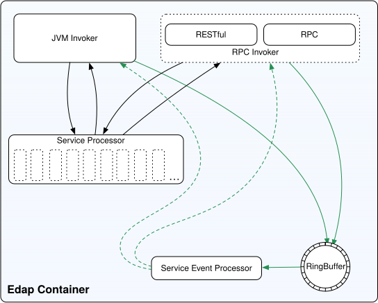
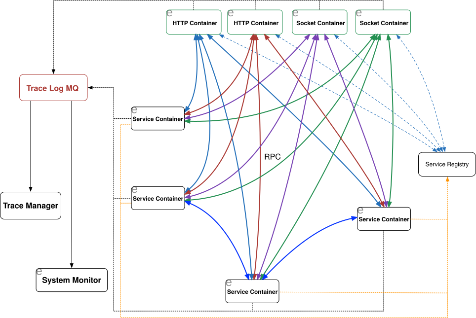

## edap

edap(easy distributed application platform) 易用的分布式应用平台。

目的是打造成为一个支持多语言的微服务容器架构，以易用，极致的性能作为开发目标。

容器架构图如下：

容器可以同时支持RESTful接口以RPC(socket)的两种方式调用，服务描述使用proto文件进行定义。

大体的使用场景如下：

## 模块地图

edap 的能力按「基础设施 → 协议 → 容器 → 应用」分层组织，各模块之间只允许自下而上的依赖。

| 层 | 模块 | 职责 |
|---|---|---|
| 基础设施 | `edap-common` / `edap-log-parent` / `edap-native` | 基础类型、日志、JNI 加速库 |
| IO | `edap-nio-parent` | NIO 传输栈：`Server` / `NioServerSession` / `Decoder` / `FastBuf` |
| 协议 | `edap-http-parent` / `edap-grpc-parent` / `edap-mqtt-parent` / `edap-erpc-parent` / `edap-codec` | 各协议的编解码与运行栈 |
| 数据 | `edap-data-parent` / `edap-tx-parent` / `edap-dbtools-parent` | 数据访问、事务、数据库工具 |
| 序列化 | `edap-json-parent` / `edap-asm-utils` | JSON5 与字节码增强 |
| 容器 | `edap-container-parent` | 微服务容器：部署、分片亲和、热部署 |
| 集成 | `edap-s3-parent` / `edap-auth-parent` / `edap-toml` / `edap-bean-convert` | 对象存储、鉴权、配置、类型转换 |
| 共识 | `edap-raft-parent` | Raft 共识：etcd raft 的 Java 移植 + 同套单元测试 |

### edap-raft

`edap-raft` 补上 edap 原先缺失的「节点之间可靠的复制 / 选主 / 提交」原语。
它与容器的**分片亲和**能力互补：分片亲和是「本地内存即权威、不跨节点同步」，
Raft 是「多副本强一致」，两者的取舍取决于业务对副本与一致性的要求。

实现路线是**把 etcd 的 `go.etcd.io/raft` 逐行移植成 Java，并把 etcd 的单元测试用例
也用 Java 实现一遍** —— 用参考实现的测试覆盖本模块的选主、复制、提交、快照、
成员变更与线性一致读。

模块完全独立，**不依赖 `edap-container`**（容器是 Edap 的用法而不是成员），
只依赖 `edap-nio-server` 复用其传输栈。详细设计见 [doc/RAFT_DESIGN.md](./doc/RAFT_DESIGN.md)。
